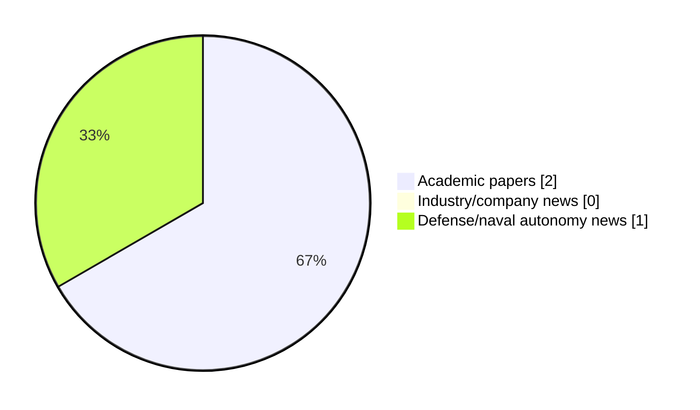

# Maritime Autonomy Watch — 2026-10-11

## Executive Summary

- Total selected items: 3
- Academic papers: 2
- Industry/company news: 0
- Defense/naval autonomy news: 1
- Failed/inaccessible sources: 1

## Contents

- [Analyst Brief](#analyst-brief)
- [Must Read](#must-read)
- [Top Signals Today](#top-signals-today)
- [Topic Signals](#topic-signals)
- [Freshness and Coverage](#freshness-and-coverage)
- [Quality Notes](#quality-notes)
- [Watchlist](#watchlist)
- [Academic Papers](#academic-papers)
- [Industry and Company News](#industry-and-company-news)
- [Defense and Naval Autonomy News](#defense-and-naval-autonomy-news)
- [Source Status Summary](#source-status-summary)

## Analyst Brief

Today's report selected 3 non-duplicate item(s), led by AUV navigation, underwater communications, perception. The strongest item is [Semantic communication for the internet of underwater things: Architectures, applications, challenges, and future directions](https://doi.org/10.1016/j.adhoc.2026.104432) from OpenAlex.
Coverage is weighted toward academic research (2), with 0 industry and 1 defense signal(s).
Quality caveat: low-score-unique=2, missing-summary=1, date-anomaly=1.

## Must Read

- [Semantic communication for the internet of underwater things: Architectures, applications, challenges, and future directions](https://doi.org/10.1016/j.adhoc.2026.104432) — Research signal: AUV navigation
- [US Navy stands up hub to prepare unmanned systems for combat](https://www.defensenews.com/industry/techwatch/2026/09/25/us-navy-stands-up-hub-to-prepare-unmanned-systems-for-combat/) — Defense signal: defense adoption

## Top Signals Today

- AUV navigation: 2 selected item(s).
- underwater communications: 1 selected item(s).
- perception: 1 selected item(s).
- critical infrastructure: 1 selected item(s).
- defense adoption: 1 selected item(s).

## Topic Signals

- AUV navigation: 2
- underwater communications: 1
- perception: 1
- critical infrastructure: 1
- defense adoption: 1

## Freshness and Coverage

- Newest selected item date: 2027-03-01
- Oldest selected item date: 2026-09-25
- Active/enabled sources: 4
- Sources with access problems: 3
- Quality flags: 4

## Quality Notes

- low-score-unique: 2
- missing-summary: 1
- date-anomaly: 1
- Date anomalies: [Fusion-driven geometry-constrained latent flow learning for robust AUV motion anticipation from heterogeneous 3D observations](https://api.elsevier.com/content/abstract/scopus_id/105051060825) reports 2027-03-01

## Watchlist

- [US Navy stands up hub to prepare unmanned systems for combat](https://www.defensenews.com/industry/techwatch/2026/09/25/us-navy-stands-up-hub-to-prepare-unmanned-systems-for-combat/) — low-score-unique
- [Fusion-driven geometry-constrained latent flow learning for robust AUV motion anticipation from heterogeneous 3D observations](https://api.elsevier.com/content/abstract/scopus_id/105051060825) — missing-summary, date-anomaly, low-score-unique

### Category Snapshot

| Category | Selected items |
|---|---:|
| Academic papers | 2 |
| Industry/company news | 0 |
| Defense/naval autonomy news | 1 |

## Academic Papers

_Selected items: 2_

### [Semantic communication for the internet of underwater things: Architectures, applications, challenges, and future directions](https://doi.org/10.1016/j.adhoc.2026.104432)

- Source: OpenAlex
- Date: 2026-10-01
- Relevance score: 7.75
- Authors: Ruhul Amin Khalil, Asiya Jehangir, Hanane Lamaazi, Sadaf Rubab, Nasir Saeed
- DOI: 10.1016/j.adhoc.2026.104432
- Signal: Research signal: AUV navigation
- Topic tags: AUV navigation, underwater communications, perception, critical infrastructure

**Abstract**

The Internet of Underwater Things (IoUT) supports marine sensing, environmental monitoring, subsea inspection, and autonomous underwater operations. However, IoUT communication is constrained by limited bandwidth, long propagation delay, time-varying underwater channels, intermittent connectivity, and strict energy budgets. Semantic Communication (SC) offers a promising alternative by transmitting task-relevant meaning rather than raw data, thereby improving communication efficiency in resource-constrained underwater networks. This paper presents a critical and feasibility-aware survey of SC for IoUT, focusing on opportunities, challenges, limitations, and future research directions. We first review the fundamentals of SC-enabled IoUT systems, including semantic representations, layered architectures, semantic channel modeling, and task-oriented evaluation metrics.

**Why it matters**

Relevant to underwater autonomy, infrastructure monitoring; the work may inform maritime autonomy research, testing priorities, or system design.

---

### [Fusion-driven geometry-constrained latent flow learning for robust AUV motion anticipation from heterogeneous 3D observations](https://api.elsevier.com/content/abstract/scopus_id/105051060825)

- Source: Elsevier Scopus
- Date: 2027-03-01
- Relevance score: 3.5
- DOI: 10.1016/j.inffus.2026.104764
- Signal: Research signal: AUV navigation
- Topic tags: AUV navigation
- Quality flags: missing-summary, date-anomaly, low-score-unique

**Abstract**

No summary available.

**Why it matters**

Relevant to underwater autonomy; the work may inform maritime autonomy research, testing priorities, or system design.

---

## Industry and Company News

_Selected items: 0_

No selected items.

## Defense and Naval Autonomy News

_Selected items: 1_

### [US Navy stands up hub to prepare unmanned systems for combat](https://www.defensenews.com/industry/techwatch/2026/09/25/us-navy-stands-up-hub-to-prepare-unmanned-systems-for-combat/)

- Source: defensenews.com
- Date: 2026-09-25
- Relevance score: 3.5
- Signal: Defense signal: defense adoption
- Topic tags: defense adoption
- Quality flags: low-score-unique

**Summary**

U.S. Chief of Naval Operations Adm. Daryl Caudle announced a new autonomous development center to train sailors and test new technology.

**Why it matters**

Signals movement in naval adoption; useful for tracking operational concepts, procurement direction, and fleet integration.

---

## Inaccessible or Failed Sources

- arXiv: The read operation timed out

## Source Status Summary

| Source | Status | Notes |
|---|---|---|
| arXiv | failed | The read operation timed out |
| OpenAlex | enabled | API source, 15 items fetched |
| RSS feeds | enabled | 107 RSS items fetched |
| SMI MASG News | enabled | HTML source, 10 items fetched |
| IEEE Xplore | disabled | Missing IEEE_XPLORE_API_KEY |
| Elsevier Scopus | enabled | API source, 15 items fetched |
| NewsAPI | disabled | Missing NEWS_API_KEY |

## Metadata

- Generated at: 2026-10-11T14:03:08.209384+02:00
- Date: 2026-10-11
- Repository: ferhannb/MarineRobotics
- Relevance threshold: 4.0
- Deduplication method: DOI, canonical URL, source ID, normalized title, similar recent titles, category caps, and novelty score
