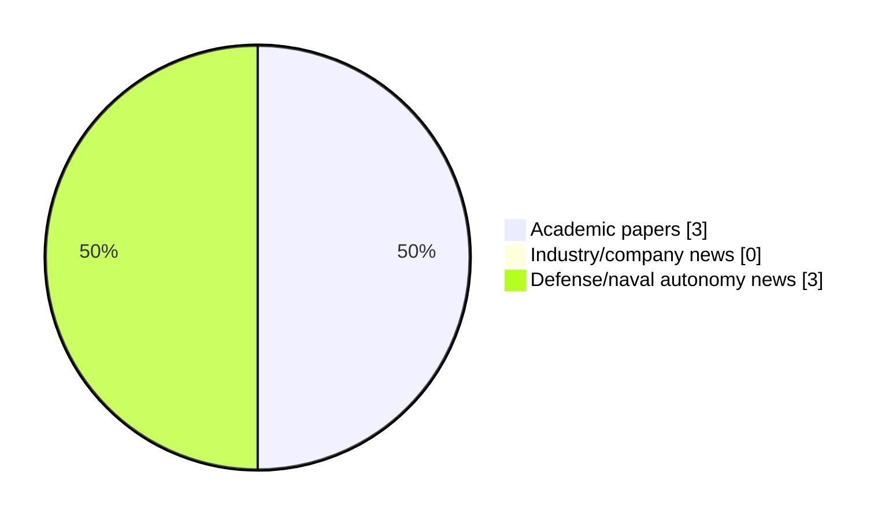

# Maritime Autonomy Watch — 2026-10-12

## Executive Summary

- Total selected items: 6
- Academic papers: 3
- Industry/company news: 0
- Defense/naval autonomy news: 3
- Failed/inaccessible sources: 0

## Contents

- [Analyst Brief](#analyst-brief)
- [Must Read](#must-read)
- [Top Signals Today](#top-signals-today)
- [Topic Signals](#topic-signals)
- [Freshness and Coverage](#freshness-and-coverage)
- [Quality Notes](#quality-notes)
- [Watchlist](#watchlist)
- [Academic Papers](#academic-papers)
- [Industry and Company News](#industry-and-company-news)
- [Defense and Naval Autonomy News](#defense-and-naval-autonomy-news)
- [Source Status Summary](#source-status-summary)

## Analyst Brief

Today's report selected 6 non-duplicate item(s), led by USV operations, defense adoption, planning/control. The strongest item is [Prediction-Informed Landing Window Planning for UAV Landing on USV in High Sea States](http://arxiv.org/abs/2610.13190v1) from arXiv.
Coverage is weighted toward academic research (3), with 0 industry and 3 defense signal(s).
Quality caveat: low-score-unique=3, missing-summary=1, date-anomaly=1.

## Must Read

- [Prediction-Informed Landing Window Planning for UAV Landing on USV in High Sea States](http://arxiv.org/abs/2610.13190v1) — Research signal: USV operations
- [French MoD Selects Top Contenders for DANAE Armed Surface Drone Project](https://www.navalnews.com/naval-news/2026/10/french-mod-selects-top-contenders-for-danae-armed-surface-drone-project/) — Defense signal: USV operations
- [Exail Starts Production of Unmanned MCM System for Indonesian Navy](https://www.navalnews.com/event-news/euronaval-2026/2026/10/exail-starts-production-of-unmanned-mcm-system-for-indonesian-navy/) — Defense signal: USV operations
- [Probabilistic Ship Trajectory Forecasting using Transformer Models on AIS Data](http://arxiv.org/abs/2610.13557v1) — Research signal: USV operations
- [SEA & Oshen Expand Autonomous Acoustic Sensing Fleet for Maritime Surveillance](https://www.oceansciencetechnology.com/news/sea-oshen-expand-autonomous-acoustic-sensing-fleet-for-maritime-surveillance/) — Defense signal: underwater communications

## Top Signals Today

- USV operations: 4 selected item(s).
- defense adoption: 3 selected item(s).
- planning/control: 2 selected item(s).
- perception: 2 selected item(s).
- swarm autonomy: 2 selected item(s).

## Topic Signals

- USV operations: 4
- defense adoption: 3
- planning/control: 2
- perception: 2
- swarm autonomy: 2
- underwater communications: 1

## Freshness and Coverage

- Newest selected item date: 2027-02-01
- Oldest selected item date: 2026-10-09
- Active/enabled sources: 5
- Sources with access problems: 2
- Quality flags: 5

## Quality Notes

- low-score-unique: 3
- missing-summary: 1
- date-anomaly: 1
- Date anomalies: [Edge-enhanced graph attention-based multi-agent reinforcement learning for multi-UUV cooperative area protection under communication and sensing constraints](https://api.elsevier.com/content/abstract/scopus_id/105051196107) reports 2027-02-01

## Watchlist

- [SEA & Oshen Expand Autonomous Acoustic Sensing Fleet for Maritime Surveillance](https://www.oceansciencetechnology.com/news/sea-oshen-expand-autonomous-acoustic-sensing-fleet-for-maritime-surveillance/) — low-score-unique
- [Probabilistic Ship Trajectory Forecasting using Transformer Models on AIS Data](http://arxiv.org/abs/2610.13557v1) — low-score-unique
- [Edge-enhanced graph attention-based multi-agent reinforcement learning for multi-UUV cooperative area protection under communication and sensing constraints](https://api.elsevier.com/content/abstract/scopus_id/105051196107) — missing-summary, date-anomaly, low-score-unique

### Category Snapshot

| Category | Selected items |
|---|---:|
| Academic papers | 3 |
| Industry/company news | 0 |
| Defense/naval autonomy news | 3 |

## Academic Papers

_Selected items: 3_

### [Prediction-Informed Landing Window Planning for UAV Landing on USV in High Sea States](http://arxiv.org/abs/2610.13190v1)

- Source: arXiv
- Date: 2026-10-09
- Relevance score: 8.75
- Authors: Kaizhen Li, Xi Zhou, Dan Zhang, Xiaowei Li
- Signal: Research signal: USV operations
- Topic tags: USV operations, planning/control

**Abstract**

Autonomous landing of unmanned aerial vehicle (UAV) on unmanned surface vehicle (USV) is difficult in high sea states. Existing hierarchical landing methods often infer future USV motion only implicitly from short observation histories, which limits their ability to adapt to severe and rapidly changing sea conditions. This paper presents a prediction-informed hierarchical control framework. A pretrained model is developed to explicitly predict the USV attitude during high-level landing decisions. The prediction helps identify suitable landing windows and choose the right touchdown time, while a conventional low-level flight controller maintains UAV stability and tracks motion commands. To evaluate the framework under realistic disturbances, a real-sim validation setup is constructed in which USV-motion data collected in real sea conditions are transferred to a MuJoCo USV.

**Why it matters**

Relevant to surface-vessel operations; the work may inform maritime autonomy research, testing priorities, or system design.

---

### [Probabilistic Ship Trajectory Forecasting using Transformer Models on AIS Data](http://arxiv.org/abs/2610.13557v1)

- Source: arXiv
- Date: 2026-10-09
- Relevance score: 3.5
- Authors: Frederik E. T. Schöller
- Signal: Research signal: USV operations
- Topic tags: USV operations, swarm autonomy, planning/control
- Quality flags: low-score-unique

**Abstract**

Anticipation of vessel trajectories is an essential task when navigating at sea. This applies to both human navigators and autonomous surface vessels. Trajectory forecasting enables sub-routines such as collision avoidance to assess the situation and react accordingly in time. This paper investigates Transformer and Performer models for trajectory prediction of surface vessels in confined waters. Using widely available position data from the Automatic Identification System (AIS), candidate models are trained and evaluated. Historical information on how other vessels have moved in the local area surrounding each agent is conveyed using positional heat maps. The heat maps are generated using Kernel Density Estimation (KDE) and encoded with a Convolutional Neural Network (CNN) before entering the Transformer models.

**Why it matters**

Relevant to surface-vessel operations, multi-vehicle coordination, navigation safety; the work may inform maritime autonomy research, testing priorities, or system design.

---

### [Edge-enhanced graph attention-based multi-agent reinforcement learning for multi-UUV cooperative area protection under communication and sensing constraints](https://api.elsevier.com/content/abstract/scopus_id/105051196107)

- Source: Elsevier Scopus
- Date: 2027-02-01
- Relevance score: 3.5
- DOI: 10.1016/j.eswa.2026.134415
- Signal: Research signal: swarm autonomy
- Topic tags: swarm autonomy, perception
- Quality flags: missing-summary, date-anomaly, low-score-unique

**Abstract**

No summary available.

**Why it matters**

This paper may influence autonomy, perception, planning, or control work for maritime robotic systems.

---

## Industry and Company News

_Selected items: 0_

No selected items.

## Defense and Naval Autonomy News

_Selected items: 3_

### [French MoD Selects Top Contenders for DANAE Armed Surface Drone Project](https://www.navalnews.com/naval-news/2026/10/french-mod-selects-top-contenders-for-danae-armed-surface-drone-project/)

- Source: navalnews.com
- Date: 2026-10-12
- Relevance score: 5.25
- Signal: Defense signal: USV operations
- Topic tags: USV operations, defense adoption

**Summary**

The French Navy and AID select three industrial teams to develop advanced armed autonomous surface drones for the DANAE armed USV project.

**Why it matters**

Signals movement in surface-vessel operations, naval adoption; useful for tracking operational concepts, procurement direction, and fleet integration.

---

### [Exail Starts Production of Unmanned MCM System for Indonesian Navy](https://www.navalnews.com/event-news/euronaval-2026/2026/10/exail-starts-production-of-unmanned-mcm-system-for-indonesian-navy/)

- Source: navalnews.com
- Date: 2026-10-12
- Relevance score: 5.25
- Signal: Defense signal: USV operations
- Topic tags: USV operations, defense adoption

**Summary**

Exail has begun production of the Unmanned MCM System (UMIS) for the Indonesian Navy, featuring Inspector 90 USVs, third-party integrations, and training.

**Why it matters**

Signals movement in surface-vessel operations, naval adoption; useful for tracking operational concepts, procurement direction, and fleet integration.

---

### [SEA & Oshen Expand Autonomous Acoustic Sensing Fleet for Maritime Surveillance](https://www.oceansciencetechnology.com/news/sea-oshen-expand-autonomous-acoustic-sensing-fleet-for-maritime-surveillance/)

- Source: oceansciencetechnology.com
- Date: 2026-10-12
- Relevance score: 3
- Signal: Defense signal: underwater communications
- Topic tags: underwater communications, perception, defense adoption
- Quality flags: low-score-unique

**Summary**

Marine autonomy specialist Oshen has awarded defense technology firm SEA a contract for additional hydrophones to expand its low-power acoustic.

**Why it matters**

Signals movement in naval adoption; useful for tracking operational concepts, procurement direction, and fleet integration.

---

## Inaccessible or Failed Sources

- None

## Source Status Summary

| Source | Status | Notes |
|---|---|---|
| arXiv | enabled | API source, 15 items fetched |
| OpenAlex | enabled | API source, 15 items fetched |
| RSS feeds | enabled | 107 RSS items fetched |
| SMI MASG News | enabled | HTML source, 10 items fetched |
| IEEE Xplore | disabled | Missing IEEE_XPLORE_API_KEY |
| Elsevier Scopus | enabled | API source, 15 items fetched |
| NewsAPI | disabled | Missing NEWS_API_KEY |

## Metadata

- Generated at: 2026-10-12T16:20:47.900620+02:00
- Date: 2026-10-12
- Repository: ferhannb/MarineRobotics
- Relevance threshold: 4.0
- Deduplication method: DOI, canonical URL, source ID, normalized title, similar recent titles, category caps, and novelty score
