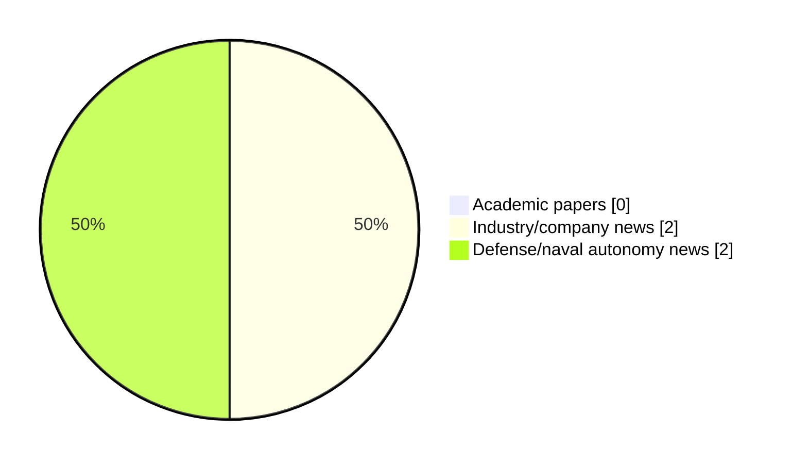

# Maritime Autonomy Watch — 2026-10-13

## Executive Summary

- Total selected items: 4
- Academic papers: 0
- Industry/company news: 2
- Defense/naval autonomy news: 2
- Failed/inaccessible sources: 0

## Contents

- [Analyst Brief](#analyst-brief)
- [Must Read](#must-read)
- [Top Signals Today](#top-signals-today)
- [Topic Signals](#topic-signals)
- [Freshness and Coverage](#freshness-and-coverage)
- [Quality Notes](#quality-notes)
- [Watchlist](#watchlist)
- [Academic Papers](#academic-papers)
- [Industry and Company News](#industry-and-company-news)
- [Defense and Naval Autonomy News](#defense-and-naval-autonomy-news)
- [Source Status Summary](#source-status-summary)

## Analyst Brief

Today's report selected 4 non-duplicate item(s), led by USV operations, defense adoption, perception. The strongest item is [Sentiq Defence Launches as Italian Integrator of Autonomous Maritime Systems](https://oceannews.com/news/defense/sentiq-defence-launches-as-italian-integrator-of-autonomous-maritime-systems/) from oceannews.com.
Coverage is weighted toward academic research (0), with 2 industry and 2 defense signal(s).
Quality caveat: low-score-unique=1.

## Must Read

- [Sentiq Defence Launches as Italian Integrator of Autonomous Maritime Systems](https://oceannews.com/news/defense/sentiq-defence-launches-as-italian-integrator-of-autonomous-maritime-systems/) — Defense signal: USV operations
- [Greensea IQ Bayonet 150 Completes Offshore Deployment from Modified USV](https://www.oceansciencetechnology.com/news/greensea-iq-bayonet-150-completes-offshore-deployment-from-modified-usv/) — Industry signal: AUV navigation
- [Ocius Technology Opens Auckland Facility to Support Royal New Zealand Navy Bluebottle USV Fleet](https://oceannews.com/news/defense/ocius-technology-opens-auckland-facility-to-support-royal-new-zealand-navy-bluebottle-usv-fleet/) — Defense signal: USV operations
- [Gulf Blue Wins SBA SCALE Grant to Build Maritime Unmanned Systems Supply Chain](https://oceannews.com/news/science-technology/gulf-blue-wins-sba-scale-grant-to-build-maritime-unmanned-systems-supply-chain/) — Industry signal: general autonomy

## Top Signals Today

- USV operations: 3 selected item(s).
- defense adoption: 2 selected item(s).
- perception: 1 selected item(s).
- AUV navigation: 1 selected item(s).
- general autonomy: 1 selected item(s).

## Topic Signals

- USV operations: 3
- defense adoption: 2
- perception: 1
- AUV navigation: 1
- general autonomy: 1

## Freshness and Coverage

- Newest selected item date: 2026-10-13
- Oldest selected item date: 2026-10-12
- Active/enabled sources: 5
- Sources with access problems: 2
- Quality flags: 1

## Quality Notes

- low-score-unique: 1

## Watchlist

- [Gulf Blue Wins SBA SCALE Grant to Build Maritime Unmanned Systems Supply Chain](https://oceannews.com/news/science-technology/gulf-blue-wins-sba-scale-grant-to-build-maritime-unmanned-systems-supply-chain/) — low-score-unique

### Category Snapshot

| Category | Selected items |
|---|---:|
| Academic papers | 0 |
| Industry/company news | 2 |
| Defense/naval autonomy news | 2 |

## Academic Papers

_Selected items: 0_

No selected items.

## Industry and Company News

_Selected items: 2_

### [Greensea IQ Bayonet 150 Completes Offshore Deployment from Modified USV](https://www.oceansciencetechnology.com/news/greensea-iq-bayonet-150-completes-offshore-deployment-from-modified-usv/)

- Source: oceansciencetechnology.com
- Date: 2026-10-13
- Relevance score: 6
- Signal: Industry signal: AUV navigation
- Topic tags: AUV navigation, USV operations

**Summary**

Greensea IQ’s Bayonet 150 Autonomous Underwater Ground Vehicle (AUGV) has successfully completed an offshore deployment and transit to shore following.

**Why it matters**

Signals momentum in underwater autonomy, surface-vessel operations; useful for tracking product direction, partnerships, and deployment opportunities.

---

### [Gulf Blue Wins SBA SCALE Grant to Build Maritime Unmanned Systems Supply Chain](https://oceannews.com/news/science-technology/gulf-blue-wins-sba-scale-grant-to-build-maritime-unmanned-systems-supply-chain/)

- Source: oceannews.com
- Date: 2026-10-12
- Relevance score: 3.5
- Signal: Industry signal: general autonomy
- Topic tags: general autonomy
- Quality flags: low-score-unique

**Summary**

Gulf Blue LLC has been selected by the US Small Business Administration (SBA) as one of 18 organizations nationwide to receive funding through the Supply Chain Acceleration and Logistics Enablement (SCALE) Program, supporting a new Gulf Blue initiative designed to strengthen the maritime unmanned systems industrial base.

**Why it matters**

This item may signal product, market, or deployment momentum in maritime autonomy.

---

## Defense and Naval Autonomy News

_Selected items: 2_

### [Sentiq Defence Launches as Italian Integrator of Autonomous Maritime Systems](https://oceannews.com/news/defense/sentiq-defence-launches-as-italian-integrator-of-autonomous-maritime-systems/)

- Source: oceannews.com
- Date: 2026-10-13
- Relevance score: 8.25
- Signal: Defense signal: USV operations
- Topic tags: USV operations, perception, defense adoption

**Summary**

Sentiq Defence (Sentiq) has announced the start of operations as an Italian integrator of autonomous and remotely operated maritime systems for defense, security, and the blue economy. At launch, Sentiq brings together a portfolio of uncrewed surface vessels (USVs), underwater surveillance sonars, remotely operated vehicles (ROVs), and unmanned aerial systems (UAS), developed with international manufacturers, and configured, delivered, and supported from Italy.

**Why it matters**

Signals movement in underwater autonomy, surface-vessel operations, naval adoption; useful for tracking operational concepts, procurement direction, and fleet integration.

---

### [Ocius Technology Opens Auckland Facility to Support Royal New Zealand Navy Bluebottle USV Fleet](https://oceannews.com/news/defense/ocius-technology-opens-auckland-facility-to-support-royal-new-zealand-navy-bluebottle-usv-fleet/)

- Source: oceannews.com
- Date: 2026-10-13
- Relevance score: 5.25
- Signal: Defense signal: USV operations
- Topic tags: USV operations, defense adoption

**Summary**

Ocius Technology has opened its first overseas advanced maritime maintenance facility in Auckland through its wholly owned subsidiary, Ocius New Zealand (Ocius NZ).

**Why it matters**

Signals movement in surface-vessel operations, naval adoption; useful for tracking operational concepts, procurement direction, and fleet integration.

---

## Inaccessible or Failed Sources

- None

## Source Status Summary

| Source | Status | Notes |
|---|---|---|
| arXiv | enabled | API source, 15 items fetched |
| OpenAlex | enabled | API source, 15 items fetched |
| RSS feeds | enabled | 107 RSS items fetched |
| SMI MASG News | enabled | HTML source, 10 items fetched |
| IEEE Xplore | disabled | Missing IEEE_XPLORE_API_KEY |
| Elsevier Scopus | enabled | API source, 15 items fetched |
| NewsAPI | disabled | Missing NEWS_API_KEY |

## Metadata

- Generated at: 2026-10-13T15:30:01.037459+02:00
- Date: 2026-10-13
- Repository: ferhannb/MarineRobotics
- Relevance threshold: 4.0
- Deduplication method: DOI, canonical URL, source ID, normalized title, similar recent titles, category caps, and novelty score
