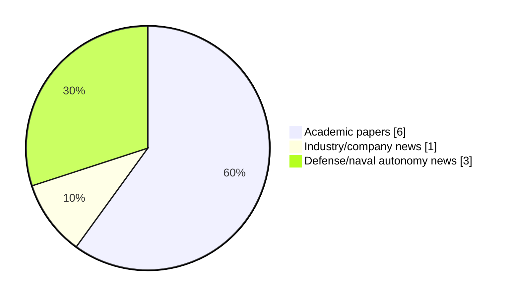

# Maritime Autonomy Watch — 2026-10-14

## Executive Summary

- Total selected items: 10
- Academic papers: 6
- Industry/company news: 1
- Defense/naval autonomy news: 3
- Failed/inaccessible sources: 0

## Contents

- [Analyst Brief](#analyst-brief)
- [Must Read](#must-read)
- [Top Signals Today](#top-signals-today)
- [Topic Signals](#topic-signals)
- [Freshness and Coverage](#freshness-and-coverage)
- [Quality Notes](#quality-notes)
- [Watchlist](#watchlist)
- [Academic Papers](#academic-papers)
- [Industry and Company News](#industry-and-company-news)
- [Defense and Naval Autonomy News](#defense-and-naval-autonomy-news)
- [Source Status Summary](#source-status-summary)

## Analyst Brief

Today's report selected 10 non-duplicate item(s), led by AUV navigation, USV operations, planning/control. The strongest item is [Hellenic Navy Tests SARONIC’s Corsair USV Ahead of Major Order](https://www.navalnews.com/naval-news/2026/10/hellenic-navy-tests-saronics-corsair-usv-ahead-of-major-order/) from navalnews.com.
Coverage is weighted toward academic research (6), with 1 industry and 3 defense signal(s).
Quality caveat: low-score-unique=3.

## Must Read

- [Hellenic Navy Tests SARONIC’s Corsair USV Ahead of Major Order](https://www.navalnews.com/naval-news/2026/10/hellenic-navy-tests-saronics-corsair-usv-ahead-of-major-order/) — Defense signal: USV operations
- [Taiwan Coast Guard Administration Acquires MARTAC Devil Ray T24 USVs](https://www.marinelink.com/news/taiwan-coast-guard-administration-543659) — Industry signal: USV operations
- [Input-Constrained Active Disturbance Rejection Control for AUVs](http://arxiv.org/abs/2610.17498v1) — Research signal: AUV navigation
- [Range-Aided SLAM Initialization Exploiting Accurate Heading Information](http://arxiv.org/abs/2609.24846v1) — Research signal: AUV navigation
- [Voyant Demos GPS-Denied Navigation on Autonomous Vessel for UK MOD](https://www.marinelink.com/news/voyant-demos-gpsdenied-navigation-543670) — Defense signal: USV operations

## Top Signals Today

- AUV navigation: 4 selected item(s).
- USV operations: 3 selected item(s).
- planning/control: 3 selected item(s).
- swarm autonomy: 3 selected item(s).
- defense adoption: 2 selected item(s).

## Topic Signals

- AUV navigation: 4
- USV operations: 3
- planning/control: 3
- swarm autonomy: 3
- defense adoption: 2
- underwater communications: 1
- general autonomy: 1
- perception: 1

## Freshness and Coverage

- Newest selected item date: 2026-10-14
- Oldest selected item date: 2026-09-21
- Active/enabled sources: 5
- Sources with access problems: 2
- Quality flags: 3

## Quality Notes

- low-score-unique: 3

## Watchlist

- [How autonomous weapons are changing the way brigades fight](https://www.defensenews.com/industry/techwatch/2026/10/13/how-autonomous-weapons-are-changing-the-way-brigades-fight/) — low-score-unique
- [Fly, Drive, Reconfigure: A Modular Reconfigurable Aerial-Ground Platform for Field Operations](http://arxiv.org/abs/2609.28887v1) — low-score-unique
- [GA-Agent: Large Language Models as Hyperparameter Optimizers for Evolutionary Controller Synthesis](http://arxiv.org/abs/2609.27725v1) — low-score-unique

### Category Snapshot

| Category | Selected items |
|---|---:|
| Academic papers | 6 |
| Industry/company news | 1 |
| Defense/naval autonomy news | 3 |

## Academic Papers

_Selected items: 6_

### [Input-Constrained Active Disturbance Rejection Control for AUVs](http://arxiv.org/abs/2610.17498v1)

- Source: arXiv
- Date: 2026-10-12
- Relevance score: 7.75
- Authors: Minh-Quan Le, Ying Tan, Jinghe Yang, Jason Monty, Ye Pu
- Signal: Research signal: AUV navigation
- Topic tags: AUV navigation, planning/control

**Abstract**

This paper addresses the control of autonomous underwater vehicles (AUVs) operating in dynamic environments, where wave-induced forces, modelling errors, and actuator limitations make reliable control challenging. Active disturbance rejection control (ADRC), together with an extended state observer (ESO), estimates lumped uncertainties online, simplifying control design using nominal models. However, existing stability analyses typically assume bounded control inputs and derivatives, which are difficult to guarantee under unknown disturbances and measurement noise. To bridge this theory--practice gap, this paper introduces an ADRC framework with active input saturation and post-saturation low-pass filtering. The saturation constrains the control magnitude, while the filter regularizes the saturated signal to ensure bounded input-rate variations.

**Why it matters**

Relevant to underwater autonomy; the work may inform maritime autonomy research, testing priorities, or system design.

---

### [Range-Aided SLAM Initialization Exploiting Accurate Heading Information](http://arxiv.org/abs/2609.24846v1)

- Source: arXiv
- Date: 2026-09-21
- Relevance score: 7.75
- Authors: Isabel Lougheed, James Richard Forbes
- Signal: Research signal: AUV navigation
- Topic tags: AUV navigation, swarm autonomy

**Abstract**

This paper presents a novel initialization method for range-aided simultaneous localization and mapping (RA-SLAM). The general SLAM problem has a well-known separable structure where landmark and robot positions can be solved for in a linear fashion given known robot headings. This paper considers the case where highly accurate heading information is available, which is typical of autonomous underwater vehicle (AUV) navigation, to solve for the range transponder and robot positions. The proposed approach consists of two steps. First, using a generalized trust region subproblem (GTRS), the positions of the transponders relative to the AUV are solved for given the nonlinear range measurements. Second, the relative transponder positions and the known heading of the AUV are used to estimate the transponder and AUV positions by solving a linear least-squares problem.

**Why it matters**

Relevant to underwater autonomy, multi-vehicle coordination; the work may inform maritime autonomy research, testing priorities, or system design.

---

### [Wave-Robust Passive AUV Localization Using FP-MUSIC](http://arxiv.org/abs/2609.27712v1)

- Source: arXiv
- Date: 2026-09-23
- Relevance score: 7
- Authors: Usama Saqib, Ola Rønning, Andrzej Wąsowski
- Signal: Research signal: AUV navigation
- Topic tags: AUV navigation

**Abstract**

Localizing an autonomous underwater vehicle without pre-deployed seabed transponders, or direct access to onboard vehicle sensors remains a core challenge. We present a receiver-passive 3-D localization and spatial mapping system utilizing a single floating surface buoy equipped with a hydrophone array and an inertial measurement unit (IMU). The central difficulty is that surface wave motion induces six-degree-of-freedom (6-DOF) perturbations that rotate the array between snapshots, degrading conventional subspace processing. We resolve this by introducing a fixed-point iterative MUltiple SIgnal Classification algorithm (FP-MUSIC) that uses IMU measurements to de-warp snapshot covariances prior to direction-of-arrival estimation. Furthermore, we employ a subspace-projected wideband matched filter to resolve beacon ranges and use power asymmetry for independent front-back identification.

**Why it matters**

Relevant to underwater autonomy; the work may inform maritime autonomy research, testing priorities, or system design.

---

### [Compressed delayed-information projection for six-degree-of-freedom underwater vehicle navigation under delayed acoustic positioning](http://arxiv.org/abs/2609.27439v1)

- Source: arXiv
- Date: 2026-09-23
- Relevance score: 7
- Authors: Shuyue Li, Miguel López-Benítez, Eng Gee Lim, Fei Ma, Qian Dong, Mengze Cao, Limin Yu, Xiaohui Qin
- Signal: Research signal: underwater communications
- Topic tags: underwater communications, swarm autonomy, planning/control

**Abstract**

Delayed acoustic positioning packets constrain historical navigation states, but a current-time update evaluates them against a mismatched state, whereas exact rewind/replay re-executes the intervening estimator history. This paper introduces compressed delayed-information projection (CDIP), a causal 15-state error-state Kalman filter (ESKF) treatment for delayed-acoustic unmanned underwater vehicle (UUV) navigation. CDIP retains a source-epoch snapshot and the historical-to-current cross-covariance, then projects the delayed source-epoch acoustic correction directly to the current state without full rewind/replay. Exact fixed-lag rewind/replay out-of-sequence-measurement (OOSM) processing serves as a high-fidelity accuracy reference. In 154 usable paired recordings at a fixed 1.5-s acoustic delay without an outage, CDIP reduced mean trajectory-position root-mean-square error (RMSE) from 1.062 m for the baseline to 0.456 m (57.1%).

**Why it matters**

Relevant to underwater autonomy, multi-vehicle coordination, planning and control; the work may inform maritime autonomy research, testing priorities, or system design.

---

### [Fly, Drive, Reconfigure: A Modular Reconfigurable Aerial-Ground Platform for Field Operations](http://arxiv.org/abs/2609.28887v1)

- Source: arXiv
- Date: 2026-09-24
- Relevance score: 3.5
- Authors: Li-Yu Lo, Yanbaihui Liu, Chengchuan Shu, Tyler Harris, Jonathan Ryan, Boyuan Chen
- Signal: Research signal: swarm autonomy
- Topic tags: swarm autonomy, perception
- Quality flags: low-score-unique

**Abstract**

Heterogeneous robot teams distribute complementary capabilities across specialized agents, but their physical roles and capacities typically remain fixed throughout a mission. We present HARP, a Heterogeneous Aerial Robotic modules Platform in which independently deployable aerial robots physically reconfigure to compose their capabilities for field operations. HARP comprises sensor-equipped scouts, flydrive rover modules, and task-specific payload modules. Scouts map the environment and inform an energy-aware planner that jointly selects routes and air-ground mobility modes. Rover and payload modules fly independently across terrain that constrains ground travel, then autonomously assemble into a cooperative ground vehicle for energy-efficient payload transport.

**Why it matters**

This paper may influence autonomy, perception, planning, or control work for maritime robotic systems.

---

### [GA-Agent: Large Language Models as Hyperparameter Optimizers for Evolutionary Controller Synthesis](http://arxiv.org/abs/2609.27725v1)

- Source: arXiv
- Date: 2026-09-23
- Relevance score: 3.5
- Authors: Mohammad Narimani, Seyyed Ali Emami
- Signal: Research signal: AUV navigation
- Topic tags: AUV navigation, planning/control
- Quality flags: low-score-unique

**Abstract**

Tuning PID controllers to satisfy competing objectives - low tracking error, fast settling, limited overshoot, and moderate control effort - is labor-intensive and requires expertise. Genetic algorithms (GAs) offer gradient-free optimization of controller gains against a weighted fitness function, but success depends on meta-level choices: population size, generation budget, gain bounds, and fitness weights. These are usually set by manual trial-and-error or costly bilevel optimization, exposing a tension: GAs excel at dense numerical search, but configuring them needs high-level, context-dependent semantic reasoning. We propose GA-Agent, which decouples these modes. A standard GA handles low-level PID gain optimization. A large language model (LLM) agent operates at the meta-level: it observes completed GA runs, diagnoses gaps versus user control objectives, and proposes updated GA configurations.

**Why it matters**

Relevant to underwater autonomy; the work may inform maritime autonomy research, testing priorities, or system design.

---

## Industry and Company News

_Selected items: 1_

### [Taiwan Coast Guard Administration Acquires MARTAC Devil Ray T24 USVs](https://www.marinelink.com/news/taiwan-coast-guard-administration-543659)

- Source: marinelink.com
- Date: 2026-10-13
- Relevance score: 10
- Signal: Industry signal: USV operations
- Topic tags: USV operations

**Summary**

Maritime Tactical Systems, Inc. (MARTAC), a U.S. provider of fully autonomous unmanned surface vessels (USVs), announced that the Taiwan Coast Guard Administration (CGA) is acquiring an undisclosed number of Devil Ray T24 autonomous surface vessels.

**Why it matters**

Signals momentum in surface-vessel operations; useful for tracking product direction, partnerships, and deployment opportunities.

---

## Defense and Naval Autonomy News

_Selected items: 3_

### [Hellenic Navy Tests SARONIC’s Corsair USV Ahead of Major Order](https://www.navalnews.com/naval-news/2026/10/hellenic-navy-tests-saronics-corsair-usv-ahead-of-major-order/)

- Source: navalnews.com
- Date: 2026-10-14
- Relevance score: 10
- Signal: Defense signal: USV operations
- Topic tags: USV operations, defense adoption

**Summary**

The Hellenic Navy is currently testing a number of Corsair autonomous unmanned surface vessels (USVs) and has submitted a Letter of Request (LOR) to the United States for the procurement of at least 30 vessels to expand its unmanned maritime capabilities. On Tuesday, October 13, 2026, Greek Minister of National Defence Nikos Dendias attended the.

**Why it matters**

Signals movement in surface-vessel operations, naval adoption; useful for tracking operational concepts, procurement direction, and fleet integration.

---

### [Voyant Demos GPS-Denied Navigation on Autonomous Vessel for UK MOD](https://www.marinelink.com/news/voyant-demos-gpsdenied-navigation-543670)

- Source: marinelink.com
- Date: 2026-10-14
- Relevance score: 7
- Signal: Defense signal: USV operations
- Topic tags: USV operations, defense adoption

**Summary**

UK defense technology company Voyant successfully demonstrated its satellite-independent navigation software aboard an autonomous surface vessel (ASV) for the UK Ministry of Defence (MOD), advancing efforts to ensure uncrewed maritime systems…

**Why it matters**

Signals movement in surface-vessel operations, naval adoption; useful for tracking operational concepts, procurement direction, and fleet integration.

---

### [How autonomous weapons are changing the way brigades fight](https://www.defensenews.com/industry/techwatch/2026/10/13/how-autonomous-weapons-are-changing-the-way-brigades-fight/)

- Source: defensenews.com
- Date: 2026-10-13
- Relevance score: 3.5
- Signal: Defense signal: general autonomy
- Topic tags: general autonomy
- Quality flags: low-score-unique

**Summary**

At Fort Bragg in August, Army soldiers tested how unmanned systems could help troops breach obstacles while reducing their exposure to battlefield hazards.

**Why it matters**

This item may signal operational adoption, procurement priorities, or naval autonomy doctrine shifts.

---

## Inaccessible or Failed Sources

- None

## Source Status Summary

| Source | Status | Notes |
|---|---|---|
| arXiv | enabled | API source, 15 items fetched |
| OpenAlex | enabled | API source, 15 items fetched |
| RSS feeds | enabled | 107 RSS items fetched |
| SMI MASG News | enabled | HTML source, 10 items fetched |
| IEEE Xplore | disabled | Missing IEEE_XPLORE_API_KEY |
| Elsevier Scopus | enabled | API source, 15 items fetched |
| NewsAPI | disabled | Missing NEWS_API_KEY |

## Metadata

- Generated at: 2026-10-14T13:07:05.844754+02:00
- Date: 2026-10-14
- Repository: ferhannb/MarineRobotics
- Relevance threshold: 4.0
- Deduplication method: DOI, canonical URL, source ID, normalized title, similar recent titles, category caps, and novelty score
