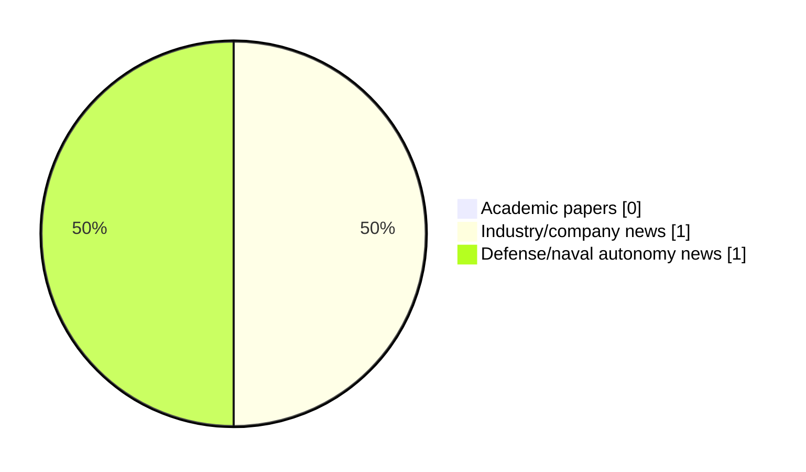

# Maritime Autonomy Watch — 2026-10-15

## Executive Summary

- Total selected items: 2
- Academic papers: 0
- Industry/company news: 1
- Defense/naval autonomy news: 1
- Failed/inaccessible sources: 0

## Contents

- [Analyst Brief](#analyst-brief)
- [Must Read](#must-read)
- [Top Signals Today](#top-signals-today)
- [Topic Signals](#topic-signals)
- [Freshness and Coverage](#freshness-and-coverage)
- [Quality Notes](#quality-notes)
- [Watchlist](#watchlist)
- [Academic Papers](#academic-papers)
- [Industry and Company News](#industry-and-company-news)
- [Defense and Naval Autonomy News](#defense-and-naval-autonomy-news)
- [Source Status Summary](#source-status-summary)

## Analyst Brief

Today's report selected 2 non-duplicate item(s), led by USV operations, perception, planning/control. The strongest item is [Robosys Integrates VOYAGER AI with FarSounder Forward Looking Sonar, Advancing Situational Awareness for Superyachts and USVs](https://www.maritimeindustries.org/news/robosys-integrates-voyager-ai-farsounder-forward-looking-sonar-advancing-situational-awareness-superyachts-and-usvs) from maritimeindustries.org.
Coverage is weighted toward academic research (0), with 1 industry and 1 defense signal(s).

## Must Read

- [Robosys Integrates VOYAGER AI with FarSounder Forward Looking Sonar, Advancing Situational Awareness for Superyachts and USVs](https://www.maritimeindustries.org/news/robosys-integrates-voyager-ai-farsounder-forward-looking-sonar-advancing-situational-awareness-superyachts-and-usvs) — Industry signal: USV operations
- [RS Aqua Tests Marlin Acoustic System at NATO REPMUS 2026 Exercise](https://oceannews.com/news/defense/rs-aqua-tests-marlin-acoustic-system-at-nato-repmus-2026-exercise/) — Defense signal: underwater communications

## Top Signals Today

- USV operations: 1 selected item(s).
- perception: 1 selected item(s).
- planning/control: 1 selected item(s).
- underwater communications: 1 selected item(s).
- defense adoption: 1 selected item(s).

## Topic Signals

- USV operations: 1
- perception: 1
- planning/control: 1
- underwater communications: 1
- defense adoption: 1

## Freshness and Coverage

- Newest selected item date: 2026-10-14
- Oldest selected item date: 2026-09-17
- Active/enabled sources: 5
- Sources with access problems: 2
- Quality flags: 0

## Quality Notes

- No quality flags on selected items.

## Watchlist

- No watchlist items today.

### Category Snapshot

| Category | Selected items |
|---|---:|
| Academic papers | 0 |
| Industry/company news | 1 |
| Defense/naval autonomy news | 1 |

## Academic Papers

_Selected items: 0_

No selected items.

## Industry and Company News

_Selected items: 1_

### [Robosys Integrates VOYAGER AI with FarSounder Forward Looking Sonar, Advancing Situational Awareness for Superyachts and USVs](https://www.maritimeindustries.org/news/robosys-integrates-voyager-ai-farsounder-forward-looking-sonar-advancing-situational-awareness-superyachts-and-usvs)

- Source: maritimeindustries.org
- Date: 2026-09-17
- Relevance score: 6.75
- Signal: Industry signal: USV operations
- Topic tags: USV operations, perception, planning/control

**Summary**

Providence, RI – Robosys Automation, a leader in autonomous navigation and vessel control systems, has announced the integration of its VOYAGER AI Autonomous Navigation System (ANS) software with FarSounder’s Forward Looking Sonar (FLS) technology, delivering enhanced real-time situational awareness, obstacle detection, and navigation decision support for both luxury superyachts and Uncrewed Surface Vessels (USVs).

**Why it matters**

Signals momentum in surface-vessel operations; useful for tracking product direction, partnerships, and deployment opportunities.

---

## Defense and Naval Autonomy News

_Selected items: 1_

### [RS Aqua Tests Marlin Acoustic System at NATO REPMUS 2026 Exercise](https://oceannews.com/news/defense/rs-aqua-tests-marlin-acoustic-system-at-nato-repmus-2026-exercise/)

- Source: oceannews.com
- Date: 2026-10-14
- Relevance score: 4.25
- Signal: Defense signal: underwater communications
- Topic tags: underwater communications, defense adoption

**Summary**

Last month, General Oceans company, RS Aqua, took part in Robotic Experimentation and Prototyping with Maritime Unmanned Systems (REPMUS) 2026 with sponsorship from the Royal Navy: testing its Marlin acoustic monitoring system in a live operational environment.

**Why it matters**

Signals movement in infrastructure monitoring, naval adoption; useful for tracking operational concepts, procurement direction, and fleet integration.

---

## Inaccessible or Failed Sources

- None

## Source Status Summary

| Source | Status | Notes |
|---|---|---|
| arXiv | enabled | API source, 15 items fetched |
| OpenAlex | enabled | API source, 15 items fetched |
| RSS feeds | enabled | 107 RSS items fetched |
| SMI MASG News | enabled | HTML source, 10 items fetched |
| IEEE Xplore | disabled | Missing IEEE_XPLORE_API_KEY |
| Elsevier Scopus | enabled | API source, 15 items fetched |
| NewsAPI | disabled | Missing NEWS_API_KEY |

## Metadata

- Generated at: 2026-10-15T12:48:37.034411+02:00
- Date: 2026-10-15
- Repository: ferhannb/MarineRobotics
- Relevance threshold: 4.0
- Deduplication method: DOI, canonical URL, source ID, normalized title, similar recent titles, category caps, and novelty score
