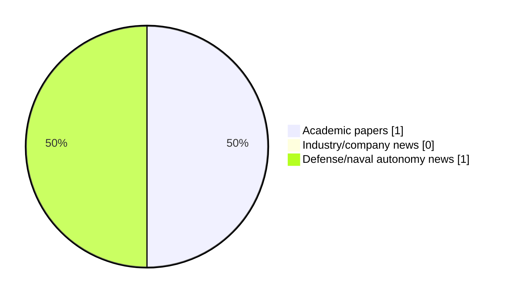

# Maritime Autonomy Watch — 2026-10-20

## Executive Summary

- Total selected items: 2
- Academic papers: 1
- Industry/company news: 0
- Defense/naval autonomy news: 1
- Failed/inaccessible sources: 0

## Contents

- [Analyst Brief](#analyst-brief)
- [Must Read](#must-read)
- [Top Signals Today](#top-signals-today)
- [Topic Signals](#topic-signals)
- [Freshness and Coverage](#freshness-and-coverage)
- [Quality Notes](#quality-notes)
- [Watchlist](#watchlist)
- [Academic Papers](#academic-papers)
- [Industry and Company News](#industry-and-company-news)
- [Defense and Naval Autonomy News](#defense-and-naval-autonomy-news)
- [Source Status Summary](#source-status-summary)

## Analyst Brief

Today's report selected 2 non-duplicate item(s), led by USV operations, defense adoption, swarm autonomy. The strongest item is [HII Sea Launcher Test Moves REMUS UUV Autonomy Closer to Fleet Deployment](https://oceannews.com/news/science-technology/hii-sea-launcher-test-moves-remus-uuv-autonomy-closer-to-fleet-deployment/) from oceannews.com.
Coverage is weighted toward academic research (1), with 0 industry and 1 defense signal(s).
Quality caveat: missing-summary=1, date-anomaly=1.

## Must Read

- [HII Sea Launcher Test Moves REMUS UUV Autonomy Closer to Fleet Deployment](https://oceannews.com/news/science-technology/hii-sea-launcher-test-moves-remus-uuv-autonomy-closer-to-fleet-deployment/) — Defense signal: USV operations

## Top Signals Today

- USV operations: 2 selected item(s).
- defense adoption: 1 selected item(s).
- swarm autonomy: 1 selected item(s).

## Topic Signals

- USV operations: 2
- defense adoption: 1
- swarm autonomy: 1

## Freshness and Coverage

- Newest selected item date: 2027-02-01
- Oldest selected item date: 2026-10-19
- Active/enabled sources: 4
- Sources with access problems: 3
- Quality flags: 2

## Quality Notes

- missing-summary: 1
- date-anomaly: 1
- Date anomalies: [Dynamic adaptive spatiotemporal fusion modeling and encounter danger analysis method based on Multi-USV swarms](https://api.elsevier.com/content/abstract/scopus_id/105050414069) reports 2027-02-01

## Watchlist

- [Dynamic adaptive spatiotemporal fusion modeling and encounter danger analysis method based on Multi-USV swarms](https://api.elsevier.com/content/abstract/scopus_id/105050414069) — missing-summary, date-anomaly

### Category Snapshot

| Category | Selected items |
|---|---:|
| Academic papers | 1 |
| Industry/company news | 0 |
| Defense/naval autonomy news | 1 |

## Academic Papers

_Selected items: 1_

### [Dynamic adaptive spatiotemporal fusion modeling and encounter danger analysis method based on Multi-USV swarms](https://api.elsevier.com/content/abstract/scopus_id/105050414069)

- Source: Elsevier Scopus
- Date: 2027-02-01
- Relevance score: 4.5
- DOI: 10.1016/j.ress.2026.113473
- Signal: Research signal: USV operations
- Topic tags: USV operations, swarm autonomy
- Quality flags: missing-summary, date-anomaly

**Abstract**

No summary available.

**Why it matters**

Relevant to surface-vessel operations, multi-vehicle coordination; the work may inform maritime autonomy research, testing priorities, or system design.

---

## Industry and Company News

_Selected items: 0_

No selected items.

## Defense and Naval Autonomy News

_Selected items: 1_

### [HII Sea Launcher Test Moves REMUS UUV Autonomy Closer to Fleet Deployment](https://oceannews.com/news/science-technology/hii-sea-launcher-test-moves-remus-uuv-autonomy-closer-to-fleet-deployment/)

- Source: oceannews.com
- Date: 2026-10-19
- Relevance score: 10
- Signal: Defense signal: USV operations
- Topic tags: USV operations, defense adoption

**Summary**

"As their capabilities mature, USVs are proving to be essential tools for distributed maritime operations—providing warfighters with flexible, scalable options rooted in the inherent strengths of unmanned technology. We must lead with urgency, pushing this innovation from concept to combat power. It's not optional, it's a combat imperative," said Vice Adm. Brendan McLane, commander of Naval Surface Forces US Pacific Fleet.

**Why it matters**

Signals movement in surface-vessel operations, naval adoption; useful for tracking operational concepts, procurement direction, and fleet integration.

---

## Inaccessible or Failed Sources

- None

## Source Status Summary

| Source | Status | Notes |
|---|---|---|
| arXiv | enabled | API source, 15 items fetched |
| OpenAlex | enabled | API source, 15 items fetched |
| RSS feeds | partial | 97 RSS items fetched; failures: https://www.navalnews.com/feed/: HTTP 503 for https://www.navalnews.com/feed/ |
| SMI MASG News | enabled | HTML source, 10 items fetched |
| IEEE Xplore | disabled | Missing IEEE_XPLORE_API_KEY |
| Elsevier Scopus | enabled | API source, 15 items fetched |
| NewsAPI | disabled | Missing NEWS_API_KEY |

## Metadata

- Generated at: 2026-10-20T12:53:20.102471+02:00
- Date: 2026-10-20
- Repository: ferhannb/MarineRobotics
- Relevance threshold: 4.0
- Deduplication method: DOI, canonical URL, source ID, normalized title, similar recent titles, category caps, and novelty score
