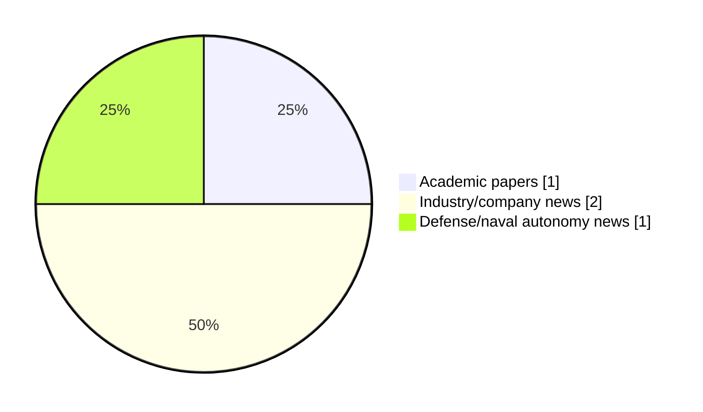

# Maritime Autonomy Watch — 2026-10-22

## Executive Summary

- Total selected items: 4
- Academic papers: 1
- Industry/company news: 2
- Defense/naval autonomy news: 1
- Failed/inaccessible sources: 0

## Contents

- [Analyst Brief](#analyst-brief)
- [Must Read](#must-read)
- [Top Signals Today](#top-signals-today)
- [Topic Signals](#topic-signals)
- [Freshness and Coverage](#freshness-and-coverage)
- [Quality Notes](#quality-notes)
- [Watchlist](#watchlist)
- [Academic Papers](#academic-papers)
- [Industry and Company News](#industry-and-company-news)
- [Defense and Naval Autonomy News](#defense-and-naval-autonomy-news)
- [Source Status Summary](#source-status-summary)

## Analyst Brief

Today's report selected 4 non-duplicate item(s), led by USV operations, swarm autonomy, planning/control. The strongest item is [Virtual uncrewed system sampling in the hurricane environment. Part 1: rigid-wing surface vehicle simulator](https://doi.org/10.3389/fmars.2026.1884756) from OpenAlex.
Coverage is weighted toward academic research (1), with 2 industry and 1 defense signal(s).

## Must Read

- [Virtual uncrewed system sampling in the hurricane environment. Part 1: rigid-wing surface vehicle simulator](https://doi.org/10.3389/fmars.2026.1884756) — Research signal: USV operations
- [Exail Marins INS Selected to Navigate Navy Fleet of Uncrewed Surface Vessels](https://oceannews.com/news/defense/exail-marins-ins-selected-to-navigate-navy-fleet-of-uncrewed-surface-vessels/) — Defense signal: USV operations
- [Distributed Autonomy & USVs Transform Maritime Surveillance](https://www.oceansciencetechnology.com/news/distributed-autonomy-usvs-transform-maritime-surveillance/) — Industry signal: USV operations
- [OMIL Offshore Partners with HydroSurv to Bring USV Technology to Spain and Portugal](https://oceannews.com/news/science-technology/omil-offshore-partners-with-hydrosurv-to-bring-usv-technology-to-spain-and-portugal/) — Industry signal: USV operations

## Top Signals Today

- USV operations: 4 selected item(s).
- swarm autonomy: 1 selected item(s).
- planning/control: 1 selected item(s).
- defense adoption: 1 selected item(s).
- critical infrastructure: 1 selected item(s).

## Topic Signals

- USV operations: 4
- swarm autonomy: 1
- planning/control: 1
- defense adoption: 1
- critical infrastructure: 1

## Freshness and Coverage

- Newest selected item date: 2026-10-22
- Oldest selected item date: 2026-10-06
- Active/enabled sources: 4
- Sources with access problems: 3
- Quality flags: 0

## Quality Notes

- No quality flags on selected items.

## Watchlist

- No watchlist items today.

### Category Snapshot

| Category | Selected items |
|---|---:|
| Academic papers | 1 |
| Industry/company news | 2 |
| Defense/naval autonomy news | 1 |

## Academic Papers

_Selected items: 1_

### [Virtual uncrewed system sampling in the hurricane environment. Part 1: rigid-wing surface vehicle simulator](https://doi.org/10.3389/fmars.2026.1884756)

- Source: OpenAlex
- Date: 2026-10-06
- Relevance score: 10
- Authors: Edoardo Mazza, Chidong Zhang, A. M. Chiodi
- DOI: 10.3389/fmars.2026.1884756
- Signal: Research signal: USV operations
- Topic tags: USV operations, swarm autonomy, planning/control

**Abstract**

Uncrewed vehicles (UxS) are the frontier of atmospheric and oceanic measurements in extreme regimes and remote areas. The combination of Uncrewed Surface Vehicles (USVs), Uncrewed Underwater Vehicles (UUVs) and Uncrewed Aerial Vehicles (UAVs) has the potential to transform air-sea coupling observations through co-located sampling of the lower atmosphere, upper ocean and air-sea interface. Although individual platforms have reached a relatively mature operational stage, designing coordinated missions remains challenging. UxS navigation is strongly affected by environmental conditions their and deployment can be logistically complex and poorly repeatable.

**Why it matters**

Relevant to underwater autonomy, surface-vessel operations, multi-vehicle coordination; the work may inform maritime autonomy research, testing priorities, or system design.

---

## Industry and Company News

_Selected items: 2_

### [Distributed Autonomy & USVs Transform Maritime Surveillance](https://www.oceansciencetechnology.com/news/distributed-autonomy-usvs-transform-maritime-surveillance/)

- Source: oceansciencetechnology.com
- Date: 2026-10-22
- Relevance score: 6.75
- Signal: Industry signal: USV operations
- Topic tags: USV operations

**Summary**

Exail has introduced Neptis, an integrated autonomous maritime surveillance system engineered to coordinate distributed uncrewed assets across above-surface, surface, and.

**Why it matters**

Signals momentum in surface-vessel operations; useful for tracking product direction, partnerships, and deployment opportunities.

---

### [OMIL Offshore Partners with HydroSurv to Bring USV Technology to Spain and Portugal](https://oceannews.com/news/science-technology/omil-offshore-partners-with-hydrosurv-to-bring-usv-technology-to-spain-and-portugal/)

- Source: oceannews.com
- Date: 2026-10-21
- Relevance score: 5.25
- Signal: Industry signal: USV operations
- Topic tags: USV operations, critical infrastructure

**Summary**

Spanish marine technology specialist OMIL Offshore has strengthened its portfolio of marine and subsea technologies through an exclusive Iberian Channel Partnership with HydroSurv, bringing the UK company's full range of REAV (Rapid Environmental Assessment Vessel) uncrewed surface platforms to customers across Spain and Portugal.

**Why it matters**

Signals momentum in surface-vessel operations; useful for tracking product direction, partnerships, and deployment opportunities.

---

## Defense and Naval Autonomy News

_Selected items: 1_

### [Exail Marins INS Selected to Navigate Navy Fleet of Uncrewed Surface Vessels](https://oceannews.com/news/defense/exail-marins-ins-selected-to-navigate-navy-fleet-of-uncrewed-surface-vessels/)

- Source: oceannews.com
- Date: 2026-10-21
- Relevance score: 8.5
- Signal: Defense signal: USV operations
- Topic tags: USV operations, defense adoption

**Summary**

A leading navy has selected Exail's high-performance, military-grade Marins inertial navigation systems (INS) to equip its complete fleet of uncrewed surface vessels (USVs). This major contract strengthens Exail's navigation position in the expanding defense USV market, where resilient navigation is becoming critical to the deployment of autonomous naval capabilities.

**Why it matters**

Signals movement in surface-vessel operations, naval adoption; useful for tracking operational concepts, procurement direction, and fleet integration.

---

## Inaccessible or Failed Sources

- None

## Source Status Summary

| Source | Status | Notes |
|---|---|---|
| arXiv | enabled | API source, 15 items fetched |
| OpenAlex | enabled | API source, 15 items fetched |
| RSS feeds | partial | 97 RSS items fetched; failures: https://www.navalnews.com/feed/: HTTP 503 for https://www.navalnews.com/feed/ |
| SMI MASG News | enabled | HTML source, 10 items fetched |
| IEEE Xplore | disabled | Missing IEEE_XPLORE_API_KEY |
| Elsevier Scopus | enabled | API source, 15 items fetched |
| NewsAPI | disabled | Missing NEWS_API_KEY |

## Metadata

- Generated at: 2026-10-22T13:06:12.807891+02:00
- Date: 2026-10-22
- Repository: ferhannb/MarineRobotics
- Relevance threshold: 4.0
- Deduplication method: DOI, canonical URL, source ID, normalized title, similar recent titles, category caps, and novelty score
