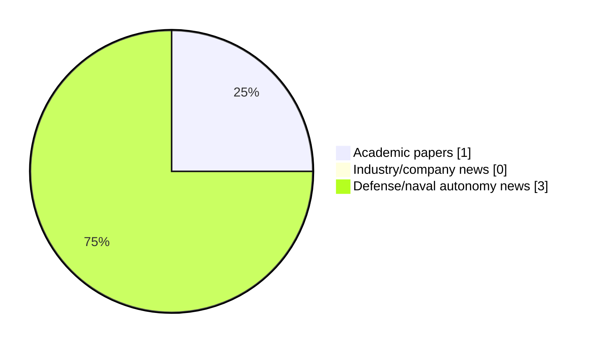

# Maritime Autonomy Watch — 2026-10-23

## Executive Summary

- Total selected items: 4
- Academic papers: 1
- Industry/company news: 0
- Defense/naval autonomy news: 3
- Failed/inaccessible sources: 0

## Contents

- [Analyst Brief](#analyst-brief)
- [Must Read](#must-read)
- [Top Signals Today](#top-signals-today)
- [Topic Signals](#topic-signals)
- [Freshness and Coverage](#freshness-and-coverage)
- [Quality Notes](#quality-notes)
- [Watchlist](#watchlist)
- [Academic Papers](#academic-papers)
- [Industry and Company News](#industry-and-company-news)
- [Defense and Naval Autonomy News](#defense-and-naval-autonomy-news)
- [Source Status Summary](#source-status-summary)

## Analyst Brief

Today's report selected 4 non-duplicate item(s), led by USV operations, defense adoption, AUV navigation. The strongest item is [NAViLoss: An Underwater Navigation-Aware Dual-Residual Objective for Physics-Consistent Learning](http://arxiv.org/abs/2610.09690v1) from arXiv.
Coverage is weighted toward academic research (1), with 0 industry and 3 defense signal(s).
Quality caveat: low-score-unique=1.

## Must Read

- [NAViLoss: An Underwater Navigation-Aware Dual-Residual Objective for Physics-Consistent Learning](http://arxiv.org/abs/2610.09690v1) — Research signal: AUV navigation
- [OCIUS’ New Bluebottle Hybrid USV Demonstrates Capability at Maritime Big Play Pacific](https://www.navalnews.com/naval-news/2026/10/ocius-new-bluebottle-hybrid-usv-demonstrates-capability-at-maritime-big-play-pacific/) — Defense signal: USV operations
- [Pentagon Launches 120-Day “Sprint” to Field Counter-UAS Armed USVs](https://www.navalnews.com/naval-news/2026/10/pentagon-diu-sprint-counter-uas-armed-usvs/) — Defense signal: USV operations
- [Saab & Swedish Armed Forces Advance Naval Autonomy With Rapid Underwater Vehicle Launch](https://www.oceansciencetechnology.com/news/saab-swedish-armed-forces-advance-naval-autonomy-with-rapid-underwater-vehicle-launch/) — Defense signal: defense adoption

## Top Signals Today

- USV operations: 2 selected item(s).
- defense adoption: 2 selected item(s).
- AUV navigation: 1 selected item(s).
- perception: 1 selected item(s).

## Topic Signals

- USV operations: 2
- defense adoption: 2
- AUV navigation: 1
- perception: 1

## Freshness and Coverage

- Newest selected item date: 2026-10-23
- Oldest selected item date: 2026-10-07
- Active/enabled sources: 5
- Sources with access problems: 2
- Quality flags: 1

## Quality Notes

- low-score-unique: 1

## Watchlist

- [Saab & Swedish Armed Forces Advance Naval Autonomy With Rapid Underwater Vehicle Launch](https://www.oceansciencetechnology.com/news/saab-swedish-armed-forces-advance-naval-autonomy-with-rapid-underwater-vehicle-launch/) — low-score-unique

### Category Snapshot

| Category | Selected items |
|---|---:|
| Academic papers | 1 |
| Industry/company news | 0 |
| Defense/naval autonomy news | 3 |

## Academic Papers

_Selected items: 1_

### [NAViLoss: An Underwater Navigation-Aware Dual-Residual Objective for Physics-Consistent Learning](http://arxiv.org/abs/2610.09690v1)

- Source: arXiv
- Date: 2026-10-07
- Relevance score: 8.5
- Authors: Arup Kumar Sahoo, Itzik Klein
- Signal: Research signal: AUV navigation
- Topic tags: AUV navigation, perception

**Abstract**

Autonomous underwater vehicles (AUVs) commonly rely on inertial navigation systems (INS) aided by Doppler velocity logs (DVLs) for reliable underwater navigation. Accurate DVL velocity estimation is therefore essential for successful operation. Recent learning-based methods have demonstrated improved DVL velocity estimation, particularly under degraded measurement conditions. However, their training objectives typically rely on conventional regression losses that are highly sensitive to large residuals and corrupted observations. Additionally, they do not explicitly account for the physical consistency and measurement uncertainty associated with the underlying sensing process. To address these limitations, this paper introduces navigation-aware loss (NAViLoss), a robust and uncertainty-aware objective function for learning-based AUV velocity estimation.

**Why it matters**

Relevant to underwater autonomy; the work may inform maritime autonomy research, testing priorities, or system design.

---

## Industry and Company News

_Selected items: 0_

No selected items.

## Defense and Naval Autonomy News

_Selected items: 3_

### [OCIUS’ New Bluebottle Hybrid USV Demonstrates Capability at Maritime Big Play Pacific](https://www.navalnews.com/naval-news/2026/10/ocius-new-bluebottle-hybrid-usv-demonstrates-capability-at-maritime-big-play-pacific/)

- Source: navalnews.com
- Date: 2026-10-21
- Relevance score: 6
- Signal: Defense signal: USV operations
- Topic tags: USV operations, defense adoption

**Summary**

Two diesel-hybrid variants of Ocius’ renewably powered Bluebottle Uncrewed Surface Vessel (USV), ‘Bluebottle Hybrid’, are participating in the US Navy-led Maritime Big Play Pacific exercise, which runs throughout October. Ocius press release The exercise will mark the first time the Bluebottle Hybrid has participated in a Navy exercise anywhere in the world. The vessels will carry ThayerMahan.

**Why it matters**

Signals movement in surface-vessel operations, naval adoption; useful for tracking operational concepts, procurement direction, and fleet integration.

---

### [Pentagon Launches 120-Day “Sprint” to Field Counter-UAS Armed USVs](https://www.navalnews.com/naval-news/2026/10/pentagon-diu-sprint-counter-uas-armed-usvs/)

- Source: navalnews.com
- Date: 2026-10-22
- Relevance score: 4.5
- Signal: Defense signal: USV operations
- Topic tags: USV operations

**Summary**

The Pentagon and DIU launched a 120-day sprint to acquire and field new counter-UAS armed USVs to defend surface fleets against low-cost drone threats.

**Why it matters**

Signals movement in surface-vessel operations; useful for tracking operational concepts, procurement direction, and fleet integration.

---

### [Saab & Swedish Armed Forces Advance Naval Autonomy With Rapid Underwater Vehicle Launch](https://www.oceansciencetechnology.com/news/saab-swedish-armed-forces-advance-naval-autonomy-with-rapid-underwater-vehicle-launch/)

- Source: oceansciencetechnology.com
- Date: 2026-10-23
- Relevance score: 3.5
- Signal: Defense signal: defense adoption
- Topic tags: defense adoption
- Quality flags: low-score-unique

**Summary**

Less than one year after the contract award, Saab, the Swedish Defence Materiel Administration (FMV), and the Swedish Armed Forces.

**Why it matters**

Signals movement in underwater autonomy, naval adoption; useful for tracking operational concepts, procurement direction, and fleet integration.

---

## Inaccessible or Failed Sources

- None

## Source Status Summary

| Source | Status | Notes |
|---|---|---|
| arXiv | enabled | API source, 15 items fetched |
| OpenAlex | enabled | API source, 15 items fetched |
| RSS feeds | enabled | 107 RSS items fetched |
| SMI MASG News | enabled | HTML source, 10 items fetched |
| IEEE Xplore | disabled | Missing IEEE_XPLORE_API_KEY |
| Elsevier Scopus | enabled | API source, 15 items fetched |
| NewsAPI | disabled | Missing NEWS_API_KEY |

## Metadata

- Generated at: 2026-10-23T12:57:48.139509+02:00
- Date: 2026-10-23
- Repository: ferhannb/MarineRobotics
- Relevance threshold: 4.0
- Deduplication method: DOI, canonical URL, source ID, normalized title, similar recent titles, category caps, and novelty score
