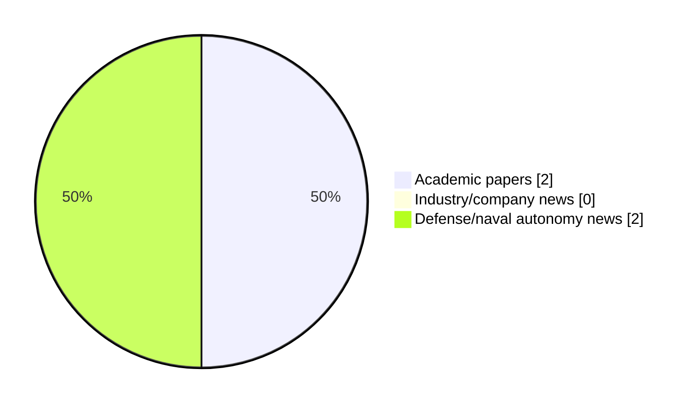

# Maritime Autonomy Watch — 2026-10-26

## Executive Summary

- Total selected items: 4
- Academic papers: 2
- Industry/company news: 0
- Defense/naval autonomy news: 2
- Failed/inaccessible sources: 1

## Contents

- [Analyst Brief](#analyst-brief)
- [Must Read](#must-read)
- [Top Signals Today](#top-signals-today)
- [Topic Signals](#topic-signals)
- [Freshness and Coverage](#freshness-and-coverage)
- [Quality Notes](#quality-notes)
- [Watchlist](#watchlist)
- [Academic Papers](#academic-papers)
- [Industry and Company News](#industry-and-company-news)
- [Defense and Naval Autonomy News](#defense-and-naval-autonomy-news)
- [Source Status Summary](#source-status-summary)

## Analyst Brief

Today's report selected 4 non-duplicate item(s), led by USV operations, AUV navigation, underwater communications. The strongest item is [Sweden Selects Saildrone for Year-long MDA Mission in the Baltic Sea](https://www.navalnews.com/naval-news/2026/10/sweden-selects-saildrone-for-year-long-mda-mission-in-the-baltic-sea/) from navalnews.com.
Coverage is weighted toward academic research (2), with 0 industry and 2 defense signal(s).
Quality caveat: missing-summary=1, date-anomaly=1, low-score-unique=1.

## Must Read

- [Sweden Selects Saildrone for Year-long MDA Mission in the Baltic Sea](https://www.navalnews.com/naval-news/2026/10/sweden-selects-saildrone-for-year-long-mda-mission-in-the-baltic-sea/) — Defense signal: USV operations
- [Semantic communication for the internet of underwater things: Architectures, applications, challenges, and future directions](https://doi.org/10.1016/j.adhoc.2026.104432) — Research signal: AUV navigation
- [From Concept to Sea Trials in Six Months: France Fast-Tracks SMOKERS Kamikaze USV](https://www.navalnews.com/naval-news/2026/10/france-smokers-kamikaze-usv/) — Defense signal: USV operations

## Top Signals Today

- USV operations: 2 selected item(s).
- AUV navigation: 2 selected item(s).
- underwater communications: 1 selected item(s).
- perception: 1 selected item(s).
- critical infrastructure: 1 selected item(s).

## Topic Signals

- USV operations: 2
- AUV navigation: 2
- underwater communications: 1
- perception: 1
- critical infrastructure: 1
- defense adoption: 1

## Freshness and Coverage

- Newest selected item date: 2027-03-01
- Oldest selected item date: 2026-10-10
- Active/enabled sources: 4
- Sources with access problems: 3
- Quality flags: 3

## Quality Notes

- missing-summary: 1
- date-anomaly: 1
- low-score-unique: 1
- Date anomalies: [Fusion-driven geometry-constrained latent flow learning for robust AUV motion anticipation from heterogeneous 3D observations](https://api.elsevier.com/content/abstract/scopus_id/105051060825) reports 2027-03-01

## Watchlist

- [Fusion-driven geometry-constrained latent flow learning for robust AUV motion anticipation from heterogeneous 3D observations](https://api.elsevier.com/content/abstract/scopus_id/105051060825) — missing-summary, date-anomaly, low-score-unique

### Category Snapshot

| Category | Selected items |
|---|---:|
| Academic papers | 2 |
| Industry/company news | 0 |
| Defense/naval autonomy news | 2 |

## Academic Papers

_Selected items: 2_

### [Semantic communication for the internet of underwater things: Architectures, applications, challenges, and future directions](https://doi.org/10.1016/j.adhoc.2026.104432)

- Source: OpenAlex
- Date: 2026-10-10
- Relevance score: 7.75
- Authors: Ruhul Amin Khalil, Asiya Jehangir, Hanane Lamaazi, Sadaf Rubab, Nasir Saeed
- DOI: 10.1016/j.adhoc.2026.104432
- Signal: Research signal: AUV navigation
- Topic tags: AUV navigation, underwater communications, perception, critical infrastructure

**Abstract**

The Internet of Underwater Things (IoUT) supports marine sensing, environmental monitoring, subsea inspection, and autonomous underwater operations. However, IoUT communication is constrained by limited bandwidth, long propagation delay, time-varying underwater channels, intermittent connectivity, and strict energy budgets. Semantic Communication (SC) offers a promising alternative by transmitting task-relevant meaning rather than raw data, thereby improving communication efficiency in resource-constrained underwater networks. This paper presents a critical and feasibility-aware survey of SC for IoUT, focusing on opportunities, challenges, limitations, and future research directions. We first review the fundamentals of SC-enabled IoUT systems, including semantic representations, layered architectures, semantic channel modeling, and task-oriented evaluation metrics.

**Why it matters**

Relevant to underwater autonomy, infrastructure monitoring; the work may inform maritime autonomy research, testing priorities, or system design.

---

### [Fusion-driven geometry-constrained latent flow learning for robust AUV motion anticipation from heterogeneous 3D observations](https://api.elsevier.com/content/abstract/scopus_id/105051060825)

- Source: Elsevier Scopus
- Date: 2027-03-01
- Relevance score: 3.5
- DOI: 10.1016/j.inffus.2026.104764
- Signal: Research signal: AUV navigation
- Topic tags: AUV navigation
- Quality flags: missing-summary, date-anomaly, low-score-unique

**Abstract**

No summary available.

**Why it matters**

Relevant to underwater autonomy; the work may inform maritime autonomy research, testing priorities, or system design.

---

## Industry and Company News

_Selected items: 0_

No selected items.

## Defense and Naval Autonomy News

_Selected items: 2_

### [Sweden Selects Saildrone for Year-long MDA Mission in the Baltic Sea](https://www.navalnews.com/naval-news/2026/10/sweden-selects-saildrone-for-year-long-mda-mission-in-the-baltic-sea/)

- Source: navalnews.com
- Date: 2026-10-26
- Relevance score: 8
- Signal: Defense signal: USV operations
- Topic tags: USV operations

**Summary**

Saildrone announced a year-long mission with the Swedish Armed Forces to deliver persistent Maritime Domain Awareness (MDA) across Sweden’s territorial waters and exclusive economic zone in the Baltic Sea. Saildrone press release Under the agreement, Saildrone will deploy and operate four Voyager unmanned surface vehicles (USVs) for 360 days each, representing 1,440 contracted vehicle-days of continuous.

**Why it matters**

Signals movement in surface-vessel operations; useful for tracking operational concepts, procurement direction, and fleet integration.

---

### [From Concept to Sea Trials in Six Months: France Fast-Tracks SMOKERS Kamikaze USV](https://www.navalnews.com/naval-news/2026/10/france-smokers-kamikaze-usv/)

- Source: navalnews.com
- Date: 2026-10-26
- Relevance score: 4.5
- Signal: Defense signal: USV operations
- Topic tags: USV operations, defense adoption

**Summary**

The French Defense Procurement Agency (DGA) has rapidly developed the low-cost SMOKERS kamikaze USV, moving from concept to sea trials in just six months.

**Why it matters**

Signals movement in surface-vessel operations, naval adoption; useful for tracking operational concepts, procurement direction, and fleet integration.

---

## Inaccessible or Failed Sources

- arXiv: HTTP 429 for https://export.arxiv.org/api/query?search_query=all%3A%22maritime+autonomy%22+OR+all%3A%22marine+robotics%22+OR+all%3A%22autonomous+vessel%22+OR+all%3A%22autonomous+mission%22+OR+all%3A%22autonomous+surface+vessel%22+OR+all%3A%22autonomous+underwater+vehicle%22+OR+all%3A%22unmanned+surface+vehicle%22+OR+all%3A%22unmanned+underwater+vehicle%22&start=0&max_results=15&sortBy=submittedDate&sortOrder=descending

## Source Status Summary

| Source | Status | Notes |
|---|---|---|
| arXiv | failed | HTTP 429 for https://export.arxiv.org/api/query?search_query=all%3A%22maritime+autonomy%22+OR+all%3A%22marine+robotics%22+OR+all%3A%22autonomous+vessel%22+OR+all%3A%22autonomous+mission%22+OR+all%3A%22autonomous+surface+vessel%22+OR+all%3A%22autonomous+underwater+vehicle%22+OR+all%3A%22unmanned+surface+vehicle%22+OR+all%3A%22unmanned+underwater+vehicle%22&start=0&max_results=15&sortBy=submittedDate&sortOrder=descending |
| OpenAlex | enabled | API source, 15 items fetched |
| RSS feeds | enabled | 92 RSS items fetched |
| SMI MASG News | enabled | HTML source, 10 items fetched |
| IEEE Xplore | disabled | Missing IEEE_XPLORE_API_KEY |
| Elsevier Scopus | enabled | API source, 15 items fetched |
| NewsAPI | disabled | Missing NEWS_API_KEY |

## Metadata

- Generated at: 2026-10-26T13:12:18.345844+01:00
- Date: 2026-10-26
- Repository: ferhannb/MarineRobotics
- Relevance threshold: 4.0
- Deduplication method: DOI, canonical URL, source ID, normalized title, similar recent titles, category caps, and novelty score
