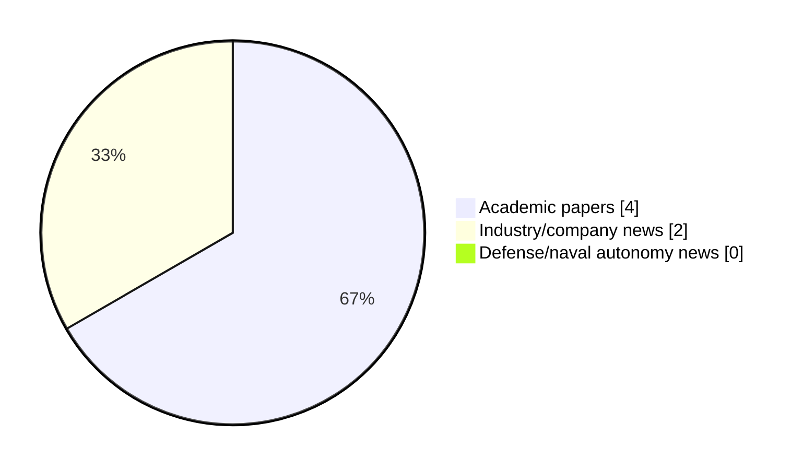

# Maritime Autonomy Watch — 2026-10-27

## Executive Summary

- Total selected items: 6
- Academic papers: 4
- Industry/company news: 2
- Defense/naval autonomy news: 0
- Failed/inaccessible sources: 0

## Contents

- [Analyst Brief](#analyst-brief)
- [Must Read](#must-read)
- [Top Signals Today](#top-signals-today)
- [Topic Signals](#topic-signals)
- [Freshness and Coverage](#freshness-and-coverage)
- [Quality Notes](#quality-notes)
- [Watchlist](#watchlist)
- [Academic Papers](#academic-papers)
- [Industry and Company News](#industry-and-company-news)
- [Defense and Naval Autonomy News](#defense-and-naval-autonomy-news)
- [Source Status Summary](#source-status-summary)

## Analyst Brief

Today's report selected 6 non-duplicate item(s), led by USV operations, AUV navigation, planning/control. The strongest item is [Conditional Diffusion Generation of DVL and Inertial Signals for Underwater Navigation](http://arxiv.org/abs/2610.34574v1) from arXiv.
Coverage is weighted toward academic research (4), with 2 industry and 0 defense signal(s).
Quality caveat: low-score-unique=2, missing-summary=1, date-anomaly=1.

## Must Read

- [Conditional Diffusion Generation of DVL and Inertial Signals for Underwater Navigation](http://arxiv.org/abs/2610.34574v1) — Research signal: AUV navigation
- [Prediction-Informed Landing Window Planning for UAV Landing on USV in High Sea States](http://arxiv.org/abs/2610.13190v1) — Research signal: USV operations
- [IQUA Robotics Deploys SPARUS II AUV at REPMUS 26 for MCM and Seabed Mapping](https://oceannews.com/news/defense/iqua-robotics-deploys-sparus-ii-auv-at-repmus-26-for-mcm-and-seabed-mapping/) — Industry signal: AUV navigation
- [ComNav Technology Displays GNSS and USV Solutions at Azerbaijan and Bolivia Expos](https://oceannews.com/news/milestones/comnav-technology-displays-gnss-and-usv-solutions-at-azerbaijan-and-bolivia-expos/) — Industry signal: USV operations
- [Probabilistic Ship Trajectory Forecasting using Transformer Models on AIS Data](http://arxiv.org/abs/2610.13557v1) — Research signal: USV operations

## Top Signals Today

- USV operations: 3 selected item(s).
- AUV navigation: 2 selected item(s).
- planning/control: 2 selected item(s).
- swarm autonomy: 2 selected item(s).
- perception: 1 selected item(s).

## Topic Signals

- USV operations: 3
- AUV navigation: 2
- planning/control: 2
- swarm autonomy: 2
- perception: 1

## Freshness and Coverage

- Newest selected item date: 2027-02-01
- Oldest selected item date: 2026-10-09
- Active/enabled sources: 4
- Sources with access problems: 3
- Quality flags: 4

## Quality Notes

- low-score-unique: 2
- missing-summary: 1
- date-anomaly: 1
- Date anomalies: [Edge-enhanced graph attention-based multi-agent reinforcement learning for multi-UUV cooperative area protection under communication and sensing constraints](https://api.elsevier.com/content/abstract/scopus_id/105051196107) reports 2027-02-01

## Watchlist

- [Probabilistic Ship Trajectory Forecasting using Transformer Models on AIS Data](http://arxiv.org/abs/2610.13557v1) — low-score-unique
- [Edge-enhanced graph attention-based multi-agent reinforcement learning for multi-UUV cooperative area protection under communication and sensing constraints](https://api.elsevier.com/content/abstract/scopus_id/105051196107) — missing-summary, date-anomaly, low-score-unique

### Category Snapshot

| Category | Selected items |
|---|---:|
| Academic papers | 4 |
| Industry/company news | 2 |
| Defense/naval autonomy news | 0 |

## Academic Papers

_Selected items: 4_

### [Conditional Diffusion Generation of DVL and Inertial Signals for Underwater Navigation](http://arxiv.org/abs/2610.34574v1)

- Source: arXiv
- Date: 2026-10-25
- Relevance score: 10
- Authors: Michal Levin, Itzik Klein
- Signal: Research signal: AUV navigation
- Topic tags: AUV navigation

**Abstract**

Autonomous underwater vehicles (AUVs) navigate without satellite positioning and rely on Doppler velocity log (DVL) and inertial sensors for motion estimation. Deep learning methods for processing these sensors require training data covering the motion the AUV encounters, commonly obtained through costly sea trials. To overcome this limitation, we present a conditional diffusion framework that generates synthetic DVL and inertial signals to replace real recordings in training. The generator employs an Elucidated diffusion model conditioned on three per-channel motion descriptors. Three configurations are evaluated: DVL beams alone, inertial channels alone, and all channels jointly from one model. Across thirteen trajectories of the real dataset, the generated signals followed the requested conditions with Pearson correlations between 0.72 and 0.

**Why it matters**

Relevant to underwater autonomy; the work may inform maritime autonomy research, testing priorities, or system design.

---

### [Prediction-Informed Landing Window Planning for UAV Landing on USV in High Sea States](http://arxiv.org/abs/2610.13190v1)

- Source: arXiv
- Date: 2026-10-09
- Relevance score: 8.75
- Authors: Kaizhen Li, Xi Zhou, Dan Zhang, Xiaowei Li
- Signal: Research signal: USV operations
- Topic tags: USV operations, planning/control

**Abstract**

Autonomous landing of unmanned aerial vehicle (UAV) on unmanned surface vehicle (USV) is difficult in high sea states. Existing hierarchical landing methods often infer future USV motion only implicitly from short observation histories, which limits their ability to adapt to severe and rapidly changing sea conditions. This paper presents a prediction-informed hierarchical control framework. A pretrained model is developed to explicitly predict the USV attitude during high-level landing decisions. The prediction helps identify suitable landing windows and choose the right touchdown time, while a conventional low-level flight controller maintains UAV stability and tracks motion commands. To evaluate the framework under realistic disturbances, a real-sim validation setup is constructed in which USV-motion data collected in real sea conditions are transferred to a MuJoCo USV.

**Why it matters**

Relevant to surface-vessel operations; the work may inform maritime autonomy research, testing priorities, or system design.

---

### [Probabilistic Ship Trajectory Forecasting using Transformer Models on AIS Data](http://arxiv.org/abs/2610.13557v1)

- Source: arXiv
- Date: 2026-10-09
- Relevance score: 3.5
- Authors: Frederik E. T. Schöller
- Signal: Research signal: USV operations
- Topic tags: USV operations, swarm autonomy, planning/control
- Quality flags: low-score-unique

**Abstract**

Anticipation of vessel trajectories is an essential task when navigating at sea. This applies to both human navigators and autonomous surface vessels. Trajectory forecasting enables sub-routines such as collision avoidance to assess the situation and react accordingly in time. This paper investigates Transformer and Performer models for trajectory prediction of surface vessels in confined waters. Using widely available position data from the Automatic Identification System (AIS), candidate models are trained and evaluated. Historical information on how other vessels have moved in the local area surrounding each agent is conveyed using positional heat maps. The heat maps are generated using Kernel Density Estimation (KDE) and encoded with a Convolutional Neural Network (CNN) before entering the Transformer models.

**Why it matters**

Relevant to surface-vessel operations, multi-vehicle coordination, navigation safety; the work may inform maritime autonomy research, testing priorities, or system design.

---

### [Edge-enhanced graph attention-based multi-agent reinforcement learning for multi-UUV cooperative area protection under communication and sensing constraints](https://api.elsevier.com/content/abstract/scopus_id/105051196107)

- Source: Elsevier Scopus
- Date: 2027-02-01
- Relevance score: 3.5
- DOI: 10.1016/j.eswa.2026.134415
- Signal: Research signal: swarm autonomy
- Topic tags: swarm autonomy, perception
- Quality flags: missing-summary, date-anomaly, low-score-unique

**Abstract**

No summary available.

**Why it matters**

This paper may influence autonomy, perception, planning, or control work for maritime robotic systems.

---

## Industry and Company News

_Selected items: 2_

### [IQUA Robotics Deploys SPARUS II AUV at REPMUS 26 for MCM and Seabed Mapping](https://oceannews.com/news/defense/iqua-robotics-deploys-sparus-ii-auv-at-repmus-26-for-mcm-and-seabed-mapping/)

- Source: oceannews.com
- Date: 2026-10-26
- Relevance score: 7.75
- Signal: Industry signal: AUV navigation
- Topic tags: AUV navigation

**Summary**

IQUA Robotics has shared details of its fifth consecutive REPMUS, once again proving the capabilities of the company's SPARUS II autonomous underwater vehicle (AUV) in mine countermeasures and seabed mapping operations.

**Why it matters**

Signals momentum in underwater autonomy; useful for tracking product direction, partnerships, and deployment opportunities.

---

### [ComNav Technology Displays GNSS and USV Solutions at Azerbaijan and Bolivia Expos](https://oceannews.com/news/milestones/comnav-technology-displays-gnss-and-usv-solutions-at-azerbaijan-and-bolivia-expos/)

- Source: oceannews.com
- Date: 2026-10-26
- Relevance score: 4.5
- Signal: Industry signal: USV operations
- Topic tags: USV operations

**Summary**

ComNav Technology recently joined its local partners at two exhibitions in Azerbaijan and Bolivia, showcasing its solutions for surveying, 3D scanning, and precision agriculture.

**Why it matters**

Signals momentum in surface-vessel operations; useful for tracking product direction, partnerships, and deployment opportunities.

---

## Defense and Naval Autonomy News

_Selected items: 0_

No selected items.

## Inaccessible or Failed Sources

- None

## Source Status Summary

| Source | Status | Notes |
|---|---|---|
| arXiv | enabled | API source, 15 items fetched |
| OpenAlex | enabled | API source, 15 items fetched |
| RSS feeds | partial | 82 RSS items fetched; failures: https://www.navalnews.com/feed/: HTTP 503 for https://www.navalnews.com/feed/ |
| SMI MASG News | enabled | HTML source, 10 items fetched |
| IEEE Xplore | disabled | Missing IEEE_XPLORE_API_KEY |
| Elsevier Scopus | enabled | API source, 15 items fetched |
| NewsAPI | disabled | Missing NEWS_API_KEY |

## Metadata

- Generated at: 2026-10-27T12:33:16.740389+01:00
- Date: 2026-10-27
- Repository: ferhannb/MarineRobotics
- Relevance threshold: 4.0
- Deduplication method: DOI, canonical URL, source ID, normalized title, similar recent titles, category caps, and novelty score
