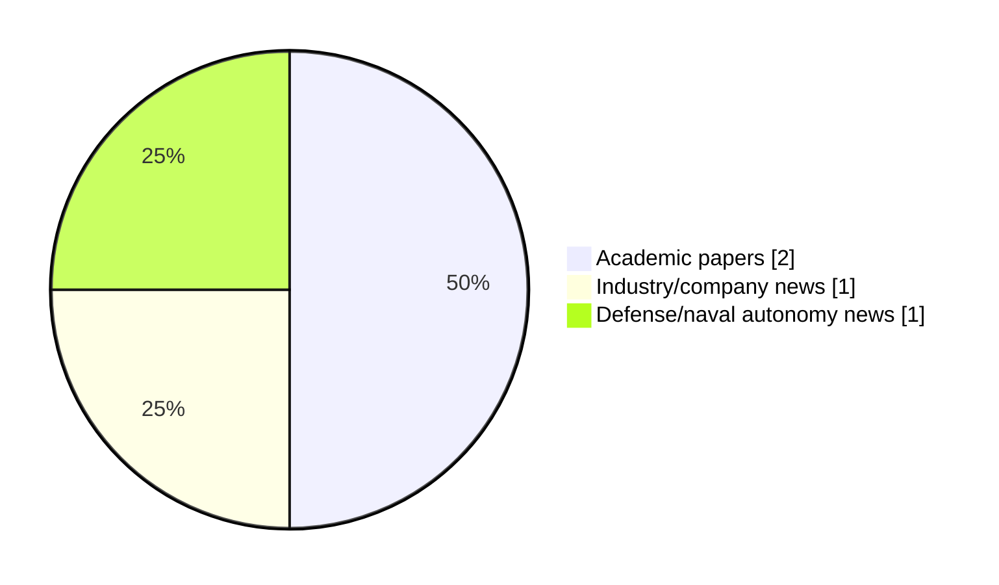

# Maritime Autonomy Watch — 2026-10-28

## Executive Summary

- Total selected items: 4
- Academic papers: 2
- Industry/company news: 1
- Defense/naval autonomy news: 1
- Failed/inaccessible sources: 0

## Contents

- [Analyst Brief](#analyst-brief)
- [Must Read](#must-read)
- [Top Signals Today](#top-signals-today)
- [Topic Signals](#topic-signals)
- [Freshness and Coverage](#freshness-and-coverage)
- [Quality Notes](#quality-notes)
- [Watchlist](#watchlist)
- [Academic Papers](#academic-papers)
- [Industry and Company News](#industry-and-company-news)
- [Defense and Naval Autonomy News](#defense-and-naval-autonomy-news)
- [Source Status Summary](#source-status-summary)

## Analyst Brief

Today's report selected 4 non-duplicate item(s), led by AUV navigation, swarm autonomy, USV operations. The strongest item is [SVIn+: Multi-Modal Framework for Robust Underwater State Estimation using 3D Sonar, Visual-Inertial, Water-Pressure, and DVL](http://arxiv.org/abs/2610.36454v1) from arXiv.
Coverage is weighted toward academic research (2), with 1 industry and 1 defense signal(s).
Quality caveat: missing-summary=1, date-anomaly=1.

## Must Read

- [SVIn+: Multi-Modal Framework for Robust Underwater State Estimation using 3D Sonar, Visual-Inertial, Water-Pressure, and DVL](http://arxiv.org/abs/2610.36454v1) — Research signal: AUV navigation
- [Exail Unveils Marins M1 Compact INS for Smaller Naval Platforms and UXVs](https://www.navalnews.com/naval-news/2026/10/exail-unveils-marins-m1-compact-ins-for-smaller-naval-platforms-and-uxvs/) — Defense signal: USV operations
- [SEABER Launches RAVEN Compact AUV to Challenge High-End Platforms](https://oceannews.com/news/science-technology/seaber-launches-raven-compact-auv-to-challenge-high-end-platforms/) — Industry signal: AUV navigation

## Top Signals Today

- AUV navigation: 2 selected item(s).
- swarm autonomy: 2 selected item(s).
- USV operations: 2 selected item(s).
- underwater communications: 1 selected item(s).
- perception: 1 selected item(s).

## Topic Signals

- AUV navigation: 2
- swarm autonomy: 2
- USV operations: 2
- underwater communications: 1
- perception: 1
- planning/control: 1
- defense adoption: 1

## Freshness and Coverage

- Newest selected item date: 2027-03-05
- Oldest selected item date: 2026-10-26
- Active/enabled sources: 5
- Sources with access problems: 2
- Quality flags: 2

## Quality Notes

- missing-summary: 1
- date-anomaly: 1
- Date anomalies: [Offline-to-online multi-agent constrained decision transformer for multi-USV cooperative pursuit-evasion games](https://api.elsevier.com/content/abstract/scopus_id/105054140077) reports 2027-03-05

## Watchlist

- [Offline-to-online multi-agent constrained decision transformer for multi-USV cooperative pursuit-evasion games](https://api.elsevier.com/content/abstract/scopus_id/105054140077) — missing-summary, date-anomaly

### Category Snapshot

| Category | Selected items |
|---|---:|
| Academic papers | 2 |
| Industry/company news | 1 |
| Defense/naval autonomy news | 1 |

## Academic Papers

_Selected items: 2_

### [SVIn+: Multi-Modal Framework for Robust Underwater State Estimation using 3D Sonar, Visual-Inertial, Water-Pressure, and DVL](http://arxiv.org/abs/2610.36454v1)

- Source: arXiv
- Date: 2026-10-27
- Relevance score: 8.5
- Authors: Chinmay Burgul, Xiaoming Zhao, Yewei Huang, Michalis Chatzispyrou, Marios Xanthidis, Ioannis Rekleitis, Alberto Quattrini Li
- Signal: Research signal: AUV navigation
- Topic tags: AUV navigation, underwater communications, swarm autonomy, perception, planning/control

**Abstract**

As expansion and scalability in underwater oper- ations becomes more important and challenging, autonomous underwater vehicles (AUVs) become more relevant and the necessity for reliable autonomy more critical. A fundamental challenge in any autonomous underwater operation, from control to safe navigation and mapping, is state estimation; a notorious hard problem to address, especially in low visibility conditions. In this paper, we tackle this problem, by presenting SVIn+, a multi-sensor framework for robust state estimation of AUVs equipped with an IMU, cameras, a water-pressure sensor, a Doppler Velocity Log (DVL), and a compact 3D sonar. This framework extends an established open-source state-of-the-art visual-inertial SLAM, SVIn, by integrating water-pressure and DVL measurements into a tightly-coupled nonlinear optimiza- tion formulation resulting in improved estimates.

**Why it matters**

Relevant to underwater autonomy, multi-vehicle coordination; the work may inform maritime autonomy research, testing priorities, or system design.

---

### [Offline-to-online multi-agent constrained decision transformer for multi-USV cooperative pursuit-evasion games](https://api.elsevier.com/content/abstract/scopus_id/105054140077)

- Source: Elsevier Scopus
- Date: 2027-03-05
- Relevance score: 4.5
- DOI: 10.1016/j.ins.2026.124322
- Signal: Research signal: USV operations
- Topic tags: USV operations, swarm autonomy
- Quality flags: missing-summary, date-anomaly

**Abstract**

No summary available.

**Why it matters**

Relevant to surface-vessel operations; the work may inform maritime autonomy research, testing priorities, or system design.

---

## Industry and Company News

_Selected items: 1_

### [SEABER Launches RAVEN Compact AUV to Challenge High-End Platforms](https://oceannews.com/news/science-technology/seaber-launches-raven-compact-auv-to-challenge-high-end-platforms/)

- Source: oceannews.com
- Date: 2026-10-27
- Relevance score: 5
- Signal: Industry signal: AUV navigation
- Topic tags: AUV navigation

**Summary**

French AUV manufacturer SEABER announces the launch of RAVEN®, a new generation of compact AUVs for mine countermeasures (MCM) and survey. Designed to compete with established market leaders, RAVEN® challenges their cost structure.

**Why it matters**

Signals momentum in underwater autonomy; useful for tracking product direction, partnerships, and deployment opportunities.

---

## Defense and Naval Autonomy News

_Selected items: 1_

### [Exail Unveils Marins M1 Compact INS for Smaller Naval Platforms and UXVs](https://www.navalnews.com/naval-news/2026/10/exail-unveils-marins-m1-compact-ins-for-smaller-naval-platforms-and-uxvs/)

- Source: navalnews.com
- Date: 2026-10-26
- Relevance score: 8
- Signal: Defense signal: USV operations
- Topic tags: USV operations, defense adoption

**Summary**

Exail introduces the Marins M1 compact INS, providing resilient FOG navigation for USVs, UUVs, and tactical craft operating in GNSS-denied environments. Exail press release Saint-Germain-en-Laye, France, October 26, 2026 – Exail unveils Marins M1, a compact inertial navigation system (INS) designed to bring very high-performance, resilient navigation to a wider range of naval platforms, including.

**Why it matters**

Signals movement in surface-vessel operations, naval adoption; useful for tracking operational concepts, procurement direction, and fleet integration.

---

## Inaccessible or Failed Sources

- None

## Source Status Summary

| Source | Status | Notes |
|---|---|---|
| arXiv | enabled | API source, 15 items fetched |
| OpenAlex | enabled | API source, 15 items fetched |
| RSS feeds | enabled | 92 RSS items fetched |
| SMI MASG News | enabled | HTML source, 10 items fetched |
| IEEE Xplore | disabled | Missing IEEE_XPLORE_API_KEY |
| Elsevier Scopus | enabled | API source, 15 items fetched |
| NewsAPI | disabled | Missing NEWS_API_KEY |

## Metadata

- Generated at: 2026-10-28T13:03:09.210444+01:00
- Date: 2026-10-28
- Repository: ferhannb/MarineRobotics
- Relevance threshold: 4.0
- Deduplication method: DOI, canonical URL, source ID, normalized title, similar recent titles, category caps, and novelty score
