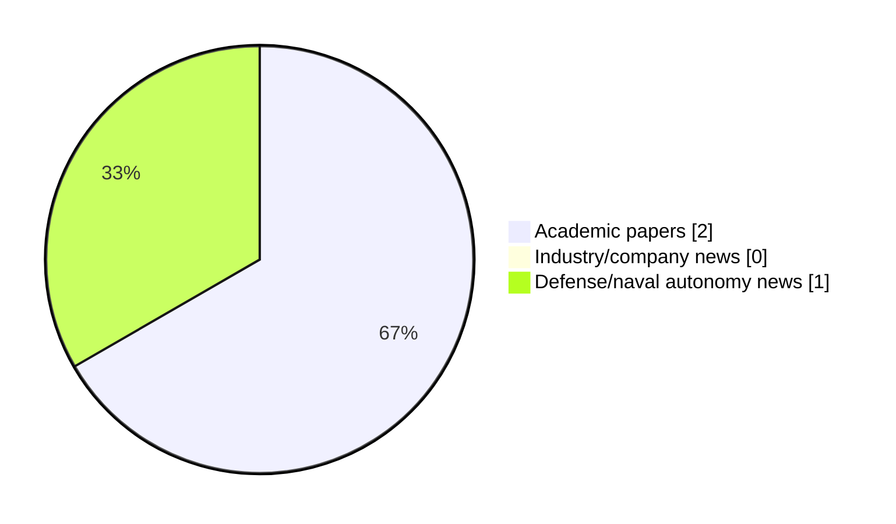

# Maritime Autonomy Watch — 2026-10-29

## Executive Summary

- Total selected items: 3
- Academic papers: 2
- Industry/company news: 0
- Defense/naval autonomy news: 1
- Failed/inaccessible sources: 0

## Contents

- [Analyst Brief](#analyst-brief)
- [Must Read](#must-read)
- [Top Signals Today](#top-signals-today)
- [Topic Signals](#topic-signals)
- [Freshness and Coverage](#freshness-and-coverage)
- [Quality Notes](#quality-notes)
- [Watchlist](#watchlist)
- [Academic Papers](#academic-papers)
- [Industry and Company News](#industry-and-company-news)
- [Defense and Naval Autonomy News](#defense-and-naval-autonomy-news)
- [Source Status Summary](#source-status-summary)

## Analyst Brief

Today's report selected 3 non-duplicate item(s), led by USV operations, defense adoption, AUV navigation. The strongest item is [Input-Constrained Active Disturbance Rejection Control for AUVs](http://arxiv.org/abs/2610.17498v1) from arXiv.
Coverage is weighted toward academic research (2), with 0 industry and 1 defense signal(s).
Quality caveat: low-score-unique=1.

## Must Read

- [Input-Constrained Active Disturbance Rejection Control for AUVs](http://arxiv.org/abs/2610.17498v1) — Research signal: AUV navigation
- [HII Marks Production Milestone for ROMULUS USVs with Ceremony in Louisiana](https://oceannews.com/news/milestones/hii-marks-production-milestone-for-romulus-usvs-with-ceremony-in-louisiana/) — Defense signal: USV operations
- [Fly, Drive, Reconfigure: A Modular Reconfigurable Aerial-Ground Platform for Field Operations](http://arxiv.org/abs/2609.28887v1) — Research signal: swarm autonomy

## Top Signals Today

- USV operations: 1 selected item(s).
- defense adoption: 1 selected item(s).
- AUV navigation: 1 selected item(s).
- planning/control: 1 selected item(s).
- swarm autonomy: 1 selected item(s).

## Topic Signals

- USV operations: 1
- defense adoption: 1
- AUV navigation: 1
- planning/control: 1
- swarm autonomy: 1
- perception: 1

## Freshness and Coverage

- Newest selected item date: 2026-10-28
- Oldest selected item date: 2026-09-24
- Active/enabled sources: 4
- Sources with access problems: 3
- Quality flags: 1

## Quality Notes

- low-score-unique: 1

## Watchlist

- [Fly, Drive, Reconfigure: A Modular Reconfigurable Aerial-Ground Platform for Field Operations](http://arxiv.org/abs/2609.28887v1) — low-score-unique

### Category Snapshot

| Category | Selected items |
|---|---:|
| Academic papers | 2 |
| Industry/company news | 0 |
| Defense/naval autonomy news | 1 |

## Academic Papers

_Selected items: 2_

### [Input-Constrained Active Disturbance Rejection Control for AUVs](http://arxiv.org/abs/2610.17498v1)

- Source: arXiv
- Date: 2026-10-12
- Relevance score: 7.75
- Authors: Minh-Quan Le, Ying Tan, Jinghe Yang, Jason Monty, Ye Pu
- Signal: Research signal: AUV navigation
- Topic tags: AUV navigation, planning/control

**Abstract**

This paper addresses the control of autonomous underwater vehicles (AUVs) operating in dynamic environments, where wave-induced forces, modelling errors, and actuator limitations make reliable control challenging. Active disturbance rejection control (ADRC), together with an extended state observer (ESO), estimates lumped uncertainties online, simplifying control design using nominal models. However, existing stability analyses typically assume bounded control inputs and derivatives, which are difficult to guarantee under unknown disturbances and measurement noise. To bridge this theory--practice gap, this paper introduces an ADRC framework with active input saturation and post-saturation low-pass filtering. The saturation constrains the control magnitude, while the filter regularizes the saturated signal to ensure bounded input-rate variations.

**Why it matters**

Relevant to underwater autonomy; the work may inform maritime autonomy research, testing priorities, or system design.

---

### [Fly, Drive, Reconfigure: A Modular Reconfigurable Aerial-Ground Platform for Field Operations](http://arxiv.org/abs/2609.28887v1)

- Source: arXiv
- Date: 2026-09-24
- Relevance score: 3.5
- Authors: Li-Yu Lo, Yanbaihui Liu, Chengchuan Shu, Tyler Harris, Jonathan Ryan, Boyuan Chen
- Signal: Research signal: swarm autonomy
- Topic tags: swarm autonomy, perception
- Quality flags: low-score-unique

**Abstract**

Heterogeneous robot teams distribute complementary capabilities across specialized agents, but their physical roles and capacities typically remain fixed throughout a mission. We present HARP, a Heterogeneous Aerial Robotic modules Platform in which independently deployable aerial robots physically reconfigure to compose their capabilities for field operations. HARP comprises sensor-equipped scouts, flydrive rover modules, and task-specific payload modules. Scouts map the environment and inform an energy-aware planner that jointly selects routes and air-ground mobility modes. Rover and payload modules fly independently across terrain that constrains ground travel, then autonomously assemble into a cooperative ground vehicle for energy-efficient payload transport.

**Why it matters**

This paper may influence autonomy, perception, planning, or control work for maritime robotic systems.

---

## Industry and Company News

_Selected items: 0_

No selected items.

## Defense and Naval Autonomy News

_Selected items: 1_

### [HII Marks Production Milestone for ROMULUS USVs with Ceremony in Louisiana](https://oceannews.com/news/milestones/hii-marks-production-milestone-for-romulus-usvs-with-ceremony-in-louisiana/)

- Source: oceannews.com
- Date: 2026-10-28
- Relevance score: 7.5
- Signal: Defense signal: USV operations
- Topic tags: USV operations, defense adoption

**Summary**

On Tuesday, HII, America's largest military shipbuilder and the global leader in autonomous seapower, celebrated a milestone in the production of ROMULUS unmanned surface vessels (USVs) for the US Navy during a ceremony in Louisiana, highlighting the state's vital role in delivering the next generation of autonomous maritime capabilities.

**Why it matters**

Signals movement in surface-vessel operations, naval adoption; useful for tracking operational concepts, procurement direction, and fleet integration.

---

## Inaccessible or Failed Sources

- None

## Source Status Summary

| Source | Status | Notes |
|---|---|---|
| arXiv | enabled | API source, 15 items fetched |
| OpenAlex | enabled | API source, 15 items fetched |
| RSS feeds | partial | 82 RSS items fetched; failures: https://www.navalnews.com/feed/: HTTP 503 for https://www.navalnews.com/feed/ |
| SMI MASG News | enabled | HTML source, 10 items fetched |
| IEEE Xplore | disabled | Missing IEEE_XPLORE_API_KEY |
| Elsevier Scopus | enabled | API source, 15 items fetched |
| NewsAPI | disabled | Missing NEWS_API_KEY |

## Metadata

- Generated at: 2026-10-29T13:14:25.685119+01:00
- Date: 2026-10-29
- Repository: ferhannb/MarineRobotics
- Relevance threshold: 4.0
- Deduplication method: DOI, canonical URL, source ID, normalized title, similar recent titles, category caps, and novelty score
