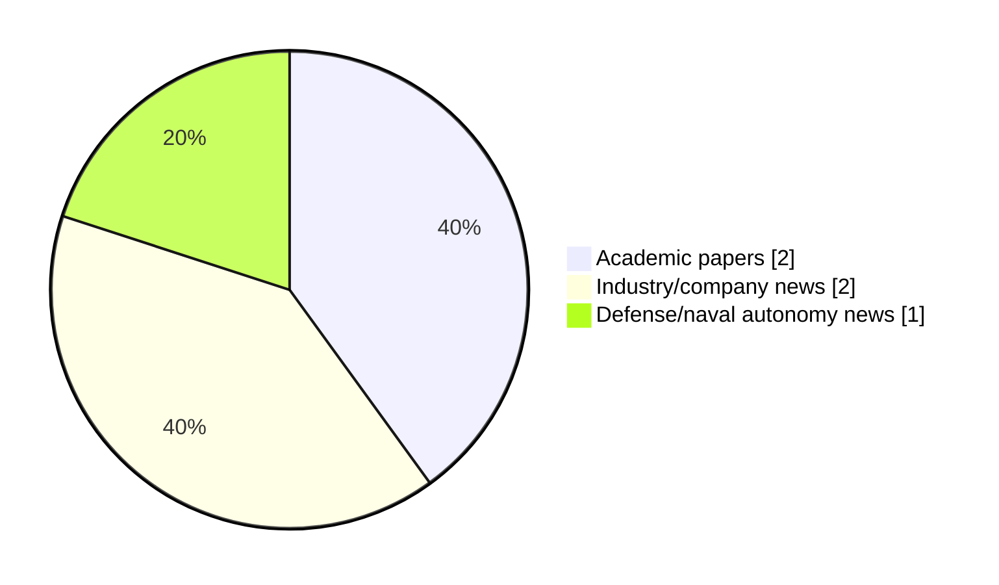

# Maritime Autonomy Watch — 2026-10-30

## Executive Summary

- Total selected items: 5
- Academic papers: 2
- Industry/company news: 2
- Defense/naval autonomy news: 1
- Failed/inaccessible sources: 0

## Contents

- [Analyst Brief](#analyst-brief)
- [Must Read](#must-read)
- [Top Signals Today](#top-signals-today)
- [Topic Signals](#topic-signals)
- [Freshness and Coverage](#freshness-and-coverage)
- [Quality Notes](#quality-notes)
- [Watchlist](#watchlist)
- [Academic Papers](#academic-papers)
- [Industry and Company News](#industry-and-company-news)
- [Defense and Naval Autonomy News](#defense-and-naval-autonomy-news)
- [Source Status Summary](#source-status-summary)

## Analyst Brief

Today's report selected 5 non-duplicate item(s), led by USV operations, swarm autonomy, perception. The strongest item is [Elbit Systems Debuts UUV Capabilities at Euronaval 2026 Following ISE Acquisition](https://oceannews.com/news/science-technology/elbit-systems-debuts-uuv-capabilities-at-euronaval-2026-following-ise-acquisition/) from oceannews.com.
Coverage is weighted toward academic research (2), with 2 industry and 1 defense signal(s).
Quality caveat: low-score-unique=1.

## Must Read

- [Elbit Systems Debuts UUV Capabilities at Euronaval 2026 Following ISE Acquisition](https://oceannews.com/news/science-technology/elbit-systems-debuts-uuv-capabilities-at-euronaval-2026-following-ise-acquisition/) — Defense signal: defense adoption
- [Stability-Performance Trade-off in Maritime Integrated Sensing, Communication, and Computation: A Lyapunov-Guided Dual-Timescale Hierarchical RL Approach](http://arxiv.org/abs/2610.39082v1) — Research signal: USV operations
- [Tunable Spatial Task Allocation with Application to Maritime Swarms](http://arxiv.org/abs/2610.39018v1) — Research signal: AUV navigation
- [Robosys Integrates VOYAGER AI with FarSounder Forward Looking Sonar, Advancing Situational Awareness for Superyachts and USVs](https://www.maritimeindustries.org/news/robosys-integrates-voyager-ai-farsounder-forward-looking-sonar-advancing-situational-awareness-superyachts-and-usvs) — Industry signal: USV operations
- [KONGSBERG Wins DIU Contract Modification for Autonomous Underwater Vehicles](https://oceannews.com/news/defense/kongsberg-wins-diu-contract-modification-for-autonomous-underwater-vehicles/) — Industry signal: AUV navigation

## Top Signals Today

- USV operations: 2 selected item(s).
- swarm autonomy: 2 selected item(s).
- perception: 2 selected item(s).
- AUV navigation: 2 selected item(s).
- defense adoption: 1 selected item(s).

## Topic Signals

- USV operations: 2
- swarm autonomy: 2
- perception: 2
- AUV navigation: 2
- defense adoption: 1
- planning/control: 1

## Freshness and Coverage

- Newest selected item date: 2026-10-29
- Oldest selected item date: 2026-09-17
- Active/enabled sources: 4
- Sources with access problems: 3
- Quality flags: 1

## Quality Notes

- low-score-unique: 1

## Watchlist

- [KONGSBERG Wins DIU Contract Modification for Autonomous Underwater Vehicles](https://oceannews.com/news/defense/kongsberg-wins-diu-contract-modification-for-autonomous-underwater-vehicles/) — low-score-unique

### Category Snapshot

| Category | Selected items |
|---|---:|
| Academic papers | 2 |
| Industry/company news | 2 |
| Defense/naval autonomy news | 1 |

## Academic Papers

_Selected items: 2_

### [Stability-Performance Trade-off in Maritime Integrated Sensing, Communication, and Computation: A Lyapunov-Guided Dual-Timescale Hierarchical RL Approach](http://arxiv.org/abs/2610.39082v1)

- Source: arXiv
- Date: 2026-10-29
- Relevance score: 8
- Authors: Ruoguang Li, Yu Wang, Bingxin Tian, Benedetta Picano, Yingyang Chen, Xiaomin Chen, Li Wang, Guangjie Han, Zhu Han
- Signal: Research signal: USV operations
- Topic tags: USV operations, swarm autonomy, perception

**Abstract**

Driven by the ever-growing demand for intelligent maritime services, cooperative unmanned aerial vehicle (UAV) and unmanned surface vehicle (USV) operations, together with wireless integrated sensing, communication, and computation (ISCC), have become pivotal in maritime environments. However, the distinctive maritime environment precludes a direct application of terrestrial ISCC models, while sensing, communication, and computation compete for the same spatio-temporal resources, thus yielding inherent performance trade-offs that become particularly severe in resource-constrained ocean scenarios. To address these issues, we investigate an ISCC system in which multiple UAVs detect targets at the sea surface and partially offload the collected data to a USV for cooperative processing.

**Why it matters**

Relevant to surface-vessel operations; the work may inform maritime autonomy research, testing priorities, or system design.

---

### [Tunable Spatial Task Allocation with Application to Maritime Swarms](http://arxiv.org/abs/2610.39018v1)

- Source: arXiv
- Date: 2026-10-28
- Relevance score: 7.75
- Authors: Vishnudatta Thota, Tyler Paine, Anastasia Bizyaeva
- Signal: Research signal: AUV navigation
- Topic tags: AUV navigation, swarm autonomy

**Abstract**

In this chapter, we explore how a team of autonomous agents can flexibly reconfigure the distribution of its members across many spatially embedded tasks using a task allocation strategy grounded in a generalization of the recently proposed Nonlinear Opinion Dynamics model. Motivated by an adaptive maritime survey application, we couple opinion dynamics directly to spatial movement and examine how the emergent macroscopic allocation is shaped by the interplay between environmental geometry, nature of social interactions, and task demands. We illustrate in simulation how social coupling in the model tunes group cohesion, producing macroscopic allocation patterns ranging from maximally dispersed states, to intermediate semi-dispersed states with a smaller number of distinct subgroups, to maximally cohesive consensus states, in distinct and interpretable parameter regimes.

**Why it matters**

Relevant to underwater autonomy, multi-vehicle coordination; the work may inform maritime autonomy research, testing priorities, or system design.

---

## Industry and Company News

_Selected items: 2_

### [Robosys Integrates VOYAGER AI with FarSounder Forward Looking Sonar, Advancing Situational Awareness for Superyachts and USVs](https://www.maritimeindustries.org/news/robosys-integrates-voyager-ai-farsounder-forward-looking-sonar-advancing-situational-awareness-superyachts-and-usvs)

- Source: maritimeindustries.org
- Date: 2026-09-17
- Relevance score: 6.75
- Signal: Industry signal: USV operations
- Topic tags: USV operations, perception, planning/control

**Summary**

Providence, RI – Robosys Automation, a leader in autonomous navigation and vessel control systems, has announced the integration of its VOYAGER AI Autonomous Navigation System (ANS) software with FarSounder’s Forward Looking Sonar (FLS) technology, delivering enhanced real-time situational awareness, obstacle detection, and navigation decision support for both luxury superyachts and Uncrewed Surface Vessels (USVs).

**Why it matters**

Signals momentum in surface-vessel operations; useful for tracking product direction, partnerships, and deployment opportunities.

---

### [KONGSBERG Wins DIU Contract Modification for Autonomous Underwater Vehicles](https://oceannews.com/news/defense/kongsberg-wins-diu-contract-modification-for-autonomous-underwater-vehicles/)

- Source: oceannews.com
- Date: 2026-10-29
- Relevance score: 3.5
- Signal: Industry signal: AUV navigation
- Topic tags: AUV navigation
- Quality flags: low-score-unique

**Summary**

Kongsberg Gruppen ASA (KONGSBERG) has been awarded a major contract modification by the Department of War Innovation Unit (DIU) for autonomous underwater capabilities.

**Why it matters**

Signals momentum in underwater autonomy; useful for tracking product direction, partnerships, and deployment opportunities.

---

## Defense and Naval Autonomy News

_Selected items: 1_

### [Elbit Systems Debuts UUV Capabilities at Euronaval 2026 Following ISE Acquisition](https://oceannews.com/news/science-technology/elbit-systems-debuts-uuv-capabilities-at-euronaval-2026-following-ise-acquisition/)

- Source: oceannews.com
- Date: 2026-10-29
- Relevance score: 8.5
- Signal: Defense signal: defense adoption
- Topic tags: defense adoption

**Summary**

Elbit Systems Ltd. will present its unmanned underwater vehicle (UUV) capabilities for the first time at Euronaval 2026, marking the expansion of the company's autonomous maritime offering into the underwater domain.

**Why it matters**

Signals movement in underwater autonomy, naval adoption; useful for tracking operational concepts, procurement direction, and fleet integration.

---

## Inaccessible or Failed Sources

- None

## Source Status Summary

| Source | Status | Notes |
|---|---|---|
| arXiv | enabled | API source, 15 items fetched |
| OpenAlex | enabled | API source, 15 items fetched |
| RSS feeds | partial | 82 RSS items fetched; failures: https://www.navalnews.com/feed/: HTTP 503 for https://www.navalnews.com/feed/ |
| SMI MASG News | enabled | HTML source, 10 items fetched |
| IEEE Xplore | disabled | Missing IEEE_XPLORE_API_KEY |
| Elsevier Scopus | enabled | API source, 15 items fetched |
| NewsAPI | disabled | Missing NEWS_API_KEY |

## Metadata

- Generated at: 2026-10-30T13:04:37.778946+01:00
- Date: 2026-10-30
- Repository: ferhannb/MarineRobotics
- Relevance threshold: 4.0
- Deduplication method: DOI, canonical URL, source ID, normalized title, similar recent titles, category caps, and novelty score
