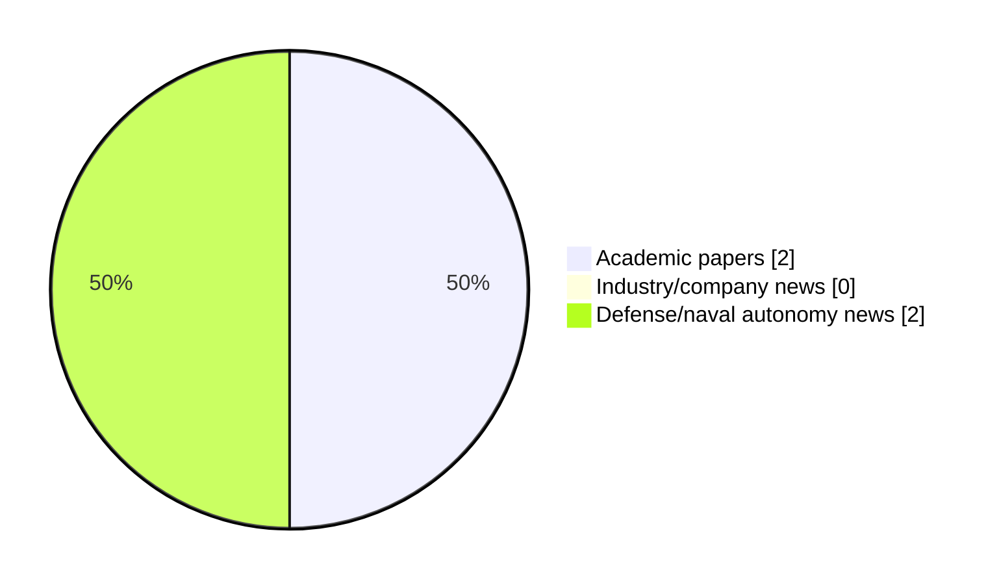

# Maritime Autonomy Watch — 2026-10-31

## Executive Summary

- Total selected items: 4
- Academic papers: 2
- Industry/company news: 0
- Defense/naval autonomy news: 2
- Failed/inaccessible sources: 0

## Contents

- [Analyst Brief](#analyst-brief)
- [Must Read](#must-read)
- [Top Signals Today](#top-signals-today)
- [Topic Signals](#topic-signals)
- [Freshness and Coverage](#freshness-and-coverage)
- [Quality Notes](#quality-notes)
- [Watchlist](#watchlist)
- [Academic Papers](#academic-papers)
- [Industry and Company News](#industry-and-company-news)
- [Defense and Naval Autonomy News](#defense-and-naval-autonomy-news)
- [Source Status Summary](#source-status-summary)

## Analyst Brief

Today's report selected 4 non-duplicate item(s), led by USV operations, defense adoption, AUV navigation. The strongest item is [AEVEX Maritime Wins Dual Navy Contracts for SightGlass and Fisher Mine Countermeasures Systems](https://oceannews.com/news/defense/aevex-maritime-wins-dual-navy-contracts-for-sightglass-and-fisher-mine-countermeasures-systems/) from oceannews.com.
Coverage is weighted toward academic research (2), with 0 industry and 2 defense signal(s).
Quality caveat: low-score-unique=1.

## Must Read

- [AEVEX Maritime Wins Dual Navy Contracts for SightGlass and Fisher Mine Countermeasures Systems](https://oceannews.com/news/defense/aevex-maritime-wins-dual-navy-contracts-for-sightglass-and-fisher-mine-countermeasures-systems/) — Defense signal: USV operations
- [French Navy and DGA Evaluate Exail DriX O-16 USV in the Mediterranean](https://www.navalnews.com/naval-news/2026/10/french-navy-evaluates-exail-drix-o-16-usv/) — Defense signal: USV operations
- [Adaptive Prescribed Performance Trajectory Tracking for Uncertain Autonomous Underwater Vehicles With Input Saturation](http://arxiv.org/abs/2610.20957v1) — Research signal: AUV navigation
- [Clarity-Driven Adaptive Mission Planning for a Solar-Powered Autonomous Surface Vessel](http://arxiv.org/abs/2610.20871v1) — Research signal: USV operations

## Top Signals Today

- USV operations: 3 selected item(s).
- defense adoption: 2 selected item(s).
- AUV navigation: 1 selected item(s).
- planning/control: 1 selected item(s).
- swarm autonomy: 1 selected item(s).

## Topic Signals

- USV operations: 3
- defense adoption: 2
- AUV navigation: 1
- planning/control: 1
- swarm autonomy: 1

## Freshness and Coverage

- Newest selected item date: 2026-10-30
- Oldest selected item date: 2026-10-14
- Active/enabled sources: 4
- Sources with access problems: 3
- Quality flags: 1

## Quality Notes

- low-score-unique: 1

## Watchlist

- [Clarity-Driven Adaptive Mission Planning for a Solar-Powered Autonomous Surface Vessel](http://arxiv.org/abs/2610.20871v1) — low-score-unique

### Category Snapshot

| Category | Selected items |
|---|---:|
| Academic papers | 2 |
| Industry/company news | 0 |
| Defense/naval autonomy news | 2 |

## Academic Papers

_Selected items: 2_

### [Adaptive Prescribed Performance Trajectory Tracking for Uncertain Autonomous Underwater Vehicles With Input Saturation](http://arxiv.org/abs/2610.20957v1)

- Source: arXiv
- Date: 2026-10-14
- Relevance score: 5
- Authors: Athanasios K. Gkesoulis, Christos Vlachos, George K. Fourlas, Charalampos P. Bechlioulis, George C. Karras
- Signal: Research signal: AUV navigation
- Topic tags: AUV navigation, planning/control

**Abstract**

Accurate trajectory tracking is essential for autonomous underwater vehicles operating with uncertain hydrodynamics and limited thruster authority. This paper develops a low-complexity adaptive prescribed performance controller for uncertain underwater vehicle dynamics with coupled and saturated inputs. The proposed method adapts the performance functions directly through the mismatch between the requested and saturated control inputs, enlarging the performance funnels only when the available actuation cannot meet the nominal specifications. A coupled invariant-set analysis establishes boundedness of all closed-loop signals, prescribed bounds on the filtered tracking errors, and explicit feasibility conditions.

**Why it matters**

Relevant to underwater autonomy, planning and control; the work may inform maritime autonomy research, testing priorities, or system design.

---

### [Clarity-Driven Adaptive Mission Planning for a Solar-Powered Autonomous Surface Vessel](http://arxiv.org/abs/2610.20871v1)

- Source: arXiv
- Date: 2026-10-14
- Relevance score: 3.5
- Authors: Kavin M. Govindarajan, Kaleb Ben Naveed, David Li, Devansh R. Agrawal, Mary Maceda, Matthew Bryant, Dimitra Panagou, Chris Vermillion
- Signal: Research signal: USV operations
- Topic tags: USV operations, swarm autonomy
- Quality flags: low-score-unique

**Abstract**

This paper presents a comprehensive methodology, backed by simulation and experimental results, for an adaptive mission planning strategy that is mathematically grounded in the maximization of the information-driven quantity of clarity. In particular, the methodology introduced in this work addresses the use of sustainably powered autonomous surface vessels (ASVs) to perform scientific missions that prioritize locations of maximum interest. Because these locations of maximum interest are not known a priori but are rather identified based on in-situ measurements, online adaptation is essential for mission planning. Furthermore, the reliance on a limited-power renewable resource requires an adaptation strategy that maximizes information gathering subject to mobility restrictions imposed by the renewable resource.

**Why it matters**

Relevant to surface-vessel operations, multi-vehicle coordination; the work may inform maritime autonomy research, testing priorities, or system design.

---

## Industry and Company News

_Selected items: 0_

No selected items.

## Defense and Naval Autonomy News

_Selected items: 2_

### [AEVEX Maritime Wins Dual Navy Contracts for SightGlass and Fisher Mine Countermeasures Systems](https://oceannews.com/news/defense/aevex-maritime-wins-dual-navy-contracts-for-sightglass-and-fisher-mine-countermeasures-systems/)

- Source: oceannews.com
- Date: 2026-10-30
- Relevance score: 5.75
- Signal: Defense signal: USV operations
- Topic tags: USV operations, defense adoption

**Summary**

AEVEX Corp. has announced that its Maritime Systems division has been awarded two contracts totaling $41.6 million by the Portfolio Acquisition Executive for Robotic and Autonomous Systems (PAE RAS) for the production, fielding, and operation of the SightGlass and Fisher mine countermeasures (MCM) systems. The systems expand MCM capabilities across the US Navy's existing Global Autonomous Reconnaissance Craft (GARC) fleet and AEVEX's newer Lynx and next-generation Chaser small unmanned surface vessels (sUSVs).

**Why it matters**

Signals movement in surface-vessel operations, naval adoption; useful for tracking operational concepts, procurement direction, and fleet integration.

---

### [French Navy and DGA Evaluate Exail DriX O-16 USV in the Mediterranean](https://www.navalnews.com/naval-news/2026/10/french-navy-evaluates-exail-drix-o-16-usv/)

- Source: navalnews.com
- Date: 2026-10-29
- Relevance score: 5.25
- Signal: Defense signal: USV operations
- Topic tags: USV operations, defense adoption

**Summary**

The French Navy and DGA are conducting extensive at-sea evaluations of the Exail DriX O-16 USV in the Mediterranean for ASW and maritime surveillance missions.

**Why it matters**

Signals movement in surface-vessel operations, naval adoption; useful for tracking operational concepts, procurement direction, and fleet integration.

---

## Inaccessible or Failed Sources

- None

## Source Status Summary

| Source | Status | Notes |
|---|---|---|
| arXiv | enabled | API source, 15 items fetched |
| OpenAlex | enabled | API source, 15 items fetched |
| RSS feeds | partial | 82 RSS items fetched; failures: https://www.marinelink.com/news/rss: The read operation timed out |
| SMI MASG News | enabled | HTML source, 10 items fetched |
| IEEE Xplore | disabled | Missing IEEE_XPLORE_API_KEY |
| Elsevier Scopus | enabled | API source, 15 items fetched |
| NewsAPI | disabled | Missing NEWS_API_KEY |

## Metadata

- Generated at: 2026-10-31T12:38:35.285325+01:00
- Date: 2026-10-31
- Repository: ferhannb/MarineRobotics
- Relevance threshold: 4.0
- Deduplication method: DOI, canonical URL, source ID, normalized title, similar recent titles, category caps, and novelty score
