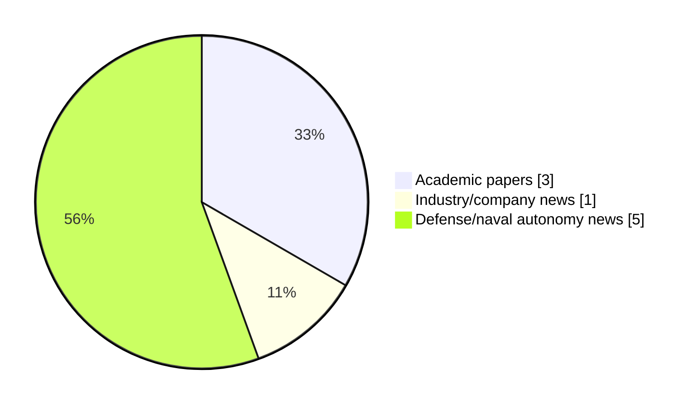

# Maritime Autonomy Watch — 2026-11-02

## Executive Summary

- Total selected items: 9
- Academic papers: 3
- Industry/company news: 1
- Defense/naval autonomy news: 5
- Failed/inaccessible sources: 0

## Contents

- [Analyst Brief](#analyst-brief)
- [Must Read](#must-read)
- [Top Signals Today](#top-signals-today)
- [Topic Signals](#topic-signals)
- [Freshness and Coverage](#freshness-and-coverage)
- [Quality Notes](#quality-notes)
- [Watchlist](#watchlist)
- [Academic Papers](#academic-papers)
- [Industry and Company News](#industry-and-company-news)
- [Defense and Naval Autonomy News](#defense-and-naval-autonomy-news)
- [Source Status Summary](#source-status-summary)

## Analyst Brief

Today's report selected 9 non-duplicate item(s), led by USV operations, defense adoption, planning/control. The strongest item is [The multi-USV mission management problem: Formalization and literature review](https://doi.org/10.1016/j.oceaneng.2026.129113) from OpenAlex.
Coverage is weighted toward academic research (3), with 1 industry and 5 defense signal(s).
Quality caveat: low-score-unique=2.

## Must Read

- [The multi-USV mission management problem: Formalization and literature review](https://doi.org/10.1016/j.oceaneng.2026.129113) — Research signal: USV operations
- [Autonomous Marine Waste Collection Integrating Real-Time Perception, Energy-Aware Control, and Mission-Level Planning on an Unmanned Surface Vehicle (USV)](https://doi.org/10.1016/j.sciaf.2026.e03723) — Research signal: USV operations
- [Fairbanks Morse Defense Unveils Autonomous Vessel Recovery System](https://www.marinelink.com/news/fairbanks-morse-defense-unveils-544061) — Defense signal: USV operations
- [OceanAlpha L42B Survey USV Earns Bureau Veritas Approval in Principle](https://oceannews.com/news/milestones/oceanalpha-l42b-survey-usv-earns-bureau-veritas-approval-in-principle/) — Industry signal: USV operations
- [Video: Naval Group Demonstrates Armed SEAQUEST-S USV](https://www.navalnews.com/event-news/euronaval-2026/2026/11/video-naval-group-demonstrates-armed-seaquest-s-usv/) — Defense signal: USV operations

## Top Signals Today

- USV operations: 8 selected item(s).
- defense adoption: 5 selected item(s).
- planning/control: 2 selected item(s).
- perception: 1 selected item(s).
- AUV navigation: 1 selected item(s).

## Topic Signals

- USV operations: 8
- defense adoption: 5
- planning/control: 2
- perception: 1
- AUV navigation: 1

## Freshness and Coverage

- Newest selected item date: 2026-11-02
- Oldest selected item date: 2026-10-01
- Active/enabled sources: 5
- Sources with access problems: 2
- Quality flags: 2

## Quality Notes

- low-score-unique: 2

## Watchlist

- [Court Orders Navy to Reevaluate Saildrone in MUSV Competition](https://oceannews.com/news/defense/court-orders-navy-to-reevaluate-saildrone-in-musv-competition/) — low-score-unique
- [Interaction-Aware Sampling-Based Motion Planning for Autonomous Surface Vessels in Urban Waterways](http://arxiv.org/abs/2610.41676v1) — low-score-unique

### Category Snapshot

| Category | Selected items |
|---|---:|
| Academic papers | 3 |
| Industry/company news | 1 |
| Defense/naval autonomy news | 5 |

## Academic Papers

_Selected items: 3_

### [The multi-USV mission management problem: Formalization and literature review](https://doi.org/10.1016/j.oceaneng.2026.129113)

- Source: OpenAlex
- Date: 2026-11-01
- Relevance score: 10
- Authors: Félix Orjales, Enrique Fernández-Pérez, Alejandro Romero, Julián Rodríguez-Cortegoso, William F. Infante, Richard José Duro
- DOI: 10.1016/j.oceaneng.2026.129113
- Signal: Research signal: USV operations
- Topic tags: USV operations

**Abstract**

Unmanned Surface Vehicles (USVs) have gained prominence in recent years due to their versatility and their ability to operate in hazardous maritime environments, thereby reducing human exposure to risk. As mission complexity increases, the deployment of multiple USVs becomes necessary to achieve scalability, robustness, and operational efficiency. Such multi-USV systems require advanced coordination and cooperation mechanisms to ensure successful mission execution. This paper starts by providing a comprehensive formalization of a decision-making and mission management framework for heterogeneous multi-robot teams in general, particularizing for multi-USV teams where relevant. The proposed formulation systematically covers all stages of the decision-making hierarchy, including goal definition, sub-goal specification and decomposition, task allocation, task planning, and task execution.

**Why it matters**

Relevant to surface-vessel operations; the work may inform maritime autonomy research, testing priorities, or system design.

---

### [Autonomous Marine Waste Collection Integrating Real-Time Perception, Energy-Aware Control, and Mission-Level Planning on an Unmanned Surface Vehicle (USV)](https://doi.org/10.1016/j.sciaf.2026.e03723)

- Source: OpenAlex
- Date: 2026-10-01
- Relevance score: 10
- Authors: Chiaka Chibuike David, Xueyong Chen
- DOI: 10.1016/j.sciaf.2026.e03723
- Signal: Research signal: USV operations
- Topic tags: USV operations, perception, planning/control

**Abstract**

ABSTRACT Autonomous marine waste collection using Unmanned Surface Vehicles (USVs) requires robust perception, adaptive planning, and stringent energy management. Current control paradigms often decouple navigation from mission execution, resulting in inefficiencies and limited strategic adaptability. We propose the Energy-Aware MPC-Constrained Reinforcement Learning (EA-MPC-CRL) framework, which establishes bidirectional coupling between a high-level Constrained Reinforcement Learning agent for strategic decision-making and a low-level Model Predictive Controller for energy-optimal trajectory tracking. A dynamic cost-mapping function enables real-time modulation of MPC objectives based on mission context, including battery state and target proximity. Extensive field trials demonstrate significant improvements over conventional baselines.

**Why it matters**

Relevant to surface-vessel operations, planning and control; the work may inform maritime autonomy research, testing priorities, or system design.

---

### [Interaction-Aware Sampling-Based Motion Planning for Autonomous Surface Vessels in Urban Waterways](http://arxiv.org/abs/2610.41676v1)

- Source: arXiv
- Date: 2026-10-30
- Relevance score: 3.5
- Authors: Elia Trevisan, Alejandro Gonzalez-Garcia, Jan Swevers, Javier Alonso-Mora
- Signal: Research signal: USV operations
- Topic tags: USV operations, planning/control
- Quality flags: low-score-unique

**Abstract**

Autonomous surface vessels operating in urban waterways must coordinate with other vessels in confined spaces while complying with traffic regulations, often without knowing their intentions. We present a decentralized motion planner based on model predictive path integral control, a sampling-based model predictive control scheme. The planner jointly computes a trajectory for the ego vessel and a prediction of the trajectories of the other vessels, and therefore accounts for their interaction. Traffic regulations are encoded as discontinuous costs, which the sampling-based formulation admits without a smooth approximation. We evaluate the method in maps taken from real sections of Amsterdam's canals, in encounters between two vessels and in scenarios with four interacting vessels.

**Why it matters**

Relevant to surface-vessel operations, navigation safety, planning and control; the work may inform maritime autonomy research, testing priorities, or system design.

---

## Industry and Company News

_Selected items: 1_

### [OceanAlpha L42B Survey USV Earns Bureau Veritas Approval in Principle](https://oceannews.com/news/milestones/oceanalpha-l42b-survey-usv-earns-bureau-veritas-approval-in-principle/)

- Source: oceannews.com
- Date: 2026-11-02
- Relevance score: 6
- Signal: Industry signal: USV operations
- Topic tags: USV operations

**Summary**

OceanAlpha has received Approval in Principle (AiP) from Bureau Veritas Marine & Offshore (BV) for the design of its L42B uncrewed surface vessel (USV), developed for offshore hydrographic and geophysical survey operations.

**Why it matters**

Signals momentum in surface-vessel operations; useful for tracking product direction, partnerships, and deployment opportunities.

---

## Defense and Naval Autonomy News

_Selected items: 5_

### [Fairbanks Morse Defense Unveils Autonomous Vessel Recovery System](https://www.marinelink.com/news/fairbanks-morse-defense-unveils-544061)

- Source: marinelink.com
- Date: 2026-11-02
- Relevance score: 8.75
- Signal: Defense signal: USV operations
- Topic tags: USV operations, defense adoption

**Summary**

Fairbanks Morse Defense (FMD) has unveiled AutoHook, an autonomous vessel recovery interface developed by its Norway-based business Vestdavit, designed to recover uncrewed surface vessels (USVs) and other craft without manual connections. Introduced at EURONAVAL 2026 in Paris on November 2…

**Why it matters**

Signals movement in surface-vessel operations, naval adoption; useful for tracking operational concepts, procurement direction, and fleet integration.

---

### [Video: Naval Group Demonstrates Armed SEAQUEST-S USV](https://www.navalnews.com/event-news/euronaval-2026/2026/11/video-naval-group-demonstrates-armed-seaquest-s-usv/)

- Source: navalnews.com
- Date: 2026-11-02
- Relevance score: 4.5
- Signal: Defense signal: USV operations
- Topic tags: USV operations, defense adoption

**Summary**

During the Euronaval 2026 press tour, Naval Group’s Sirehna conducted a live demonstration of the SEAQUEST-S, a multi-role combat USV designed for deployment from warships. Sirehna, a subsidiary of Naval Group, offered a rare opportunity to the 25 journalists representing 16 nationalities who attended the tour: a live demonstration of SEAQUEST-S, a multi-role combat small.

**Why it matters**

Signals movement in surface-vessel operations, naval adoption; useful for tracking operational concepts, procurement direction, and fleet integration.

---

### [Naval Group Unveils Seaquest M MUSV as French Navy Weighs Armed Surface Drones](https://www.navalnews.com/event-news/euronaval-2026/2026/11/naval-group-seaquest-m-musv/)

- Source: navalnews.com
- Date: 2026-11-02
- Relevance score: 4.25
- Signal: Defense signal: USV operations
- Topic tags: USV operations, defense adoption

**Summary**

Naval Group unveiled the design of its new 37-meter Seaquest M Medium Unmanned Surface Vessel (MUSV), an autonomous platform featuring a fully containerized combat system and Steeris mission management, ahead of Euronaval.

**Why it matters**

Signals movement in surface-vessel operations, naval adoption; useful for tracking operational concepts, procurement direction, and fleet integration.

---

### [Australia unveils secretive Ghost Shark underwater drone payloads](https://www.defensenews.com/naval/2026/11/02/australia-unveils-secretive-ghost-shark-underwater-drone-payloads/)

- Source: defensenews.com
- Date: 2026-11-02
- Relevance score: 4.25
- Signal: Defense signal: AUV navigation
- Topic tags: AUV navigation, defense adoption

**Summary**

The Australian Navy recently lifted the veil on some payloads the service is fielding on its Ghost Shark extra-large autonomous underwater vehicles.

**Why it matters**

Signals movement in underwater autonomy, naval adoption; useful for tracking operational concepts, procurement direction, and fleet integration.

---

### [Court Orders Navy to Reevaluate Saildrone in MUSV Competition](https://oceannews.com/news/defense/court-orders-navy-to-reevaluate-saildrone-in-musv-competition/)

- Source: oceannews.com
- Date: 2026-11-02
- Relevance score: 3.5
- Signal: Defense signal: USV operations
- Topic tags: USV operations, defense adoption
- Quality flags: low-score-unique

**Summary**

Judge Hadji's recent ruling at the US Court of Federal Claims has set aside the Navy's decision to unfairly eliminate Saildrone from the Medium Unmanned Surface Vessel (MUSV) competition.

**Why it matters**

Signals movement in surface-vessel operations, naval adoption; useful for tracking operational concepts, procurement direction, and fleet integration.

---

## Inaccessible or Failed Sources

- None

## Source Status Summary

| Source | Status | Notes |
|---|---|---|
| arXiv | enabled | API source, 15 items fetched |
| OpenAlex | enabled | API source, 15 items fetched |
| RSS feeds | enabled | 92 RSS items fetched |
| SMI MASG News | enabled | HTML source, 10 items fetched |
| IEEE Xplore | disabled | Missing IEEE_XPLORE_API_KEY |
| Elsevier Scopus | enabled | API source, 15 items fetched |
| NewsAPI | disabled | Missing NEWS_API_KEY |

## Metadata

- Generated at: 2026-11-02T15:41:16.892309+01:00
- Date: 2026-11-02
- Repository: ferhannb/MarineRobotics
- Relevance threshold: 4.0
- Deduplication method: DOI, canonical URL, source ID, normalized title, similar recent titles, category caps, and novelty score
