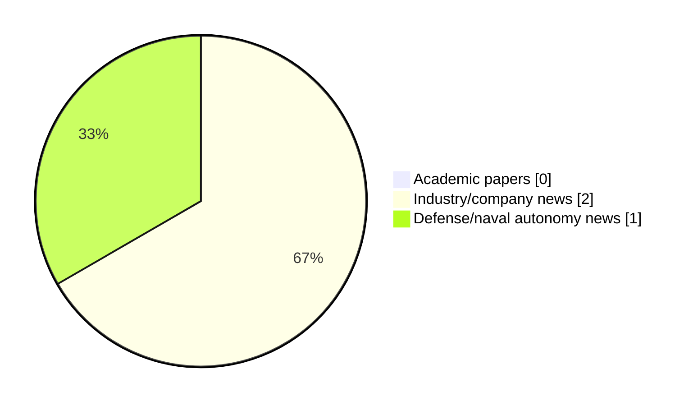

# Maritime Autonomy Watch — 2026-11-03

## Executive Summary

- Total selected items: 3
- Academic papers: 0
- Industry/company news: 2
- Defense/naval autonomy news: 1
- Failed/inaccessible sources: 0

## Contents

- [Analyst Brief](#analyst-brief)
- [Must Read](#must-read)
- [Top Signals Today](#top-signals-today)
- [Topic Signals](#topic-signals)
- [Freshness and Coverage](#freshness-and-coverage)
- [Quality Notes](#quality-notes)
- [Watchlist](#watchlist)
- [Academic Papers](#academic-papers)
- [Industry and Company News](#industry-and-company-news)
- [Defense and Naval Autonomy News](#defense-and-naval-autonomy-news)
- [Source Status Summary](#source-status-summary)

## Analyst Brief

Today's report selected 3 non-duplicate item(s), led by USV operations, general autonomy, AUV navigation. The strongest item is [Australia preps Bluebottle USV for submarine-hunting role](https://www.defensenews.com/global/asia-pacific/2026/11/03/australia-preps-bluebottle-usv-for-submarine-hunting-role/) from defensenews.com.
Coverage is weighted toward academic research (0), with 2 industry and 1 defense signal(s).

## Must Read

- [Australia preps Bluebottle USV for submarine-hunting role](https://www.defensenews.com/global/asia-pacific/2026/11/03/australia-preps-bluebottle-usv-for-submarine-hunting-role/) — Defense signal: USV operations
- [General Dynamics Mission Systems Wins Contract to Expand MEDUSA UUV Program](https://oceannews.com/news/defense/general-dynamics-mission-systems-wins-contract-to-expand-medusa-uuv-program/) — Industry signal: general autonomy
- [University of Plymouth Leads AUV Sensor Trial to Support Floating Offshore Wind Research](https://oceannews.com/news/science-technology/university-of-plymouth-leads-auv-sensor-trial-to-support-floating-offshore-wind-research/) — Industry signal: AUV navigation

## Top Signals Today

- USV operations: 1 selected item(s).
- general autonomy: 1 selected item(s).
- AUV navigation: 1 selected item(s).

## Topic Signals

- USV operations: 1
- general autonomy: 1
- AUV navigation: 1

## Freshness and Coverage

- Newest selected item date: 2026-11-03
- Oldest selected item date: 2026-11-02
- Active/enabled sources: 4
- Sources with access problems: 3
- Quality flags: 0

## Quality Notes

- No quality flags on selected items.

## Watchlist

- No watchlist items today.

### Category Snapshot

| Category | Selected items |
|---|---:|
| Academic papers | 0 |
| Industry/company news | 2 |
| Defense/naval autonomy news | 1 |

## Academic Papers

_Selected items: 0_

No selected items.

## Industry and Company News

_Selected items: 2_

### [General Dynamics Mission Systems Wins Contract to Expand MEDUSA UUV Program](https://oceannews.com/news/defense/general-dynamics-mission-systems-wins-contract-to-expand-medusa-uuv-program/)

- Source: oceannews.com
- Date: 2026-11-02
- Relevance score: 5
- Signal: Industry signal: general autonomy
- Topic tags: general autonomy

**Summary**

General Dynamics Mission Systems has announced that it was awarded a $15 million contract modification to exercise options under a previously awarded contract for the Mining Expendable Delivery Unmanned Submarine Asset (MEDUSA).

**Why it matters**

This item may signal product, market, or deployment momentum in maritime autonomy.

---

### [University of Plymouth Leads AUV Sensor Trial to Support Floating Offshore Wind Research](https://oceannews.com/news/science-technology/university-of-plymouth-leads-auv-sensor-trial-to-support-floating-offshore-wind-research/)

- Source: oceannews.com
- Date: 2026-11-02
- Relevance score: 4.25
- Signal: Industry signal: AUV navigation
- Topic tags: AUV navigation

**Summary**

A combination of monitoring technologies designed to advance understanding of the marine environment and prepare for future floating offshore wind developments has been successfully put to the test off the coast of Plymouth.

**Why it matters**

Signals momentum in underwater autonomy, infrastructure monitoring; useful for tracking product direction, partnerships, and deployment opportunities.

---

## Defense and Naval Autonomy News

_Selected items: 1_

### [Australia preps Bluebottle USV for submarine-hunting role](https://www.defensenews.com/global/asia-pacific/2026/11/03/australia-preps-bluebottle-usv-for-submarine-hunting-role/)

- Source: defensenews.com
- Date: 2026-11-03
- Relevance score: 6
- Signal: Defense signal: USV operations
- Topic tags: USV operations

**Summary**

"I want potential adversaries to understand that, when they see an Ocius Bluebottle USV, it’s a signal to get out of our ocean,” Minister for Defence Industry Pat Conroy said.

**Why it matters**

Signals movement in surface-vessel operations, naval adoption; useful for tracking operational concepts, procurement direction, and fleet integration.

---

## Inaccessible or Failed Sources

- None

## Source Status Summary

| Source | Status | Notes |
|---|---|---|
| arXiv | enabled | API source, 15 items fetched |
| OpenAlex | enabled | API source, 15 items fetched |
| RSS feeds | partial | 82 RSS items fetched; failures: https://www.navalnews.com/feed/: HTTP 503 for https://www.navalnews.com/feed/ |
| SMI MASG News | enabled | HTML source, 10 items fetched |
| IEEE Xplore | disabled | Missing IEEE_XPLORE_API_KEY |
| Elsevier Scopus | enabled | API source, 15 items fetched |
| NewsAPI | disabled | Missing NEWS_API_KEY |

## Metadata

- Generated at: 2026-11-03T14:34:08.176820+01:00
- Date: 2026-11-03
- Repository: ferhannb/MarineRobotics
- Relevance threshold: 4.0
- Deduplication method: DOI, canonical URL, source ID, normalized title, similar recent titles, category caps, and novelty score
