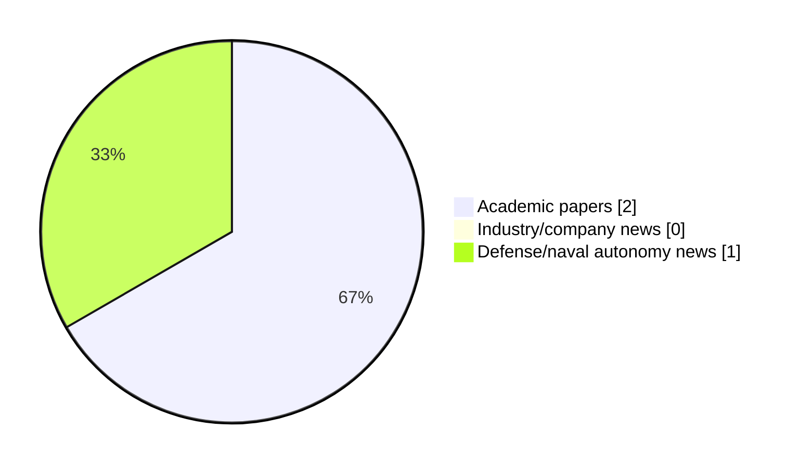

# Maritime Autonomy Watch — 2026-11-04

## Executive Summary

- Total selected items: 3
- Academic papers: 2
- Industry/company news: 0
- Defense/naval autonomy news: 1
- Failed/inaccessible sources: 0

## Contents

- [Analyst Brief](#analyst-brief)
- [Must Read](#must-read)
- [Top Signals Today](#top-signals-today)
- [Topic Signals](#topic-signals)
- [Freshness and Coverage](#freshness-and-coverage)
- [Quality Notes](#quality-notes)
- [Watchlist](#watchlist)
- [Academic Papers](#academic-papers)
- [Industry and Company News](#industry-and-company-news)
- [Defense and Naval Autonomy News](#defense-and-naval-autonomy-news)
- [Source Status Summary](#source-status-summary)

## Analyst Brief

Today's report selected 3 non-duplicate item(s), led by USV operations, planning/control, AUV navigation. The strongest item is [LLM-Assisted Planning with Distributed Onboard Behaviour Tree Execution for Multi-AUV Missions](http://arxiv.org/abs/2611.04518v1) from arXiv.
Coverage is weighted toward academic research (2), with 0 industry and 1 defense signal(s).

## Must Read

- [LLM-Assisted Planning with Distributed Onboard Behaviour Tree Execution for Multi-AUV Missions](http://arxiv.org/abs/2611.04518v1) — Research signal: AUV navigation
- [Türkiye’s MKE Debuts PIRANA Armed USV Variant with Drone Payload](https://www.navalnews.com/event-news/euronaval-2026/2026/11/turkiyes-mke-debuts-pirana-armed-usv-variant-with-drone-payload/) — Defense signal: USV operations
- [Learning Transferable Navigation Skills for USVs via Dynamics-Agnostic Behavioral Priors](https://openalex.org/W7225070428) — Research signal: USV operations

## Top Signals Today

- USV operations: 2 selected item(s).
- planning/control: 2 selected item(s).
- AUV navigation: 1 selected item(s).
- swarm autonomy: 1 selected item(s).
- defense adoption: 1 selected item(s).

## Topic Signals

- USV operations: 2
- planning/control: 2
- AUV navigation: 1
- swarm autonomy: 1
- defense adoption: 1

## Freshness and Coverage

- Newest selected item date: 2026-11-03
- Oldest selected item date: 2026-10-02
- Active/enabled sources: 5
- Sources with access problems: 2
- Quality flags: 0

## Quality Notes

- No quality flags on selected items.

## Watchlist

- No watchlist items today.

### Category Snapshot

| Category | Selected items |
|---|---:|
| Academic papers | 2 |
| Industry/company news | 0 |
| Defense/naval autonomy news | 1 |

## Academic Papers

_Selected items: 2_

### [LLM-Assisted Planning with Distributed Onboard Behaviour Tree Execution for Multi-AUV Missions](http://arxiv.org/abs/2611.04518v1)

- Source: arXiv
- Date: 2026-11-03
- Relevance score: 7.75
- Authors: Ehsan Khorrambakht, Cristiano Caissutti, Andrea Munafo, Andrea Caiti
- Signal: Research signal: AUV navigation
- Topic tags: AUV navigation

**Abstract**

Coordinating autonomous underwater vehicles requires translating operator intent into feasible assignments while preserving autonomous execution when communication is limited. We present a hierarchical framework that couples Large Language Model (LLM) interpretation of natural-language mission instructions with Mixed-Integer Linear Programming (MILP) and distributed Behaviour Tree (BT) execution. The LLM extracts assignment and ordering constraints, which the MILP optimizer combines with vehicle capabilities and temporal requirements. A BT-LLM Bridge distributes the resulting allocations to onboard BT Mission Managers. Per-vehicle Robotic Agents assess local faults and request selective replanning, allowing unaffected vehicles to continue their assigned tasks. Evaluation in a ROS-based AUV simulator compares Qwen-3-8B and Llama-3.1-8B on constraint extraction and tests recovery from sensor degradation and critical vehicle faults.

**Why it matters**

Relevant to underwater autonomy; the work may inform maritime autonomy research, testing priorities, or system design.

---

### [Learning Transferable Navigation Skills for USVs via Dynamics-Agnostic Behavioral Priors](https://openalex.org/W7225070428)

- Source: OpenAlex
- Date: 2026-10-02
- Relevance score: 4.5
- Authors: Federico António Campos Barrezueta
- Signal: Research signal: USV operations
- Topic tags: USV operations, planning/control

**Abstract**

A navegação autónoma em ambientes marítimos continua a constituir um desafio, dado que os veículos de superfície não tripulados (USVs) operam sob dinâmicas complexas, limites de atuação e características específicas de cada plataforma. Embora a sua utilização tenha crescido em áreas como a monitorização ambiental, os levantamentos hidrográficos e a inspeção de infraestruturas marítimas críticas, a garantia de uma navegação robusta e fiável permanece difícil face à incerteza e variabilidade das condições operacionais. Esta tese apresenta um enquadramento transferível de Aprendizagem por Reforço para competências de navegação de USVs, baseado numa fatorização em duas etapas: uma política de base geométrica aprende behavioral priors agnósticos à dinâmica, e um adaptador específico do veículo mapeia essas intenções geométricas para ações de controlo de baixo nível.

**Why it matters**

Relevant to surface-vessel operations; the work may inform maritime autonomy research, testing priorities, or system design.

---

## Industry and Company News

_Selected items: 0_

No selected items.

## Defense and Naval Autonomy News

_Selected items: 1_

### [Türkiye’s MKE Debuts PIRANA Armed USV Variant with Drone Payload](https://www.navalnews.com/event-news/euronaval-2026/2026/11/turkiyes-mke-debuts-pirana-armed-usv-variant-with-drone-payload/)

- Source: navalnews.com
- Date: 2026-11-03
- Relevance score: 6
- Signal: Defense signal: USV operations
- Topic tags: USV operations, swarm autonomy, planning/control, defense adoption

**Summary**

MKE’s latest PIRANA unmanned surface vessel variant is designed to enable enhanced control of kamikaze drone swarms and deliver strikes against targets through a payload bay. The Turkish defense firm revealed the new USV variant at its Euronaval debut. Informed by internal company concepts and real-life lessons learned from the trials with the Turkish Navy,.

**Why it matters**

Signals movement in surface-vessel operations, multi-vehicle coordination, naval adoption; useful for tracking operational concepts, procurement direction, and fleet integration.

---

## Inaccessible or Failed Sources

- None

## Source Status Summary

| Source | Status | Notes |
|---|---|---|
| arXiv | enabled | API source, 15 items fetched |
| OpenAlex | enabled | API source, 15 items fetched |
| RSS feeds | enabled | 92 RSS items fetched |
| SMI MASG News | enabled | HTML source, 10 items fetched |
| IEEE Xplore | disabled | Missing IEEE_XPLORE_API_KEY |
| Elsevier Scopus | enabled | API source, 15 items fetched |
| NewsAPI | disabled | Missing NEWS_API_KEY |

## Metadata

- Generated at: 2026-11-04T14:44:04.808402+01:00
- Date: 2026-11-04
- Repository: ferhannb/MarineRobotics
- Relevance threshold: 4.0
- Deduplication method: DOI, canonical URL, source ID, normalized title, similar recent titles, category caps, and novelty score
