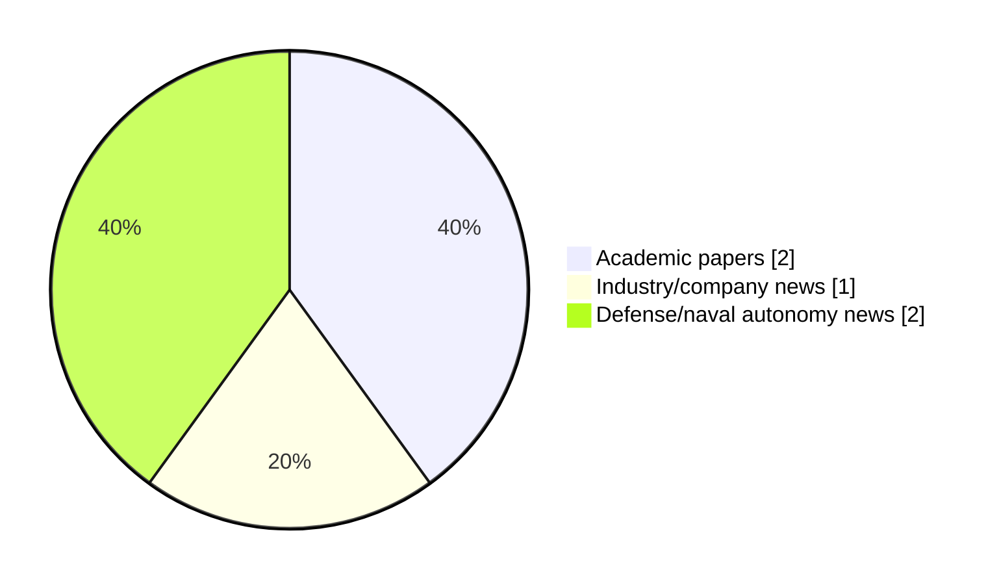

# Maritime Autonomy Watch — 2026-11-05

## Executive Summary

- Total selected items: 5
- Academic papers: 2
- Industry/company news: 1
- Defense/naval autonomy news: 2
- Failed/inaccessible sources: 0

## Contents

- [Analyst Brief](#analyst-brief)
- [Must Read](#must-read)
- [Top Signals Today](#top-signals-today)
- [Topic Signals](#topic-signals)
- [Freshness and Coverage](#freshness-and-coverage)
- [Quality Notes](#quality-notes)
- [Watchlist](#watchlist)
- [Academic Papers](#academic-papers)
- [Industry and Company News](#industry-and-company-news)
- [Defense and Naval Autonomy News](#defense-and-naval-autonomy-news)
- [Source Status Summary](#source-status-summary)

## Analyst Brief

Today's report selected 5 non-duplicate item(s), led by planning/control, USV operations, defense adoption. The strongest item is [Reinforcement Learning-Based 3D Beam Adaptation for Underwater Wireless Optical Communication with AUVs](http://arxiv.org/abs/2610.06407v2) from arXiv.
Coverage is weighted toward academic research (2), with 1 industry and 2 defense signal(s).
Quality caveat: low-score-unique=2.

## Must Read

- [Reinforcement Learning-Based 3D Beam Adaptation for Underwater Wireless Optical Communication with AUVs](http://arxiv.org/abs/2610.06407v2) — Research signal: AUV navigation
- [Zodiac Milpro Unveils Equinox 930, Its First Autonomous, Modular, And Multi-mission USV](https://www.navalnews.com/event-news/euronaval-2026/2026/11/zodiac-milpro-unveils-equinox-930-its-first-autonomous-modular-and-multi-mission-usv/) — Defense signal: USV operations
- [TAMUG Student-Built USV Completes 24-Hour Galveston Bay Survey Mission](https://oceannews.com/news/science-technology/tamug-student-built-usv-completes-24-hour-galveston-bay-survey-mission/) — Industry signal: USV operations
- [Naval Systems & SubSea Craft Demo Rapid Unmanned Systems Integration in AUKUS Exercise off California](https://oceannews.com/news/defense/naval-systems-subsea-craft-demo-rapid-unmanned-systems-integration-in-aukus-exercise-off-california/) — Defense signal: critical infrastructure
- [Nesterov-Accelerated Concurrent Learning for Lyapunov-Based Deep Neural Networks](http://arxiv.org/abs/2610.04200v1) — Research signal: planning/control

## Top Signals Today

- planning/control: 2 selected item(s).
- USV operations: 2 selected item(s).
- defense adoption: 2 selected item(s).
- AUV navigation: 1 selected item(s).
- critical infrastructure: 1 selected item(s).

## Topic Signals

- planning/control: 2
- USV operations: 2
- defense adoption: 2
- AUV navigation: 1
- critical infrastructure: 1
- regulation/legal: 1

## Freshness and Coverage

- Newest selected item date: 2026-11-04
- Oldest selected item date: 2026-10-03
- Active/enabled sources: 5
- Sources with access problems: 2
- Quality flags: 2

## Quality Notes

- low-score-unique: 2

## Watchlist

- [Naval Systems & SubSea Craft Demo Rapid Unmanned Systems Integration in AUKUS Exercise off California](https://oceannews.com/news/defense/naval-systems-subsea-craft-demo-rapid-unmanned-systems-integration-in-aukus-exercise-off-california/) — low-score-unique
- [Nesterov-Accelerated Concurrent Learning for Lyapunov-Based Deep Neural Networks](http://arxiv.org/abs/2610.04200v1) — low-score-unique

### Category Snapshot

| Category | Selected items |
|---|---:|
| Academic papers | 2 |
| Industry/company news | 1 |
| Defense/naval autonomy news | 2 |

## Academic Papers

_Selected items: 2_

### [Reinforcement Learning-Based 3D Beam Adaptation for Underwater Wireless Optical Communication with AUVs](http://arxiv.org/abs/2610.06407v2)

- Source: arXiv
- Date: 2026-10-05
- Relevance score: 8.5
- Authors: Viviana Centritto, Ama Bandara, Sergi Abadal, Evgenii Vinogradov
- Signal: Research signal: AUV navigation
- Topic tags: AUV navigation, planning/control

**Abstract**

Underwater Wireless Optical Communications (UWOC) provide essential high data rates for Autonomous Underwater Vehicles (AUVs), but reliable connectivity is critically affected by transmitter-receiver misalignment. This work addresses the beam pointing problem for a moving AUV subject to unknown ocean currents through a Deep Reinforcement Learning (DRL) framework. We develop a comprehensive 3D UWOC channel model incorporating depth-dependent attenuation, turbulence, and a discrete-ray method to accurately quantify geometric and misalignment losses. The resulting agent jointly optimizes beam steering and divergence angles, learning a policy that prioritizes continuous link maintenance. Evaluated using real oceanographic data, the framework's performance is assessed via the excess outage metric, which isolates outages occurring exclusively due to pointing errors.

**Why it matters**

Relevant to underwater autonomy; the work may inform maritime autonomy research, testing priorities, or system design.

---

### [Nesterov-Accelerated Concurrent Learning for Lyapunov-Based Deep Neural Networks](http://arxiv.org/abs/2610.04200v1)

- Source: arXiv
- Date: 2026-10-03
- Relevance score: 3.5
- Authors: Hossein Papi, Omkar Sudhir Patil
- Signal: Research signal: planning/control
- Topic tags: planning/control, regulation/legal
- Quality flags: low-score-unique

**Abstract**

Concurrent learning (CL) has recently been extended to Lyapunov-based deep neural networks (DNNs) to obtain parameter convergence under finite rather than persistent excitation. However, the existing first-order law converges slowly, especially for high-dimensional systems and overparameterized networks. To address this problem, this paper develops a Nesterov-accelerated concurrent learning (NACL) adaptation law for uncertain second-order control-affine systems. The developed law drives momentum dynamics with recorded state-input data, so that all hidden layers of the DNN are updated online under a verifiable finite excitation condition. A dynamic state-derivative observer is designed to reconstruct the recorded input without acceleration measurements.

**Why it matters**

Relevant to underwater autonomy; the work may inform maritime autonomy research, testing priorities, or system design.

---

## Industry and Company News

_Selected items: 1_

### [TAMUG Student-Built USV Completes 24-Hour Galveston Bay Survey Mission](https://oceannews.com/news/science-technology/tamug-student-built-usv-completes-24-hour-galveston-bay-survey-mission/)

- Source: oceannews.com
- Date: 2026-11-04
- Relevance score: 4.5
- Signal: Industry signal: USV operations
- Topic tags: USV operations

**Summary**

Often, the power of computer-based models and simulations is taken for granted. While models and simulations serve as incredible tools for predicting how different variables affect the environment, their utility is entirely lost if they do not reflect reality. Knowing this, scientists infuse grounded, real-world data into the models they use to ensure they are as accurate as possible. The more abundantly this data can be provided, the better.

**Why it matters**

Signals momentum in surface-vessel operations; useful for tracking product direction, partnerships, and deployment opportunities.

---

## Defense and Naval Autonomy News

_Selected items: 2_

### [Zodiac Milpro Unveils Equinox 930, Its First Autonomous, Modular, And Multi-mission USV](https://www.navalnews.com/event-news/euronaval-2026/2026/11/zodiac-milpro-unveils-equinox-930-its-first-autonomous-modular-and-multi-mission-usv/)

- Source: navalnews.com
- Date: 2026-11-04
- Relevance score: 6
- Signal: Defense signal: USV operations
- Topic tags: USV operations, defense adoption

**Summary**

Zodiac Milpro announces the launch of the EQUINOX 930 USV, its first Uncrewed Surface Vessel (USV), at Euronaval 2026. Zodiac Milpro press release Building on its recognised expertise in the design and production of military and professional boats, Zodiac Milpro is extending its know-how to uncrewed naval platforms. The EQUINOX 930 USV combines a robust,.

**Why it matters**

Signals movement in surface-vessel operations, naval adoption; useful for tracking operational concepts, procurement direction, and fleet integration.

---

### [Naval Systems & SubSea Craft Demo Rapid Unmanned Systems Integration in AUKUS Exercise off California](https://oceannews.com/news/defense/naval-systems-subsea-craft-demo-rapid-unmanned-systems-integration-in-aukus-exercise-off-california/)

- Source: oceannews.com
- Date: 2026-11-04
- Relevance score: 3.5
- Signal: Defense signal: critical infrastructure
- Topic tags: critical infrastructure, defense adoption
- Quality flags: low-score-unique
- Also reported by: https://www.marinelink.com/news/rss

**Summary**

US-based Naval Systems, in partnership with Dragonfish Technical Solutions (NSI/DF) and UK-based SubSea Craft have successfully demonstrated an integrated suite of advanced unmanned maritime systems during a multinational maritime exercise conducted October 5–8 off the coast of California.

**Why it matters**

Signals movement in naval adoption; useful for tracking operational concepts, procurement direction, and fleet integration.

---

## Inaccessible or Failed Sources

- None

## Source Status Summary

| Source | Status | Notes |
|---|---|---|
| arXiv | enabled | API source, 15 items fetched |
| OpenAlex | enabled | API source, 15 items fetched |
| RSS feeds | enabled | 92 RSS items fetched |
| SMI MASG News | enabled | HTML source, 10 items fetched |
| IEEE Xplore | disabled | Missing IEEE_XPLORE_API_KEY |
| Elsevier Scopus | enabled | API source, 15 items fetched |
| NewsAPI | disabled | Missing NEWS_API_KEY |

## Metadata

- Generated at: 2026-11-05T14:56:23.339852+01:00
- Date: 2026-11-05
- Repository: ferhannb/MarineRobotics
- Relevance threshold: 4.0
- Deduplication method: DOI, canonical URL, source ID, normalized title, similar recent titles, category caps, and novelty score
