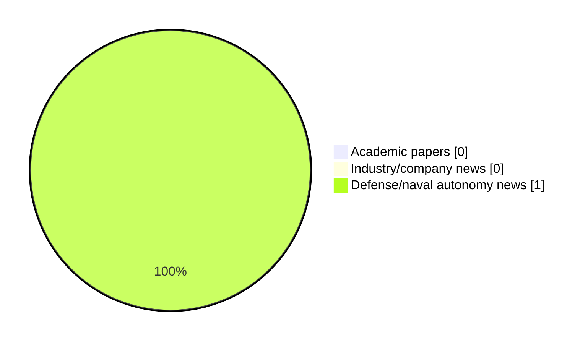

# Maritime Autonomy Watch — 2026-11-06

## Executive Summary

- Total selected items: 1
- Academic papers: 0
- Industry/company news: 0
- Defense/naval autonomy news: 1
- Failed/inaccessible sources: 1

## Contents

- [Analyst Brief](#analyst-brief)
- [Must Read](#must-read)
- [Top Signals Today](#top-signals-today)
- [Topic Signals](#topic-signals)
- [Freshness and Coverage](#freshness-and-coverage)
- [Quality Notes](#quality-notes)
- [Watchlist](#watchlist)
- [Academic Papers](#academic-papers)
- [Industry and Company News](#industry-and-company-news)
- [Defense and Naval Autonomy News](#defense-and-naval-autonomy-news)
- [Source Status Summary](#source-status-summary)

## Analyst Brief

Today's report selected 1 non-duplicate item(s), led by AUV navigation, defense adoption. The strongest item is [EUROATLAS & EvoLogics Enter Series Production for GREYSHARK AUV](https://www.oceansciencetechnology.com/news/euroatlas-evologics-enter-series-production-for-greyshark-auv/) from oceansciencetechnology.com.
Coverage is weighted toward academic research (0), with 0 industry and 1 defense signal(s).

## Must Read

- [EUROATLAS & EvoLogics Enter Series Production for GREYSHARK AUV](https://www.oceansciencetechnology.com/news/euroatlas-evologics-enter-series-production-for-greyshark-auv/) — Defense signal: AUV navigation

## Top Signals Today

- AUV navigation: 1 selected item(s).
- defense adoption: 1 selected item(s).

## Topic Signals

- AUV navigation: 1
- defense adoption: 1

## Freshness and Coverage

- Newest selected item date: 2026-11-06
- Oldest selected item date: 2026-11-06
- Active/enabled sources: 4
- Sources with access problems: 3
- Quality flags: 0

## Quality Notes

- No quality flags on selected items.

## Watchlist

- No watchlist items today.

### Category Snapshot

| Category | Selected items |
|---|---:|
| Academic papers | 0 |
| Industry/company news | 0 |
| Defense/naval autonomy news | 1 |

## Academic Papers

_Selected items: 0_

No selected items.

## Industry and Company News

_Selected items: 0_

No selected items.

## Defense and Naval Autonomy News

_Selected items: 1_

### [EUROATLAS & EvoLogics Enter Series Production for GREYSHARK AUV](https://www.oceansciencetechnology.com/news/euroatlas-evologics-enter-series-production-for-greyshark-auv/)

- Source: oceansciencetechnology.com
- Date: 2026-11-06
- Relevance score: 7
- Signal: Defense signal: AUV navigation
- Topic tags: AUV navigation, defense adoption

**Summary**

Bremen-based EUROATLAS and Berlin-based EvoLogics have unveiled the first series-production GREYSHARK autonomous underwater vehicle at EURONAVAL 2026 in Paris, confirming.

**Why it matters**

Signals movement in underwater autonomy, naval adoption; useful for tracking operational concepts, procurement direction, and fleet integration.

---

## Inaccessible or Failed Sources

- OpenAlex: HTTP 503 for https://api.openalex.org/works?search=maritime+autonomy+marine+robotics+autonomous+vessel+autonomous+mission+autonomous+surface+vessel&per-page=15&sort=publication_date%3Adesc

## Source Status Summary

| Source | Status | Notes |
|---|---|---|
| arXiv | enabled | API source, 15 items fetched |
| OpenAlex | failed | HTTP 503 for https://api.openalex.org/works?search=maritime+autonomy+marine+robotics+autonomous+vessel+autonomous+mission+autonomous+surface+vessel&per-page=15&sort=publication_date%3Adesc |
| RSS feeds | enabled | 92 RSS items fetched |
| SMI MASG News | enabled | HTML source, 10 items fetched |
| IEEE Xplore | disabled | Missing IEEE_XPLORE_API_KEY |
| Elsevier Scopus | enabled | API source, 15 items fetched |
| NewsAPI | disabled | Missing NEWS_API_KEY |

## Metadata

- Generated at: 2026-11-06T14:41:41.061216+01:00
- Date: 2026-11-06
- Repository: ferhannb/MarineRobotics
- Relevance threshold: 4.0
- Deduplication method: DOI, canonical URL, source ID, normalized title, similar recent titles, category caps, and novelty score
