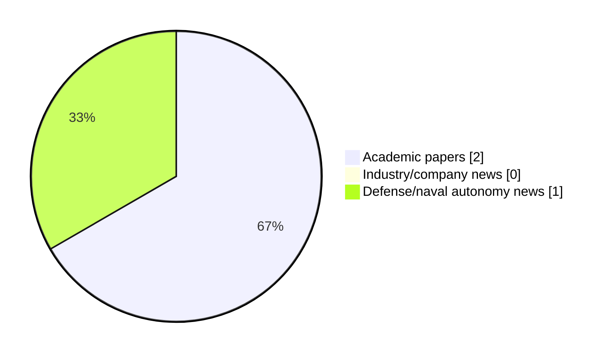

# Maritime Autonomy Watch — 2026-11-07

## Executive Summary

- Total selected items: 3
- Academic papers: 2
- Industry/company news: 0
- Defense/naval autonomy news: 1
- Failed/inaccessible sources: 0

## Contents

- [Analyst Brief](#analyst-brief)
- [Must Read](#must-read)
- [Top Signals Today](#top-signals-today)
- [Topic Signals](#topic-signals)
- [Freshness and Coverage](#freshness-and-coverage)
- [Quality Notes](#quality-notes)
- [Watchlist](#watchlist)
- [Academic Papers](#academic-papers)
- [Industry and Company News](#industry-and-company-news)
- [Defense and Naval Autonomy News](#defense-and-naval-autonomy-news)
- [Source Status Summary](#source-status-summary)

## Analyst Brief

Today's report selected 3 non-duplicate item(s), led by AUV navigation, USV operations, swarm autonomy. The strongest item is [Virtual uncrewed system sampling in the hurricane environment. Part 1: rigid-wing surface vehicle simulator](https://doi.org/10.3389/fmars.2026.1884756) from OpenAlex.
Coverage is weighted toward academic research (2), with 0 industry and 1 defense signal(s).
Quality caveat: low-score-unique=1.

## Must Read

- [Virtual uncrewed system sampling in the hurricane environment. Part 1: rigid-wing surface vehicle simulator](https://doi.org/10.3389/fmars.2026.1884756) — Research signal: USV operations
- [NAViLoss: An Underwater Navigation-Aware Dual-Residual Objective for Physics-Consistent Learning](http://arxiv.org/abs/2610.09690v1) — Research signal: AUV navigation
- [TII and Naval Group explore joint development of underwater drones](https://www.naval-technology.com/news/tii-naval-group-underwater-drones/) — Defense signal: AUV navigation

## Top Signals Today

- AUV navigation: 2 selected item(s).
- USV operations: 1 selected item(s).
- swarm autonomy: 1 selected item(s).
- planning/control: 1 selected item(s).
- perception: 1 selected item(s).

## Topic Signals

- AUV navigation: 2
- USV operations: 1
- swarm autonomy: 1
- planning/control: 1
- perception: 1
- defense adoption: 1

## Freshness and Coverage

- Newest selected item date: 2026-11-06
- Oldest selected item date: 2026-10-06
- Active/enabled sources: 5
- Sources with access problems: 2
- Quality flags: 1

## Quality Notes

- low-score-unique: 1

## Watchlist

- [TII and Naval Group explore joint development of underwater drones](https://www.naval-technology.com/news/tii-naval-group-underwater-drones/) — low-score-unique

### Category Snapshot

| Category | Selected items |
|---|---:|
| Academic papers | 2 |
| Industry/company news | 0 |
| Defense/naval autonomy news | 1 |

## Academic Papers

_Selected items: 2_

### [Virtual uncrewed system sampling in the hurricane environment. Part 1: rigid-wing surface vehicle simulator](https://doi.org/10.3389/fmars.2026.1884756)

- Source: OpenAlex
- Date: 2026-10-06
- Relevance score: 10
- Authors: Edoardo Mazza, Chidong Zhang, A. M. Chiodi
- DOI: 10.3389/fmars.2026.1884756
- Signal: Research signal: USV operations
- Topic tags: USV operations, swarm autonomy, planning/control

**Abstract**

Uncrewed vehicles (UxS) are the frontier of atmospheric and oceanic measurements in extreme regimes and remote areas. The combination of Uncrewed Surface Vehicles (USVs), Uncrewed Underwater Vehicles (UUVs) and Uncrewed Aerial Vehicles (UAVs) has the potential to transform air-sea coupling observations through co-located sampling of the lower atmosphere, upper ocean and air-sea interface. Although individual platforms have reached a relatively mature operational stage, designing coordinated missions remains challenging. UxS navigation is strongly affected by environmental conditions their and deployment can be logistically complex and poorly repeatable.

**Why it matters**

Relevant to underwater autonomy, surface-vessel operations, multi-vehicle coordination; the work may inform maritime autonomy research, testing priorities, or system design.

---

### [NAViLoss: An Underwater Navigation-Aware Dual-Residual Objective for Physics-Consistent Learning](http://arxiv.org/abs/2610.09690v1)

- Source: arXiv
- Date: 2026-10-07
- Relevance score: 8.5
- Authors: Arup Kumar Sahoo, Itzik Klein
- Signal: Research signal: AUV navigation
- Topic tags: AUV navigation, perception

**Abstract**

Autonomous underwater vehicles (AUVs) commonly rely on inertial navigation systems (INS) aided by Doppler velocity logs (DVLs) for reliable underwater navigation. Accurate DVL velocity estimation is therefore essential for successful operation. Recent learning-based methods have demonstrated improved DVL velocity estimation, particularly under degraded measurement conditions. However, their training objectives typically rely on conventional regression losses that are highly sensitive to large residuals and corrupted observations. Additionally, they do not explicitly account for the physical consistency and measurement uncertainty associated with the underlying sensing process. To address these limitations, this paper introduces navigation-aware loss (NAViLoss), a robust and uncertainty-aware objective function for learning-based AUV velocity estimation.

**Why it matters**

Relevant to underwater autonomy; the work may inform maritime autonomy research, testing priorities, or system design.

---

## Industry and Company News

_Selected items: 0_

No selected items.

## Defense and Naval Autonomy News

_Selected items: 1_

### [TII and Naval Group explore joint development of underwater drones](https://www.naval-technology.com/news/tii-naval-group-underwater-drones/)

- Source: naval-technology.com
- Date: 2026-11-06
- Relevance score: 3.5
- Signal: Defense signal: AUV navigation
- Topic tags: AUV navigation, defense adoption
- Quality flags: low-score-unique

**Summary**

Naval Group has signed a cooperation agreement with Abu Dhabi’s Technology Innovation Institute (TII), aimed at accelerating the “joint development” of autonomous underwater vehicles.

**Why it matters**

Signals movement in underwater autonomy, naval adoption; useful for tracking operational concepts, procurement direction, and fleet integration.

---

## Inaccessible or Failed Sources

- None

## Source Status Summary

| Source | Status | Notes |
|---|---|---|
| arXiv | enabled | API source, 15 items fetched |
| OpenAlex | enabled | API source, 15 items fetched |
| RSS feeds | enabled | 92 RSS items fetched |
| SMI MASG News | enabled | HTML source, 10 items fetched |
| IEEE Xplore | disabled | Missing IEEE_XPLORE_API_KEY |
| Elsevier Scopus | enabled | API source, 15 items fetched |
| NewsAPI | disabled | Missing NEWS_API_KEY |

## Metadata

- Generated at: 2026-11-07T13:23:45.618819+01:00
- Date: 2026-11-07
- Repository: ferhannb/MarineRobotics
- Relevance threshold: 4.0
- Deduplication method: DOI, canonical URL, source ID, normalized title, similar recent titles, category caps, and novelty score
