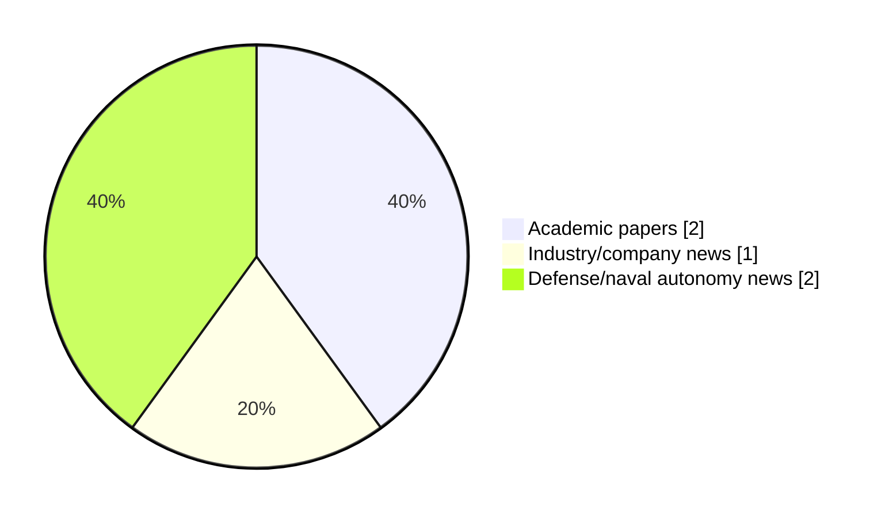

# Maritime Autonomy Watch — 2026-11-09

## Executive Summary

- Total selected items: 5
- Academic papers: 2
- Industry/company news: 1
- Defense/naval autonomy news: 2
- Failed/inaccessible sources: 1

## Contents

- [Analyst Brief](#analyst-brief)
- [Must Read](#must-read)
- [Top Signals Today](#top-signals-today)
- [Topic Signals](#topic-signals)
- [Freshness and Coverage](#freshness-and-coverage)
- [Quality Notes](#quality-notes)
- [Watchlist](#watchlist)
- [Academic Papers](#academic-papers)
- [Industry and Company News](#industry-and-company-news)
- [Defense and Naval Autonomy News](#defense-and-naval-autonomy-news)
- [Source Status Summary](#source-status-summary)

## Analyst Brief

Today's report selected 5 non-duplicate item(s), led by USV operations, AUV navigation, swarm autonomy. The strongest item is [FATHOM: World-Model-Guided Diffusion Action-Trajectory Selection for Sparse-Marker AUV Tracking](http://arxiv.org/abs/2611.08898v1) from arXiv.
Coverage is weighted toward academic research (2), with 1 industry and 2 defense signal(s).
Quality caveat: low-score-unique=1, missing-summary=1, date-anomaly=1.

## Must Read

- [FATHOM: World-Model-Guided Diffusion Action-Trajectory Selection for Sparse-Marker AUV Tracking](http://arxiv.org/abs/2611.08898v1) — Research signal: AUV navigation
- [MARTAC Delivers Devil Ray T38 USVs to Philippine Marine Corps](https://oceannews.com/news/defense/martac-delivers-devil-ray-t38-usvs-to-philippine-marine-corps/) — Industry signal: USV operations
- [Kongsberg Maritime Unveils Arctic Hunter USV](https://www.marinelink.com/news/kongsberg-maritime-unveils-arctic-hunter-544223) — Defense signal: USV operations
- [Navantia unveils its vision for next-generation naval capabilities at Euronaval 2026](https://www.navalnews.com/event-news/euronaval-2026/2026/11/navantia-unveils-its-vision-for-next-generation-naval-capabilities-at-euronaval-2026/) — Defense signal: USV operations

## Top Signals Today

- USV operations: 3 selected item(s).
- AUV navigation: 2 selected item(s).
- swarm autonomy: 2 selected item(s).
- planning/control: 2 selected item(s).
- defense adoption: 2 selected item(s).

## Topic Signals

- USV operations: 3
- AUV navigation: 2
- swarm autonomy: 2
- planning/control: 2
- defense adoption: 2
- perception: 1

## Freshness and Coverage

- Newest selected item date: 2027-03-01
- Oldest selected item date: 2026-11-06
- Active/enabled sources: 4
- Sources with access problems: 3
- Quality flags: 3

## Quality Notes

- low-score-unique: 1
- missing-summary: 1
- date-anomaly: 1
- Date anomalies: [Formation control of AUVs for enabling safe and efficient marine operations](https://api.elsevier.com/content/abstract/scopus_id/105046585164) reports 2027-03-01

## Watchlist

- [Navantia unveils its vision for next-generation naval capabilities at Euronaval 2026](https://www.navalnews.com/event-news/euronaval-2026/2026/11/navantia-unveils-its-vision-for-next-generation-naval-capabilities-at-euronaval-2026/) — low-score-unique
- [Formation control of AUVs for enabling safe and efficient marine operations](https://api.elsevier.com/content/abstract/scopus_id/105046585164) — missing-summary, date-anomaly

### Category Snapshot

| Category | Selected items |
|---|---:|
| Academic papers | 2 |
| Industry/company news | 1 |
| Defense/naval autonomy news | 2 |

## Academic Papers

_Selected items: 2_

### [FATHOM: World-Model-Guided Diffusion Action-Trajectory Selection for Sparse-Marker AUV Tracking](http://arxiv.org/abs/2611.08898v1)

- Source: arXiv
- Date: 2026-11-06
- Relevance score: 8.5
- Authors: Xiaorui Wang, Zeyu Sha, Mingyang Yang, David Chen Wang, Feitian Zhang
- Signal: Research signal: AUV navigation
- Topic tags: AUV navigation, swarm autonomy, perception, planning/control

**Abstract**

Reliable relative tracking is fundamental to cooperative autonomous underwater vehicles (AUVs), yet remains challenging under nonlinear vehicle dynamics and degraded underwater visual conditions. Active light markers improve robustness to appearance variation, but provide deliberately sparse observations that can become incomplete or corrupted by occlusion, reflections, and detection noise during dynamic motion. To address the resulting partial-observation control problem, this paper proposes FATHOM, a world-model-guided diffusion action-trajectory selection framework for sparse-marker AUV tracking. FATHOM first integrates structured marker observations, inertial measurements, action history, and temporal dynamics into a predictive tracking belief using a multimodal task-supervised recurrent state-space model.

**Why it matters**

Relevant to underwater autonomy, planning and control; the work may inform maritime autonomy research, testing priorities, or system design.

---

### [Formation control of AUVs for enabling safe and efficient marine operations](https://api.elsevier.com/content/abstract/scopus_id/105046585164)

- Source: Elsevier Scopus
- Date: 2027-03-01
- Relevance score: 4.25
- DOI: 10.1016/j.apm.2026.117232
- Signal: Research signal: AUV navigation
- Topic tags: AUV navigation, swarm autonomy, planning/control
- Quality flags: missing-summary, date-anomaly

**Abstract**

No summary available.

**Why it matters**

Relevant to underwater autonomy, multi-vehicle coordination; the work may inform maritime autonomy research, testing priorities, or system design.

---

## Industry and Company News

_Selected items: 1_

### [MARTAC Delivers Devil Ray T38 USVs to Philippine Marine Corps](https://oceannews.com/news/defense/martac-delivers-devil-ray-t38-usvs-to-philippine-marine-corps/)

- Source: oceannews.com
- Date: 2026-11-09
- Relevance score: 8.25
- Signal: Industry signal: USV operations
- Topic tags: USV operations

**Summary**

Maritime Tactical Systems, Inc. (MARTAC), a leading US provider of fully autonomous unmanned surface vessels (USVs), has announced that it has delivered two Devil Ray™ T38 USVs to the Philippine Marine Corps (PMC), providing the service with an end-to-end asymmetric maritime capability for protecting Philippine national sovereignty.

**Why it matters**

Signals momentum in surface-vessel operations; useful for tracking product direction, partnerships, and deployment opportunities.

---

## Defense and Naval Autonomy News

_Selected items: 2_

### [Kongsberg Maritime Unveils Arctic Hunter USV](https://www.marinelink.com/news/kongsberg-maritime-unveils-arctic-hunter-544223)

- Source: marinelink.com
- Date: 2026-11-09
- Relevance score: 6.75
- Signal: Defense signal: USV operations
- Topic tags: USV operations, defense adoption
- Also reported by: https://oceannews.com/feed/, https://www.navalnews.com/feed/

**Summary**

Norwegian maritime technology company Kongsberg Maritime has unveiled the Arctic Hunter USV, a new class of uncrewed surface vessels designed for rapid integration and deployment into Hybrid Fleets. In response to the UK Royal Navy’s development of its hybrid fleet of crewed and uncrewed assets…

**Why it matters**

Signals movement in surface-vessel operations, naval adoption; useful for tracking operational concepts, procurement direction, and fleet integration.

---

### [Navantia unveils its vision for next-generation naval capabilities at Euronaval 2026](https://www.navalnews.com/event-news/euronaval-2026/2026/11/navantia-unveils-its-vision-for-next-generation-naval-capabilities-at-euronaval-2026/)

- Source: navalnews.com
- Date: 2026-11-09
- Relevance score: 3.5
- Signal: Defense signal: USV operations
- Topic tags: USV operations, defense adoption
- Quality flags: low-score-unique

**Summary**

Navantia has presented its vision for the evolution of naval capabilities at Euronaval 2026, against an operational backdrop characterised by more complex threats, the increasing digitalisation of the battlespace and the introduction of autonomous systems. Naval combat cloud, F110 IAMD frigate and LASV-75 autonomous surface vessel have been the focal points of a proposal that.

**Why it matters**

Signals movement in surface-vessel operations, naval adoption; useful for tracking operational concepts, procurement direction, and fleet integration.

---

## Inaccessible or Failed Sources

- OpenAlex: HTTP 429 for https://api.openalex.org/works?search=maritime+autonomy+marine+robotics+autonomous+vessel+autonomous+mission+autonomous+surface+vessel&per-page=15&sort=publication_date%3Adesc

## Source Status Summary

| Source | Status | Notes |
|---|---|---|
| arXiv | enabled | API source, 15 items fetched |
| OpenAlex | failed | HTTP 429 for https://api.openalex.org/works?search=maritime+autonomy+marine+robotics+autonomous+vessel+autonomous+mission+autonomous+surface+vessel&per-page=15&sort=publication_date%3Adesc |
| RSS feeds | enabled | 92 RSS items fetched |
| SMI MASG News | enabled | HTML source, 10 items fetched |
| IEEE Xplore | disabled | Missing IEEE_XPLORE_API_KEY |
| Elsevier Scopus | enabled | API source, 15 items fetched |
| NewsAPI | disabled | Missing NEWS_API_KEY |

## Metadata

- Generated at: 2026-11-09T16:03:54.814501+01:00
- Date: 2026-11-09
- Repository: ferhannb/MarineRobotics
- Relevance threshold: 4.0
- Deduplication method: DOI, canonical URL, source ID, normalized title, similar recent titles, category caps, and novelty score
