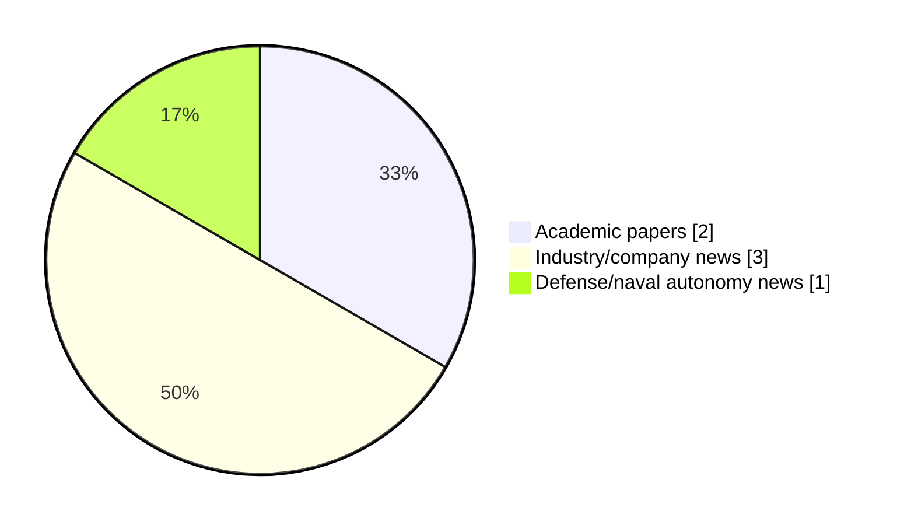

# Maritime Autonomy Watch — 2026-11-10

## Executive Summary

- Total selected items: 6
- Academic papers: 2
- Industry/company news: 3
- Defense/naval autonomy news: 1
- Failed/inaccessible sources: 1

## Contents

- [Analyst Brief](#analyst-brief)
- [Must Read](#must-read)
- [Top Signals Today](#top-signals-today)
- [Topic Signals](#topic-signals)
- [Freshness and Coverage](#freshness-and-coverage)
- [Quality Notes](#quality-notes)
- [Watchlist](#watchlist)
- [Academic Papers](#academic-papers)
- [Industry and Company News](#industry-and-company-news)
- [Defense and Naval Autonomy News](#defense-and-naval-autonomy-news)
- [Source Status Summary](#source-status-summary)

## Analyst Brief

Today's report selected 6 non-duplicate item(s), led by USV operations, AUV navigation, underwater communications. The strongest item is [Coast Guard Wraps Up Seasonal Great Lakes USV Evaluation](https://www.marinelink.com/news/coast-guard-wraps-seasonal-great-lakes-544244) from marinelink.com.
Coverage is weighted toward academic research (2), with 3 industry and 1 defense signal(s).
Quality caveat: low-score-unique=2, missing-summary=1, date-anomaly=1.

## Must Read

- [Coast Guard Wraps Up Seasonal Great Lakes USV Evaluation](https://www.marinelink.com/news/coast-guard-wraps-seasonal-great-lakes-544244) — Industry signal: USV operations
- [Semantic communication for the internet of underwater things: Architectures, applications, challenges, and future directions](https://doi.org/10.1016/j.adhoc.2026.104432) — Research signal: AUV navigation
- [Integrated Electronics Platform Introduced for Custom USV Development](https://www.oceansciencetechnology.com/news/integrated-electronics-platform-introduced-for-custom-usv-development/) — Industry signal: USV operations
- [General Atomics Ranger UUV to Support Large Payloads, UAVs](https://www.navalnews.com/event-news/euronaval-2026/2026/11/general-atomics-ranger-uuv-to-support-large-payloads-uavs/) — Defense signal: defense adoption
- [Lithium-Sulfur Battery Cells Pass 1,000-Meter Pressure Tests for UUVs](https://www.oceansciencetechnology.com/news/lithium-sulfur-battery-cells-pass-1000-meter-pressure-tests-for-uuvs/) — Industry signal: general autonomy

## Top Signals Today

- USV operations: 2 selected item(s).
- AUV navigation: 2 selected item(s).
- underwater communications: 1 selected item(s).
- perception: 1 selected item(s).
- critical infrastructure: 1 selected item(s).

## Topic Signals

- USV operations: 2
- AUV navigation: 2
- underwater communications: 1
- perception: 1
- critical infrastructure: 1
- planning/control: 1
- defense adoption: 1
- general autonomy: 1

## Freshness and Coverage

- Newest selected item date: 2027-03-01
- Oldest selected item date: 2026-10-10
- Active/enabled sources: 4
- Sources with access problems: 3
- Quality flags: 4

## Quality Notes

- low-score-unique: 2
- missing-summary: 1
- date-anomaly: 1
- Date anomalies: [Fusion-driven geometry-constrained latent flow learning for robust AUV motion anticipation from heterogeneous 3D observations](https://api.elsevier.com/content/abstract/scopus_id/105051060825) reports 2027-03-01

## Watchlist

- [Lithium-Sulfur Battery Cells Pass 1,000-Meter Pressure Tests for UUVs](https://www.oceansciencetechnology.com/news/lithium-sulfur-battery-cells-pass-1000-meter-pressure-tests-for-uuvs/) — low-score-unique
- [Fusion-driven geometry-constrained latent flow learning for robust AUV motion anticipation from heterogeneous 3D observations](https://api.elsevier.com/content/abstract/scopus_id/105051060825) — missing-summary, date-anomaly, low-score-unique

### Category Snapshot

| Category | Selected items |
|---|---:|
| Academic papers | 2 |
| Industry/company news | 3 |
| Defense/naval autonomy news | 1 |

## Academic Papers

_Selected items: 2_

### [Semantic communication for the internet of underwater things: Architectures, applications, challenges, and future directions](https://doi.org/10.1016/j.adhoc.2026.104432)

- Source: OpenAlex
- Date: 2026-10-10
- Relevance score: 7.75
- Authors: Ruhul Amin Khalil, Asiya Jehangir, Hanane Lamaazi, Sadaf Rubab, Nasir Saeed
- DOI: 10.1016/j.adhoc.2026.104432
- Signal: Research signal: AUV navigation
- Topic tags: AUV navigation, underwater communications, perception, critical infrastructure

**Abstract**

The Internet of Underwater Things (IoUT) supports marine sensing, environmental monitoring, subsea inspection, and autonomous underwater operations. However, IoUT communication is constrained by limited bandwidth, long propagation delay, time-varying underwater channels, intermittent connectivity, and strict energy budgets. Semantic Communication (SC) offers a promising alternative by transmitting task-relevant meaning rather than raw data, thereby improving communication efficiency in resource-constrained underwater networks. This paper presents a critical and feasibility-aware survey of SC for IoUT, focusing on architectures, opportunities, challenges, limitations, and future research directions. We first review the fundamentals of SC-enabled IoUT systems, including semantic representations, layered architectures, impairment-aware semantic channel modeling, and task-oriented evaluation metrics.

**Why it matters**

Relevant to underwater autonomy, infrastructure monitoring; the work may inform maritime autonomy research, testing priorities, or system design.

---

### [Fusion-driven geometry-constrained latent flow learning for robust AUV motion anticipation from heterogeneous 3D observations](https://api.elsevier.com/content/abstract/scopus_id/105051060825)

- Source: Elsevier Scopus
- Date: 2027-03-01
- Relevance score: 3.5
- DOI: 10.1016/j.inffus.2026.104764
- Signal: Research signal: AUV navigation
- Topic tags: AUV navigation
- Quality flags: missing-summary, date-anomaly, low-score-unique

**Abstract**

No summary available.

**Why it matters**

Relevant to underwater autonomy; the work may inform maritime autonomy research, testing priorities, or system design.

---

## Industry and Company News

_Selected items: 3_

### [Coast Guard Wraps Up Seasonal Great Lakes USV Evaluation](https://www.marinelink.com/news/coast-guard-wraps-seasonal-great-lakes-544244)

- Source: marinelink.com
- Date: 2026-11-09
- Relevance score: 10
- Signal: Industry signal: USV operations
- Topic tags: USV operations

**Summary**

The U.S. Coast Guard is concluding its scheduled 2026 seasonal evaluation of six Saildrone Voyager Unmanned Surface Vehicles (USVs) on the Great Lakes this week ahead of forecasted winter icing conditions. Following the completion of this seasonal evaluation…

**Why it matters**

Signals momentum in surface-vessel operations; useful for tracking product direction, partnerships, and deployment opportunities.

---

### [Integrated Electronics Platform Introduced for Custom USV Development](https://www.oceansciencetechnology.com/news/integrated-electronics-platform-introduced-for-custom-usv-development/)

- Source: oceansciencetechnology.com
- Date: 2026-11-10
- Relevance score: 5.25
- Signal: Industry signal: USV operations
- Topic tags: USV operations, planning/control

**Summary**

AGISTAR has introduced USV MAKER, a compact, integrated electronic control platform designed to simplify the development of custom Unmanned Surface.

**Why it matters**

Signals momentum in surface-vessel operations; useful for tracking product direction, partnerships, and deployment opportunities.

---

### [Lithium-Sulfur Battery Cells Pass 1,000-Meter Pressure Tests for UUVs](https://www.oceansciencetechnology.com/news/lithium-sulfur-battery-cells-pass-1000-meter-pressure-tests-for-uuvs/)

- Source: oceansciencetechnology.com
- Date: 2026-11-10
- Relevance score: 3.5
- Signal: Industry signal: general autonomy
- Topic tags: general autonomy
- Quality flags: low-score-unique

**Summary**

Li-S Energy’s lithium-sulfur battery cells have successfully completed pressure testing equivalent to depths of 1,000 meters, marking a key step.

**Why it matters**

This item may signal product, market, or deployment momentum in maritime autonomy.

---

## Defense and Naval Autonomy News

_Selected items: 1_

### [General Atomics Ranger UUV to Support Large Payloads, UAVs](https://www.navalnews.com/event-news/euronaval-2026/2026/11/general-atomics-ranger-uuv-to-support-large-payloads-uavs/)

- Source: navalnews.com
- Date: 2026-11-09
- Relevance score: 5
- Signal: Defense signal: defense adoption
- Topic tags: defense adoption

**Summary**

At Euronaval 2026, General Atomics revealed its Ranger and GA-Ray long-range UUVs, built for multi-year missions and launching sub-drones and payloads.

**Why it matters**

Signals movement in naval adoption; useful for tracking operational concepts, procurement direction, and fleet integration.

---

## Inaccessible or Failed Sources

- arXiv: The read operation timed out

## Source Status Summary

| Source | Status | Notes |
|---|---|---|
| arXiv | failed | The read operation timed out |
| OpenAlex | enabled | API source, 15 items fetched |
| RSS feeds | enabled | 92 RSS items fetched |
| SMI MASG News | enabled | HTML source, 10 items fetched |
| IEEE Xplore | disabled | Missing IEEE_XPLORE_API_KEY |
| Elsevier Scopus | enabled | API source, 15 items fetched |
| NewsAPI | disabled | Missing NEWS_API_KEY |

## Metadata

- Generated at: 2026-11-10T15:15:53.923016+01:00
- Date: 2026-11-10
- Repository: ferhannb/MarineRobotics
- Relevance threshold: 4.0
- Deduplication method: DOI, canonical URL, source ID, normalized title, similar recent titles, category caps, and novelty score
