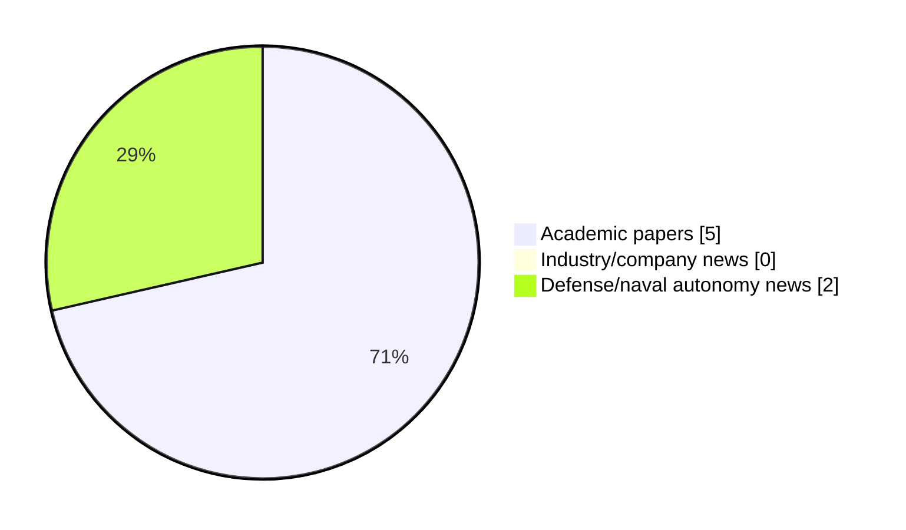

# Maritime Autonomy Watch — 2026-11-11

## Executive Summary

- Total selected items: 7
- Academic papers: 5
- Industry/company news: 0
- Defense/naval autonomy news: 2
- Failed/inaccessible sources: 1

## Contents

- [Analyst Brief](#analyst-brief)
- [Must Read](#must-read)
- [Top Signals Today](#top-signals-today)
- [Topic Signals](#topic-signals)
- [Freshness and Coverage](#freshness-and-coverage)
- [Quality Notes](#quality-notes)
- [Watchlist](#watchlist)
- [Academic Papers](#academic-papers)
- [Industry and Company News](#industry-and-company-news)
- [Defense and Naval Autonomy News](#defense-and-naval-autonomy-news)
- [Source Status Summary](#source-status-summary)

## Analyst Brief

Today's report selected 7 non-duplicate item(s), led by AUV navigation, USV operations, planning/control. The strongest item is [Graph-Based RL for Sequential Rendezvous Planning with Multiple Patrolling USVs](http://arxiv.org/abs/2611.12205v1) from arXiv.
Coverage is weighted toward academic research (5), with 0 industry and 2 defense signal(s).

## Must Read

- [Graph-Based RL for Sequential Rendezvous Planning with Multiple Patrolling USVs](http://arxiv.org/abs/2611.12205v1) — Research signal: USV operations
- [Two-Tier Task Offloading for Satellite-Assisted Marine Networks: A Hybrid Stackelberg-Bargaining Game Approach](http://arxiv.org/abs/2611.13019v1) — Research signal: AUV navigation
- [Conditional Diffusion Generation of DVL and Inertial Signals for Underwater Navigation](http://arxiv.org/abs/2610.34574v1) — Research signal: AUV navigation
- [Gaussian Process-Augmented Model Predictive Contouring Control for 6-DoF Trajectory Tracking with a Holonomic AUV](http://arxiv.org/abs/2611.14373v1) — Research signal: AUV navigation
- [Thales and Kongsberg Maritime Partner on Royal Navy Type 92 Anti-Submarine USV](https://oceannews.com/news/defense/thales-and-kongsberg-maritime-partner-on-royal-navy-type-92-anti-submarine-usv/) — Defense signal: USV operations

## Top Signals Today

- AUV navigation: 4 selected item(s).
- USV operations: 2 selected item(s).
- planning/control: 2 selected item(s).
- critical infrastructure: 2 selected item(s).
- perception: 2 selected item(s).

## Topic Signals

- AUV navigation: 4
- USV operations: 2
- planning/control: 2
- critical infrastructure: 2
- perception: 2
- underwater communications: 1
- defense adoption: 1

## Freshness and Coverage

- Newest selected item date: 2026-11-10
- Oldest selected item date: 2026-10-25
- Active/enabled sources: 3
- Sources with access problems: 4
- Quality flags: 0

## Quality Notes

- No quality flags on selected items.

## Watchlist

- No watchlist items today.

### Category Snapshot

| Category | Selected items |
|---|---:|
| Academic papers | 5 |
| Industry/company news | 0 |
| Defense/naval autonomy news | 2 |

## Academic Papers

_Selected items: 5_

### [Graph-Based RL for Sequential Rendezvous Planning with Multiple Patrolling USVs](http://arxiv.org/abs/2611.12205v1)

- Source: arXiv
- Date: 2026-11-09
- Relevance score: 10
- Authors: Seung Woo Han, Hyeon Bin Yeo, Seung Heon Oh
- Signal: Research signal: USV operations
- Topic tags: USV operations, planning/control

**Abstract**

In patrol missions involving multiple unmanned surface vehicles (USVs), a designated command USV can support fleet management by sequentially rendezvousing with each patrolling USV. These operations require motion-feasible route planning and priority-aware rendezvous sequencing, with the objective of minimizing mission completion time and total tardiness relative to priority-dependent due dates. We propose a framework combining grid-based path planning, surrogate travel-time prediction, and graph-based reinforcement learning. The path planner accounts for ocean currents and approximates turn-rate constraints through multi-stage maneuvers, with path feasibility empirically validated through trajectory-tracking simulations.

**Why it matters**

Relevant to surface-vessel operations, planning and control; the work may inform maritime autonomy research, testing priorities, or system design.

---

### [Two-Tier Task Offloading for Satellite-Assisted Marine Networks: A Hybrid Stackelberg-Bargaining Game Approach](http://arxiv.org/abs/2611.13019v1)

- Source: arXiv
- Date: 2026-11-09
- Relevance score: 10
- Authors: Zhen Wang, Bin Lin, Qiang, Ye, Haixia Peng
- Signal: Research signal: AUV navigation
- Topic tags: AUV navigation, underwater communications

**Abstract**

The proliferation of maritime activities has spurred the emergence of numerous computation-intensive and delay-sensitive marine applications and services. Given the inherent rationality, selfish nature, and limited computational abilities of marine devices, devising effective strategies to incentivize their participation in task processing become a critical challenge. In this paper, we investigate the satellite-assisted marine multi-access edge computing (MEC) and propose a two-tier task offloading scheme through a hybrid Stackelberg-Bargaining game approach to enhance offloading efficiency and maximize the utility of marine devices. Specifically, for the underwater acoustic communication, we consider the scenario where multiple autonomous underwater vehicles (AUVs), managed by maritime autonomous surface ships (MASSs), upload their collected data using non-orthogonal multiple access(NOMA) to optimize channel utilization.

**Why it matters**

Relevant to underwater autonomy; the work may inform maritime autonomy research, testing priorities, or system design.

---

### [Gaussian Process-Augmented Model Predictive Contouring Control for 6-DoF Trajectory Tracking with a Holonomic AUV](http://arxiv.org/abs/2611.14373v1)

- Source: arXiv
- Date: 2026-11-10
- Relevance score: 9.25
- Authors: David Dörner, Giancarlo Troni, Ignacio Torroba, Ivan Stenius
- Signal: Research signal: AUV navigation
- Topic tags: AUV navigation, planning/control, critical infrastructure

**Abstract**

Small, holonomic Autonomous Underwater Vehicles (AUVs) enable close-range inspection of underwater structures from arbitrary viewpoints, requiring accurate position and attitude tracking under state and input constraints. Model Predictive Contouring Control (MPCC) naturally handles these requirements, but relies on an accurate dynamics model, which is difficult to obtain underwater. In this paper, we present a nonlinear MPCC in all six Degrees of Freedom (DoF) for a holonomic AUV and alleviate the inaccuracies in the dynamics by augmenting the nominal model employed with residual dynamics learned via Gaussian Process (GP) regression. The learned residual is embedded in the optimal control problem through a zero-order robust optimization scheme, which keeps the controller real-time capable at 25 Hz.

**Why it matters**

Relevant to underwater autonomy, planning and control, infrastructure monitoring; the work may inform maritime autonomy research, testing priorities, or system design.

---

### [Conditional Diffusion Generation of DVL and Inertial Signals for Underwater Navigation](http://arxiv.org/abs/2610.34574v1)

- Source: arXiv
- Date: 2026-10-25
- Relevance score: 10
- Authors: Michal Levin, Itzik Klein
- Signal: Research signal: AUV navigation
- Topic tags: AUV navigation

**Abstract**

Autonomous underwater vehicles (AUVs) navigate without satellite positioning and rely on Doppler velocity log (DVL) and inertial sensors for motion estimation. Deep learning methods for processing these sensors require training data covering the motion the AUV encounters, commonly obtained through costly sea trials. To overcome this limitation, we present a conditional diffusion framework that generates synthetic DVL and inertial signals to replace real recordings in training. The generator employs an Elucidated diffusion model conditioned on three per-channel motion descriptors. Three configurations are evaluated: DVL beams alone, inertial channels alone, and all channels jointly from one model. Across thirteen trajectories of the real dataset, the generated signals followed the requested conditions with Pearson correlations between 0.72 and 0.

**Why it matters**

Relevant to underwater autonomy; the work may inform maritime autonomy research, testing priorities, or system design.

---

### [Budget-aware Correspondence-driven View Selection for Real-time 3D Perception of Mobile Robots](http://arxiv.org/abs/2611.11809v1)

- Source: arXiv
- Date: 2026-11-09
- Relevance score: 4.25
- Authors: Vaishnav Ramesh, Jacob Carter, Shivali J. Patel, Sanjeev J. Koppal, Md Jahidul Islam
- Signal: Research signal: perception
- Topic tags: perception, critical infrastructure

**Abstract**

3D visual perception and scene reconstruction are critical for autonomous robots and intelligent transportation, yet real-world deployments often generate long, redundant image sequences that hinder downstream processing. This report investigates BCVS (budget-aware correspondence-driven view sampling), a pose-free view selection algorithm that offers 22+ FPS on a CPU, enabling online filtering for efficient 3D perception by mobile robots. Unlike existing approaches that rely on full structure-from-motion (SfM) pipelines or camera pose estimation, BCVS employs a purely correspondence-based scoring strategy that prioritizes view novelty while maintaining sufficient overlap for geometric stability. Given a user-specified budget, BCVS iteratively selects the most distinct frames and suppresses near-duplicates, producing compact subsets that preserve connectivity and minimize reconstruction loss.

**Why it matters**

This paper may influence autonomy, perception, planning, or control work for maritime robotic systems.

---

## Industry and Company News

_Selected items: 0_

No selected items.

## Defense and Naval Autonomy News

_Selected items: 2_

### [Thales and Kongsberg Maritime Partner on Royal Navy Type 92 Anti-Submarine USV](https://oceannews.com/news/defense/thales-and-kongsberg-maritime-partner-on-royal-navy-type-92-anti-submarine-usv/)

- Source: oceannews.com
- Date: 2026-11-10
- Relevance score: 7.5
- Signal: Defense signal: USV operations
- Topic tags: USV operations, defense adoption

**Summary**

Thales in the UK has signed a Memorandum of Understanding (MOU) with Kongsberg Maritime to develop an Anti-Submarine Warfare (ASW) solution for the Royal Navy's Type 92 (T92) requirement. This cooperation combines Thales' proven ASW technologies with Kongsberg Maritime's Arctic Hunter Uncrewed Surface Vessel (USV) and proven autonomous technology, in order to accelerate hybrid naval capability.

**Why it matters**

Signals movement in surface-vessel operations, naval adoption; useful for tracking operational concepts, procurement direction, and fleet integration.

---

### [Kongsberg and Navantia partner on submarine AUV and sonar integration](https://www.naval-technology.com/news/kongsberg-navantia-submarine-sonar/)

- Source: naval-technology.com
- Date: 2026-11-10
- Relevance score: 5.75
- Signal: Defense signal: AUV navigation
- Topic tags: AUV navigation, perception

**Summary**

Kongsberg and Navantia have signed an MoU to explore the integration of AUVs and sonar systems into conventional submarines.

**Why it matters**

Signals movement in underwater autonomy; useful for tracking operational concepts, procurement direction, and fleet integration.

---

## Inaccessible or Failed Sources

- OpenAlex: HTTP 429 for https://api.openalex.org/works?search=maritime+autonomy+marine+robotics+autonomous+vessel+autonomous+mission+autonomous+surface+vessel&per-page=15&sort=publication_date%3Adesc

## Source Status Summary

| Source | Status | Notes |
|---|---|---|
| arXiv | enabled | API source, 15 items fetched |
| OpenAlex | failed | HTTP 429 for https://api.openalex.org/works?search=maritime+autonomy+marine+robotics+autonomous+vessel+autonomous+mission+autonomous+surface+vessel&per-page=15&sort=publication_date%3Adesc |
| RSS feeds | partial | 72 RSS items fetched; failures: https://www.navalnews.com/feed/: HTTP 503 for https://www.navalnews.com/feed/; https://www.marinelink.com/news/rss: The read operation timed out |
| SMI MASG News | enabled | HTML source, 10 items fetched |
| IEEE Xplore | disabled | Missing IEEE_XPLORE_API_KEY |
| Elsevier Scopus | enabled | API source, 15 items fetched |
| NewsAPI | disabled | Missing NEWS_API_KEY |

## Metadata

- Generated at: 2026-11-11T14:30:00.142412+01:00
- Date: 2026-11-11
- Repository: ferhannb/MarineRobotics
- Relevance threshold: 4.0
- Deduplication method: DOI, canonical URL, source ID, normalized title, similar recent titles, category caps, and novelty score
