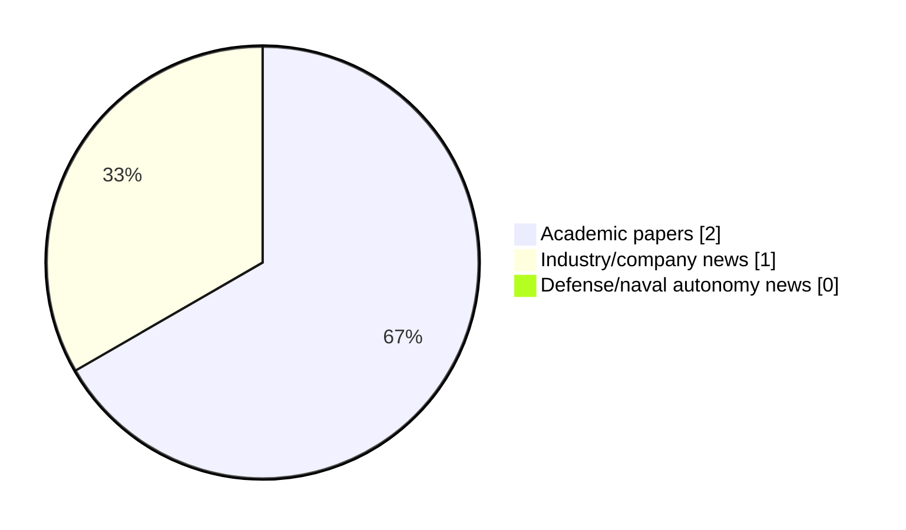

# Maritime Autonomy Watch — 2026-11-12

## Executive Summary

- Total selected items: 3
- Academic papers: 2
- Industry/company news: 1
- Defense/naval autonomy news: 0
- Failed/inaccessible sources: 0

## Contents

- [Analyst Brief](#analyst-brief)
- [Must Read](#must-read)
- [Top Signals Today](#top-signals-today)
- [Topic Signals](#topic-signals)
- [Freshness and Coverage](#freshness-and-coverage)
- [Quality Notes](#quality-notes)
- [Watchlist](#watchlist)
- [Academic Papers](#academic-papers)
- [Industry and Company News](#industry-and-company-news)
- [Defense and Naval Autonomy News](#defense-and-naval-autonomy-news)
- [Source Status Summary](#source-status-summary)

## Analyst Brief

Today's report selected 3 non-duplicate item(s), led by AUV navigation, swarm autonomy, underwater communications. The strongest item is [SVIn+: Multi-Modal Framework for Robust Underwater State Estimation using 3D Sonar, Visual-Inertial, Water-Pressure, and DVL](http://arxiv.org/abs/2610.36454v1) from arXiv.
Coverage is weighted toward academic research (2), with 1 industry and 0 defense signal(s).
Quality caveat: low-score-unique=1, missing-summary=1, date-anomaly=1.

## Must Read

- [SVIn+: Multi-Modal Framework for Robust Underwater State Estimation using 3D Sonar, Visual-Inertial, Water-Pressure, and DVL](http://arxiv.org/abs/2610.36454v1) — Research signal: AUV navigation
- [OceanScan-MST Autonomous Underwater Vehicles Join OST Ecosystem](https://www.oceansciencetechnology.com/news/oceanscan-mst-autonomous-underwater-vehicles-join-ost-ecosystem/) — Industry signal: AUV navigation

## Top Signals Today

- AUV navigation: 2 selected item(s).
- swarm autonomy: 2 selected item(s).
- underwater communications: 1 selected item(s).
- perception: 1 selected item(s).
- planning/control: 1 selected item(s).

## Topic Signals

- AUV navigation: 2
- swarm autonomy: 2
- underwater communications: 1
- perception: 1
- planning/control: 1
- USV operations: 1

## Freshness and Coverage

- Newest selected item date: 2027-03-05
- Oldest selected item date: 2026-10-27
- Active/enabled sources: 4
- Sources with access problems: 3
- Quality flags: 3

## Quality Notes

- low-score-unique: 1
- missing-summary: 1
- date-anomaly: 1
- Date anomalies: [Offline-to-online multi-agent constrained decision transformer for multi-USV cooperative pursuit-evasion games](https://api.elsevier.com/content/abstract/scopus_id/105054140077) reports 2027-03-05

## Watchlist

- [OceanScan-MST Autonomous Underwater Vehicles Join OST Ecosystem](https://www.oceansciencetechnology.com/news/oceanscan-mst-autonomous-underwater-vehicles-join-ost-ecosystem/) — low-score-unique
- [Offline-to-online multi-agent constrained decision transformer for multi-USV cooperative pursuit-evasion games](https://api.elsevier.com/content/abstract/scopus_id/105054140077) — missing-summary, date-anomaly

### Category Snapshot

| Category | Selected items |
|---|---:|
| Academic papers | 2 |
| Industry/company news | 1 |
| Defense/naval autonomy news | 0 |

## Academic Papers

_Selected items: 2_

### [SVIn+: Multi-Modal Framework for Robust Underwater State Estimation using 3D Sonar, Visual-Inertial, Water-Pressure, and DVL](http://arxiv.org/abs/2610.36454v1)

- Source: arXiv
- Date: 2026-10-27
- Relevance score: 8.5
- Authors: Chinmay Burgul, Xiaoming Zhao, Yewei Huang, Michalis Chatzispyrou, Marios Xanthidis, Ioannis Rekleitis, Alberto Quattrini Li
- Signal: Research signal: AUV navigation
- Topic tags: AUV navigation, underwater communications, swarm autonomy, perception, planning/control

**Abstract**

As expansion and scalability in underwater oper- ations becomes more important and challenging, autonomous underwater vehicles (AUVs) become more relevant and the necessity for reliable autonomy more critical. A fundamental challenge in any autonomous underwater operation, from control to safe navigation and mapping, is state estimation; a notorious hard problem to address, especially in low visibility conditions. In this paper, we tackle this problem, by presenting SVIn+, a multi-sensor framework for robust state estimation of AUVs equipped with an IMU, cameras, a water-pressure sensor, a Doppler Velocity Log (DVL), and a compact 3D sonar. This framework extends an established open-source state-of-the-art visual-inertial SLAM, SVIn, by integrating water-pressure and DVL measurements into a tightly-coupled nonlinear optimiza- tion formulation resulting in improved estimates.

**Why it matters**

Relevant to underwater autonomy, multi-vehicle coordination; the work may inform maritime autonomy research, testing priorities, or system design.

---

### [Offline-to-online multi-agent constrained decision transformer for multi-USV cooperative pursuit-evasion games](https://api.elsevier.com/content/abstract/scopus_id/105054140077)

- Source: Elsevier Scopus
- Date: 2027-03-05
- Relevance score: 4.5
- DOI: 10.1016/j.ins.2026.124322
- Signal: Research signal: USV operations
- Topic tags: USV operations, swarm autonomy
- Quality flags: missing-summary, date-anomaly

**Abstract**

No summary available.

**Why it matters**

Relevant to surface-vessel operations; the work may inform maritime autonomy research, testing priorities, or system design.

---

## Industry and Company News

_Selected items: 1_

### [OceanScan-MST Autonomous Underwater Vehicles Join OST Ecosystem](https://www.oceansciencetechnology.com/news/oceanscan-mst-autonomous-underwater-vehicles-join-ost-ecosystem/)

- Source: oceansciencetechnology.com
- Date: 2026-11-12
- Relevance score: 3.5
- Signal: Industry signal: AUV navigation
- Topic tags: AUV navigation
- Quality flags: low-score-unique

**Summary**

Ocean Science Technology (OST) is pleased to announce the addition of OceanScan-MST to our global supplier ecosystem. Their new supplier.

**Why it matters**

Signals momentum in underwater autonomy; useful for tracking product direction, partnerships, and deployment opportunities.

---

## Defense and Naval Autonomy News

_Selected items: 0_

No selected items.

## Inaccessible or Failed Sources

- None

## Source Status Summary

| Source | Status | Notes |
|---|---|---|
| arXiv | enabled | API source, 15 items fetched |
| OpenAlex | enabled | API source, 15 items fetched |
| RSS feeds | partial | 82 RSS items fetched; failures: https://www.navalnews.com/feed/: HTTP 503 for https://www.navalnews.com/feed/ |
| SMI MASG News | enabled | HTML source, 10 items fetched |
| IEEE Xplore | disabled | Missing IEEE_XPLORE_API_KEY |
| Elsevier Scopus | enabled | API source, 15 items fetched |
| NewsAPI | disabled | Missing NEWS_API_KEY |

## Metadata

- Generated at: 2026-11-12T15:33:47.419136+01:00
- Date: 2026-11-12
- Repository: ferhannb/MarineRobotics
- Relevance threshold: 4.0
- Deduplication method: DOI, canonical URL, source ID, normalized title, similar recent titles, category caps, and novelty score
