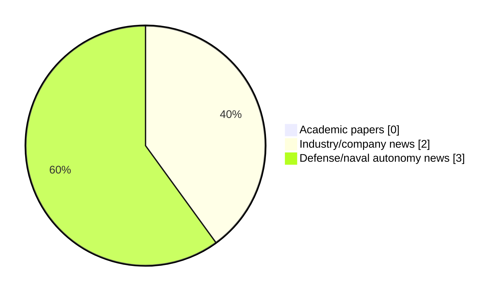

# Maritime Autonomy Watch — 2026-11-13

## Executive Summary

- Total selected items: 5
- Academic papers: 0
- Industry/company news: 2
- Defense/naval autonomy news: 3
- Failed/inaccessible sources: 0

## Contents

- [Analyst Brief](#analyst-brief)
- [Must Read](#must-read)
- [Top Signals Today](#top-signals-today)
- [Topic Signals](#topic-signals)
- [Freshness and Coverage](#freshness-and-coverage)
- [Quality Notes](#quality-notes)
- [Watchlist](#watchlist)
- [Academic Papers](#academic-papers)
- [Industry and Company News](#industry-and-company-news)
- [Defense and Naval Autonomy News](#defense-and-naval-autonomy-news)
- [Source Status Summary](#source-status-summary)

## Analyst Brief

Today's report selected 5 non-duplicate item(s), led by defense adoption, AUV navigation, USV operations. The strongest item is [Seaglider Drone & UUV Complete Mid-Mission Retasking Trial](https://www.oceansciencetechnology.com/news/seaglider-drone-uuv-complete-mid-mission-retasking-trial/) from oceansciencetechnology.com.
Coverage is weighted toward academic research (0), with 2 industry and 3 defense signal(s).

## Must Read

- [Seaglider Drone & UUV Complete Mid-Mission Retasking Trial](https://www.oceansciencetechnology.com/news/seaglider-drone-uuv-complete-mid-mission-retasking-trial/) — Industry signal: AUV navigation
- [Euronaval 2026: SeaOwl and KNDS Unveil Tracus Kamikaze USV](https://www.navalnews.com/event-news/euronaval-2026/2026/11/euronaval-2026-seaowl-and-knds-unveil-tracus-kamikaze-usv/) — Defense signal: USV operations
- [Royal Navy Orders Saab Sea Giraffe 1X Radars for K3 Scout Counter-Drone USVs](https://www.navalnews.com/naval-news/2026/11/royal-navy-orders-saab-sea-giraffe-1x-radars-for-k3-scout-counter-drone-usvs/) — Defense signal: USV operations
- [Naval Unmanned Systems Showcased at Taiwan’s Marine Tech Show](https://www.navalnews.com/naval-news/2026/11/naval-unmanned-systems-showcased-at-taiwans-marine-tech-show/) — Defense signal: defense adoption
- [University of Gothenburg Deploys New AUV to Study Riiser-Larsen Ice Shelf](https://oceannews.com/news/science-technology/university-of-gothenburg-deploys-new-auv-to-study-riiser-larsen-ice-shelf/) — Industry signal: AUV navigation

## Top Signals Today

- defense adoption: 3 selected item(s).
- AUV navigation: 2 selected item(s).
- USV operations: 2 selected item(s).

## Topic Signals

- defense adoption: 3
- AUV navigation: 2
- USV operations: 2

## Freshness and Coverage

- Newest selected item date: 2026-11-13
- Oldest selected item date: 2026-11-12
- Active/enabled sources: 5
- Sources with access problems: 2
- Quality flags: 0

## Quality Notes

- No quality flags on selected items.

## Watchlist

- No watchlist items today.

### Category Snapshot

| Category | Selected items |
|---|---:|
| Academic papers | 0 |
| Industry/company news | 2 |
| Defense/naval autonomy news | 3 |

## Academic Papers

_Selected items: 0_

No selected items.

## Industry and Company News

_Selected items: 2_

### [Seaglider Drone & UUV Complete Mid-Mission Retasking Trial](https://www.oceansciencetechnology.com/news/seaglider-drone-uuv-complete-mid-mission-retasking-trial/)

- Source: oceansciencetechnology.com
- Date: 2026-11-13
- Relevance score: 7
- Signal: Industry signal: AUV navigation
- Topic tags: AUV navigation

**Summary**

REGENT and NSI have successfully integrated an uncrewed ground-effect aircraft with an autonomous underwater vehicle to enable mid-mission retasking without.

**Why it matters**

Signals momentum in underwater autonomy; useful for tracking product direction, partnerships, and deployment opportunities.

---

### [University of Gothenburg Deploys New AUV to Study Riiser-Larsen Ice Shelf](https://oceannews.com/news/science-technology/university-of-gothenburg-deploys-new-auv-to-study-riiser-larsen-ice-shelf/)

- Source: oceannews.com
- Date: 2026-11-12
- Relevance score: 4.25
- Signal: Industry signal: AUV navigation
- Topic tags: AUV navigation

**Summary**

Antarctica's glaciers are deteriorating at different rates. Now, a research project led by the University of Gothenburg aims to find out why. A new underwater vehicle, purchased to replace Ran after it disappeared beneath a floating glacier in 2024, could provide answers.

**Why it matters**

Signals momentum in underwater autonomy; useful for tracking product direction, partnerships, and deployment opportunities.

---

## Defense and Naval Autonomy News

_Selected items: 3_

### [Euronaval 2026: SeaOwl and KNDS Unveil Tracus Kamikaze USV](https://www.navalnews.com/event-news/euronaval-2026/2026/11/euronaval-2026-seaowl-and-knds-unveil-tracus-kamikaze-usv/)

- Source: navalnews.com
- Date: 2026-11-12
- Relevance score: 6.75
- Signal: Defense signal: USV operations
- Topic tags: USV operations, defense adoption

**Summary**

At Euronaval 2026 in Paris, French maritime robotics specialist SeaOwl and European defense company KNDS announced a strategic cooperation agreement to develop and field the Tracus, an innovative kamikaze Uncrewed Surface Vessel (USV) equipped with a special 30kg warhead. Originally developed as a training solution to help the French Navy prepare against asymmetric threats, the.

**Why it matters**

Signals movement in surface-vessel operations, naval adoption; useful for tracking operational concepts, procurement direction, and fleet integration.

---

### [Royal Navy Orders Saab Sea Giraffe 1X Radars for K3 Scout Counter-Drone USVs](https://www.navalnews.com/naval-news/2026/11/royal-navy-orders-saab-sea-giraffe-1x-radars-for-k3-scout-counter-drone-usvs/)

- Source: navalnews.com
- Date: 2026-11-12
- Relevance score: 5.25
- Signal: Defense signal: USV operations
- Topic tags: USV operations, defense adoption

**Summary**

The Royal Navy has awarded Saab a £15 million contract for its Sea Giraffe 1X radar system as part of the development of an autonomous “drone seeker” capability first unveiled earlier this year. Saab press release The contract will see the Royal Navy buy several of Saab’s industry leading Counter-UAS radar systems for integration with.

**Why it matters**

Signals movement in surface-vessel operations, naval adoption; useful for tracking operational concepts, procurement direction, and fleet integration.

---

### [Naval Unmanned Systems Showcased at Taiwan’s Marine Tech Show](https://www.navalnews.com/naval-news/2026/11/naval-unmanned-systems-showcased-at-taiwans-marine-tech-show/)

- Source: navalnews.com
- Date: 2026-11-13
- Relevance score: 4.25
- Signal: Defense signal: defense adoption
- Topic tags: defense adoption

**Summary**

The Taiwan Marine Tech & Unmanned Robotics Expo (MATURE Taiwan), held from November 3 to 5, 2026, in Tainan, southern Taiwan’s second-largest city and the island’s former capital, showcased a range of emerging marine technologies and unmanned robotic systems for both civilian and military applications, including naval unmanned systems. Here is an overview of some.

**Why it matters**

Signals movement in naval adoption; useful for tracking operational concepts, procurement direction, and fleet integration.

---

## Inaccessible or Failed Sources

- None

## Source Status Summary

| Source | Status | Notes |
|---|---|---|
| arXiv | enabled | API source, 15 items fetched |
| OpenAlex | enabled | API source, 15 items fetched |
| RSS feeds | enabled | 92 RSS items fetched |
| SMI MASG News | enabled | HTML source, 10 items fetched |
| IEEE Xplore | disabled | Missing IEEE_XPLORE_API_KEY |
| Elsevier Scopus | enabled | API source, 15 items fetched |
| NewsAPI | disabled | Missing NEWS_API_KEY |

## Metadata

- Generated at: 2026-11-13T14:52:30.069477+01:00
- Date: 2026-11-13
- Repository: ferhannb/MarineRobotics
- Relevance threshold: 4.0
- Deduplication method: DOI, canonical URL, source ID, normalized title, similar recent titles, category caps, and novelty score
