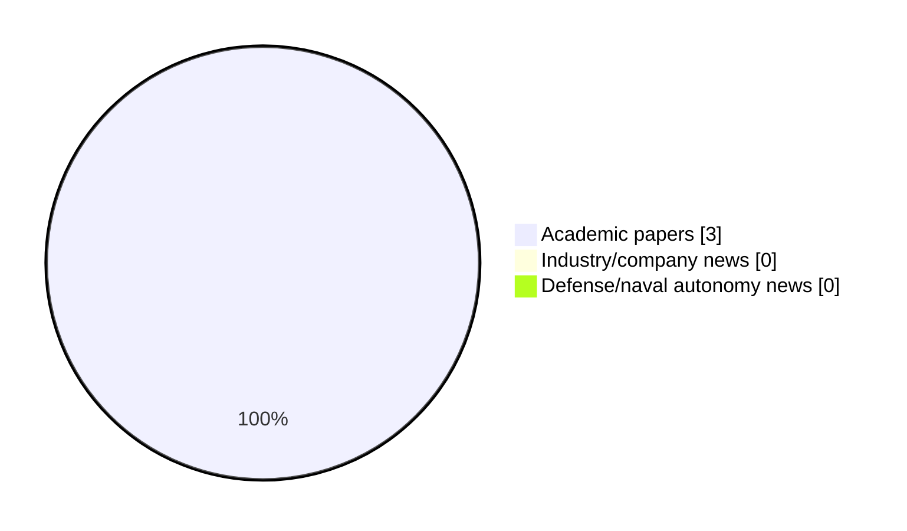

# Maritime Autonomy Watch — 2026-11-15

## Executive Summary

- Total selected items: 3
- Academic papers: 3
- Industry/company news: 0
- Defense/naval autonomy news: 0
- Failed/inaccessible sources: 0

## Contents

- [Analyst Brief](#analyst-brief)
- [Must Read](#must-read)
- [Top Signals Today](#top-signals-today)
- [Topic Signals](#topic-signals)
- [Freshness and Coverage](#freshness-and-coverage)
- [Quality Notes](#quality-notes)
- [Watchlist](#watchlist)
- [Academic Papers](#academic-papers)
- [Industry and Company News](#industry-and-company-news)
- [Defense and Naval Autonomy News](#defense-and-naval-autonomy-news)
- [Source Status Summary](#source-status-summary)

## Analyst Brief

Today's report selected 3 non-duplicate item(s), led by AUV navigation, swarm autonomy, planning/control. The strongest item is [IoUT-enabled multi-AUV network architecture with edge intelligence and multi-sensor fusion for autonomous hydrographic surveying in dynamic underwater environments](https://doi.org/10.3389/fmars.2026.1973977) from OpenAlex.
Coverage is weighted toward academic research (3), with 0 industry and 0 defense signal(s).
Quality caveat: low-score-unique=1.

## Must Read

- [IoUT-enabled multi-AUV network architecture with edge intelligence and multi-sensor fusion for autonomous hydrographic surveying in dynamic underwater environments](https://doi.org/10.3389/fmars.2026.1973977) — Research signal: AUV navigation
- [Adaptive Prescribed Performance Trajectory Tracking for Uncertain Autonomous Underwater Vehicles With Input Saturation](http://arxiv.org/abs/2610.20957v1) — Research signal: AUV navigation
- [Clarity-Driven Adaptive Mission Planning for a Solar-Powered Autonomous Surface Vessel](http://arxiv.org/abs/2610.20871v1) — Research signal: USV operations

## Top Signals Today

- AUV navigation: 2 selected item(s).
- swarm autonomy: 2 selected item(s).
- planning/control: 2 selected item(s).
- underwater communications: 1 selected item(s).
- perception: 1 selected item(s).

## Topic Signals

- AUV navigation: 2
- swarm autonomy: 2
- planning/control: 2
- underwater communications: 1
- perception: 1
- USV operations: 1

## Freshness and Coverage

- Newest selected item date: 2026-11-12
- Oldest selected item date: 2026-10-14
- Active/enabled sources: 5
- Sources with access problems: 2
- Quality flags: 1

## Quality Notes

- low-score-unique: 1

## Watchlist

- [Clarity-Driven Adaptive Mission Planning for a Solar-Powered Autonomous Surface Vessel](http://arxiv.org/abs/2610.20871v1) — low-score-unique

### Category Snapshot

| Category | Selected items |
|---|---:|
| Academic papers | 3 |
| Industry/company news | 0 |
| Defense/naval autonomy news | 0 |

## Academic Papers

_Selected items: 3_

### [IoUT-enabled multi-AUV network architecture with edge intelligence and multi-sensor fusion for autonomous hydrographic surveying in dynamic underwater environments](https://doi.org/10.3389/fmars.2026.1973977)

- Source: OpenAlex
- Date: 2026-11-12
- Relevance score: 9.25
- Authors: Faisal M. Alsaaq
- DOI: 10.3389/fmars.2026.1973977
- Signal: Research signal: AUV navigation
- Topic tags: AUV navigation, underwater communications, swarm autonomy, perception, planning/control

**Abstract**

The integration of Internet of underwater things (IoUT) technologies with autonomous underwater vehicles (AUVs) is transforming traditional hydrographic surveying by enabling collaborative, intelligent, and networked underwater observation systems. This review provides a comprehensive analysis of recent advancements in IoUT-enabled Multi-AUV network architectures, edge intelligence, and multi-sensor fusion approaches for autonomous hydrographic surveying in dynamic underwater environments. The review examines the evolution of networked AUV systems, focusing on underwater communication technologies, distributed computing strategies, cooperative control mechanisms, and data fusion techniques that support multi-vehicle operations.

**Why it matters**

Relevant to underwater autonomy, infrastructure monitoring; the work may inform maritime autonomy research, testing priorities, or system design.

---

### [Adaptive Prescribed Performance Trajectory Tracking for Uncertain Autonomous Underwater Vehicles With Input Saturation](http://arxiv.org/abs/2610.20957v1)

- Source: arXiv
- Date: 2026-10-14
- Relevance score: 5
- Authors: Athanasios K. Gkesoulis, Christos Vlachos, George K. Fourlas, Charalampos P. Bechlioulis, George C. Karras
- Signal: Research signal: AUV navigation
- Topic tags: AUV navigation, planning/control

**Abstract**

Accurate trajectory tracking is essential for autonomous underwater vehicles operating with uncertain hydrodynamics and limited thruster authority. This paper develops a low-complexity adaptive prescribed performance controller for uncertain underwater vehicle dynamics with coupled and saturated inputs. The proposed method adapts the performance functions directly through the mismatch between the requested and saturated control inputs, enlarging the performance funnels only when the available actuation cannot meet the nominal specifications. A coupled invariant-set analysis establishes boundedness of all closed-loop signals, prescribed bounds on the filtered tracking errors, and explicit feasibility conditions.

**Why it matters**

Relevant to underwater autonomy, planning and control; the work may inform maritime autonomy research, testing priorities, or system design.

---

### [Clarity-Driven Adaptive Mission Planning for a Solar-Powered Autonomous Surface Vessel](http://arxiv.org/abs/2610.20871v1)

- Source: arXiv
- Date: 2026-10-14
- Relevance score: 3.5
- Authors: Kavin M. Govindarajan, Kaleb Ben Naveed, David Li, Devansh R. Agrawal, Mary Maceda, Matthew Bryant, Dimitra Panagou, Chris Vermillion
- Signal: Research signal: USV operations
- Topic tags: USV operations, swarm autonomy
- Quality flags: low-score-unique

**Abstract**

This paper presents a comprehensive methodology, backed by simulation and experimental results, for an adaptive mission planning strategy that is mathematically grounded in the maximization of the information-driven quantity of clarity. In particular, the methodology introduced in this work addresses the use of sustainably powered autonomous surface vessels (ASVs) to perform scientific missions that prioritize locations of maximum interest. Because these locations of maximum interest are not known a priori but are rather identified based on in-situ measurements, online adaptation is essential for mission planning. Furthermore, the reliance on a limited-power renewable resource requires an adaptation strategy that maximizes information gathering subject to mobility restrictions imposed by the renewable resource.

**Why it matters**

Relevant to surface-vessel operations, multi-vehicle coordination; the work may inform maritime autonomy research, testing priorities, or system design.

---

## Industry and Company News

_Selected items: 0_

No selected items.

## Defense and Naval Autonomy News

_Selected items: 0_

No selected items.

## Inaccessible or Failed Sources

- None

## Source Status Summary

| Source | Status | Notes |
|---|---|---|
| arXiv | enabled | API source, 15 items fetched |
| OpenAlex | enabled | API source, 15 items fetched |
| RSS feeds | enabled | 92 RSS items fetched |
| SMI MASG News | enabled | HTML source, 10 items fetched |
| IEEE Xplore | disabled | Missing IEEE_XPLORE_API_KEY |
| Elsevier Scopus | enabled | API source, 15 items fetched |
| NewsAPI | disabled | Missing NEWS_API_KEY |

## Metadata

- Generated at: 2026-11-15T14:23:57.656415+01:00
- Date: 2026-11-15
- Repository: ferhannb/MarineRobotics
- Relevance threshold: 4.0
- Deduplication method: DOI, canonical URL, source ID, normalized title, similar recent titles, category caps, and novelty score
