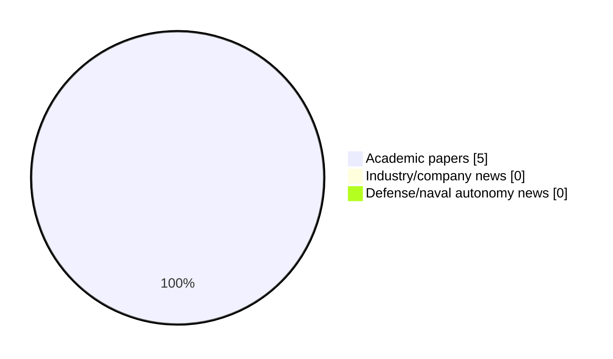

# Maritime Autonomy Watch — 2026-11-16

## Executive Summary

- Total selected items: 5
- Academic papers: 5
- Industry/company news: 0
- Defense/naval autonomy news: 0
- Failed/inaccessible sources: 0

## Contents

- [Analyst Brief](#analyst-brief)
- [Must Read](#must-read)
- [Top Signals Today](#top-signals-today)
- [Topic Signals](#topic-signals)
- [Freshness and Coverage](#freshness-and-coverage)
- [Quality Notes](#quality-notes)
- [Watchlist](#watchlist)
- [Academic Papers](#academic-papers)
- [Industry and Company News](#industry-and-company-news)
- [Defense and Naval Autonomy News](#defense-and-naval-autonomy-news)
- [Source Status Summary](#source-status-summary)

## Analyst Brief

Today's report selected 5 non-duplicate item(s), led by USV operations, planning/control, perception. The strongest item is [Resource Management and Trajectory Optimization for UAV-IRS Assisted Maritime Edge Computing Networks](http://arxiv.org/abs/2611.17803v1) from arXiv.
Coverage is weighted toward academic research (5), with 0 industry and 0 defense signal(s).
Quality caveat: low-score-unique=1.

## Must Read

- [Resource Management and Trajectory Optimization for UAV-IRS Assisted Maritime Edge Computing Networks](http://arxiv.org/abs/2611.17803v1) — Research signal: USV operations
- [Development of Unmanned Surface Vehicle, including hull, energy, propulsion, and intelligence: A review](https://doi.org/10.65218/jius.2026.155) — Research signal: USV operations
- [Mission-Oriented Payloads and Platform Support for Unmanned Surface Vehicles: From Aquatic Observation to Operational Applications](https://openalex.org/W7225961833) — Research signal: USV operations
- [H-SPAR: Hydrodynamic-aware Simulation for Particle Transport and Autonomous Robots](https://doi.org/10.21203/rs.3.rs-11298013/v1) — Research signal: USV operations
- [In Situ Monitoring and Predictive Modeling of Harmful Algal Blooms with Autonomous Surface Vehicles](http://arxiv.org/abs/2611.18501v1) — Research signal: USV operations

## Top Signals Today

- USV operations: 5 selected item(s).
- planning/control: 4 selected item(s).
- perception: 3 selected item(s).
- underwater communications: 1 selected item(s).
- critical infrastructure: 1 selected item(s).

## Topic Signals

- USV operations: 5
- planning/control: 4
- perception: 3
- underwater communications: 1
- critical infrastructure: 1
- swarm autonomy: 1

## Freshness and Coverage

- Newest selected item date: 2026-11-13
- Oldest selected item date: 2026-11-06
- Active/enabled sources: 4
- Sources with access problems: 3
- Quality flags: 1

## Quality Notes

- low-score-unique: 1

## Watchlist

- [In Situ Monitoring and Predictive Modeling of Harmful Algal Blooms with Autonomous Surface Vehicles](http://arxiv.org/abs/2611.18501v1) — low-score-unique

### Category Snapshot

| Category | Selected items |
|---|---:|
| Academic papers | 5 |
| Industry/company news | 0 |
| Defense/naval autonomy news | 0 |

## Academic Papers

_Selected items: 5_

### [Resource Management and Trajectory Optimization for UAV-IRS Assisted Maritime Edge Computing Networks](http://arxiv.org/abs/2611.17803v1)

- Source: arXiv
- Date: 2026-11-13
- Relevance score: 10
- Authors: Chaoyue Zhang, Bin Lin, Xu Hu, Shuang Qi, Liping Qian, Yuan Wu
- Signal: Research signal: USV operations
- Topic tags: USV operations, planning/control

**Abstract**

With the exponential growth of maritime wireless devices and the rapid development of maritime applications, traditional maritime communication networks encounter communication and computation limitations in supporting computation-intensive and latency-critical tasks. Edge computing and Intelligent Reflecting Surface (IRS) have emerged as promising techniques to improve communication and computation services for maritime devices with limited computation capabilities and battery capacity. This paper studies an IRS Mounted on Unmanned Aerial Vehicle (UIRS) assisted maritime edge computing network, in which the UIRS is deployed to assist the transmission from Unmanned Surface Vehicles (USVs) to the edge server via Non-Orthogonal Multiple Access (NOMA) protocol.

**Why it matters**

Relevant to surface-vessel operations, planning and control; the work may inform maritime autonomy research, testing priorities, or system design.

---

### [Development of Unmanned Surface Vehicle, including hull, energy, propulsion, and intelligence: A review](https://doi.org/10.65218/jius.2026.155)

- Source: OpenAlex
- Date: 2026-11-13
- Relevance score: 10
- Authors: Yu Liu, Changhui Song, Weicheng Cui
- DOI: 10.65218/jius.2026.155
- Signal: Research signal: USV operations
- Topic tags: USV operations, perception, planning/control

**Abstract**

Unmanned surface vehicles (USVs) are gaining growing importance in marine‑related military and economic applications. Existing review studies on USVs tend to focus on individual technical dimensions such as hull design or autonomous algorithms, while few reviews provide a holistic examination that integrates platform hardware, energy, propulsion and intelligent systems, together with large‑scale analysis of real‑world academic and industrial prototypes. In this paper, nearly one‑hundred USV products (77 of which are statistically counted) from both academia and industry are surveyed. Representative vessel configurations are covered, including monohulls, catamarans, trimarans, sailboats and wave gliders. Four core technical dimensions of USVs are systematically reviewed: hull design, energy systems, propulsion mechanisms, and autonomous intelligence systems.

**Why it matters**

Relevant to surface-vessel operations; the work may inform maritime autonomy research, testing priorities, or system design.

---

### [Mission-Oriented Payloads and Platform Support for Unmanned Surface Vehicles: From Aquatic Observation to Operational Applications](https://openalex.org/W7225961833)

- Source: OpenAlex
- Date: 2026-11-10
- Relevance score: 10
- Authors: MuYuan Zou, Yunze He, Baoyuan Deng, MengYing Qian, Saibo She, Liang Cheng
- Signal: Research signal: USV operations
- Topic tags: USV operations, underwater communications, perception, planning/control, critical infrastructure

**Abstract**

Unmanned surface vehicles (USVs) are increasingly used for hydrographic surveying, environmental monitoring, ecological observation, infrastructure inspection, and underwater search. Previous studies often focus on autonomous navigation, vehicle design, platform types, or individual applications, leaving relationships among mission objectives, payloads, platform support, and data products unclear. This paper examines these relationships for USV tasks beyond routine navigation-related surface perception. The discussion separates mission payloads from platform-support modules and mission-execution units and considers six groups: hydrographic surveying and mapping; air–sea and environmental observation; water-quality, pollution, and biogeochemical monitoring; ecological surveys, fisheries, and acoustic monitoring; infrastructure inspection; and emergency search support.

**Why it matters**

Relevant to underwater autonomy, surface-vessel operations, infrastructure monitoring; the work may inform maritime autonomy research, testing priorities, or system design.

---

### [H-SPAR: Hydrodynamic-aware Simulation for Particle Transport and Autonomous Robots](https://doi.org/10.21203/rs.3.rs-11298013/v1)

- Source: OpenAlex
- Date: 2026-11-06
- Relevance score: 9.5
- Authors: Navid Zarrabi, Nariman Yousefi, Sajad Saeedi G.
- DOI: 10.21203/rs.3.rs-11298013/v1
- Signal: Research signal: USV operations
- Topic tags: USV operations

**Abstract**

Abstract Environmental robotic sampling requires considering the dual influence of water currents on robotic motion and particle transport. Existing marine robotics simulators generally model flow, autonomy, and sampling targets separately, limiting joint evaluation of mission cost and sampling performance. H-SPAR integrates spatially and temporally varying velocity fields, Lagrangian particle transport, probabilistic sampling, and ROS 2/Gazebo-based uncrewed surface vehicle (USV) autonomy. In this work, shared precomputed flow fields drive particle advection and current-induced forces during closed-loop vehicle execution. Path-planning experiments show that the existing current-aware planner SVF-RRT* achieves 69.4% lower upstream cost than conventional RRT* at the planning level, but this reduction falls to 41.

**Why it matters**

Relevant to surface-vessel operations; the work may inform maritime autonomy research, testing priorities, or system design.

---

### [In Situ Monitoring and Predictive Modeling of Harmful Algal Blooms with Autonomous Surface Vehicles](http://arxiv.org/abs/2611.18501v1)

- Source: arXiv
- Date: 2026-11-13
- Relevance score: 3.5
- Authors: Nenyi Kweku Nkensen Dadson, Jean Paul Gonzalez, Daniel P. Arabie, Ryan J. Cedel, Dorin Boldor, Corina Barbalata
- Signal: Research signal: USV operations
- Topic tags: USV operations, swarm autonomy, perception, planning/control
- Quality flags: low-score-unique

**Abstract**

Harmful Algal Blooms (HABs) pose significant environmental, economic, and public-health challenges in coastal and inland water bodies, creating a need for scalable methods to collect spatially distributed water-quality data. This paper presents an autonomous surface vessel-based sensing system for in-situ water-quality monitoring related to harmful algal bloom detection. The system integrates a BlueBoat Autonomous Surface Vessel (ASV), a motorized winch for depth-controlled sonde deployment, a multiparameter water-quality sonde, side-scan sonar, and an event-camera payload. Autonomous waypoint missions were used to collect measurements across selected sampling regions and multiple depths, enabling both horizontal and vertical characterization of environmental conditions. Field deployments were conducted in Lake Pontchartrain, Louisiana, with additional measurements collected in False River, Louisiana to increase dataset diversity.

**Why it matters**

Relevant to surface-vessel operations, multi-vehicle coordination, infrastructure monitoring; the work may inform maritime autonomy research, testing priorities, or system design.

---

## Industry and Company News

_Selected items: 0_

No selected items.

## Defense and Naval Autonomy News

_Selected items: 0_

No selected items.

## Inaccessible or Failed Sources

- None

## Source Status Summary

| Source | Status | Notes |
|---|---|---|
| arXiv | enabled | API source, 15 items fetched |
| OpenAlex | enabled | API source, 15 items fetched |
| RSS feeds | partial | 82 RSS items fetched; failures: https://www.navalnews.com/feed/: HTTP 503 for https://www.navalnews.com/feed/ |
| SMI MASG News | enabled | HTML source, 10 items fetched |
| IEEE Xplore | disabled | Missing IEEE_XPLORE_API_KEY |
| Elsevier Scopus | enabled | API source, 15 items fetched |
| NewsAPI | disabled | Missing NEWS_API_KEY |

## Metadata

- Generated at: 2026-11-16T15:42:14.494133+01:00
- Date: 2026-11-16
- Repository: ferhannb/MarineRobotics
- Relevance threshold: 4.0
- Deduplication method: DOI, canonical URL, source ID, normalized title, similar recent titles, category caps, and novelty score
