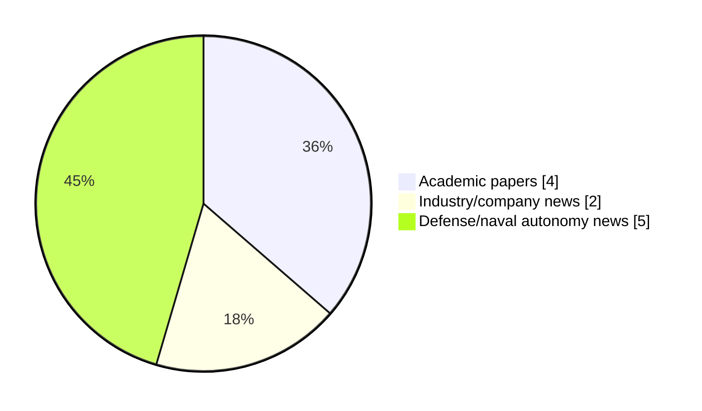

# Maritime Autonomy Watch — 2026-11-17

## Executive Summary

- Total selected items: 11
- Academic papers: 4
- Industry/company news: 2
- Defense/naval autonomy news: 5
- Failed/inaccessible sources: 0

## Contents

- [Analyst Brief](#analyst-brief)
- [Must Read](#must-read)
- [Top Signals Today](#top-signals-today)
- [Topic Signals](#topic-signals)
- [Freshness and Coverage](#freshness-and-coverage)
- [Quality Notes](#quality-notes)
- [Watchlist](#watchlist)
- [Academic Papers](#academic-papers)
- [Industry and Company News](#industry-and-company-news)
- [Defense and Naval Autonomy News](#defense-and-naval-autonomy-news)
- [Source Status Summary](#source-status-summary)

## Analyst Brief

Today's report selected 11 non-duplicate item(s), led by USV operations, planning/control, perception. The strongest item is [The multi-USV mission management problem: Formalization and literature review](https://doi.org/10.1016/j.oceaneng.2026.129113) from OpenAlex.
Coverage is weighted toward academic research (4), with 2 industry and 5 defense signal(s).
Quality caveat: low-score-unique=5.

## Must Read

- [The multi-USV mission management problem: Formalization and literature review](https://doi.org/10.1016/j.oceaneng.2026.129113) — Research signal: USV operations
- [Autonomous Marine Waste Collection Integrating Real-Time Perception, Energy-Aware Control, and Mission-Level Planning on an Unmanned Surface Vehicle (USV)](https://doi.org/10.1016/j.sciaf.2026.e03723) — Research signal: USV operations
- [DEME Picks DEMCON to Deliver Two Offshore Survey USVs](https://www.marinelink.com/news/deme-picks-demcon-deliver-two-offshore-544408) — Industry signal: USV operations
- [Autonomous LARS Passes Sea Trials](https://www.marinelink.com/news/autonomous-lars-passes-sea-trials-544406) — Defense signal: USV operations
- [U.S. Navy Orders 82 Additional Lionfish UUVs from HII](https://www.navalnews.com/naval-news/2026/11/u-s-navy-orders-82-additional-lionfish-uuvs-from-hii/) — Defense signal: defense adoption

## Top Signals Today

- USV operations: 7 selected item(s).
- planning/control: 3 selected item(s).
- perception: 2 selected item(s).
- defense adoption: 2 selected item(s).
- AUV navigation: 2 selected item(s).

## Topic Signals

- USV operations: 7
- planning/control: 3
- perception: 2
- defense adoption: 2
- AUV navigation: 2
- critical infrastructure: 1

## Freshness and Coverage

- Newest selected item date: 2026-11-17
- Oldest selected item date: 2026-10-28
- Active/enabled sources: 5
- Sources with access problems: 2
- Quality flags: 5

## Quality Notes

- low-score-unique: 5

## Watchlist

- [Fugro Completes AUV Survey for Azule Energy’s Ultra-Deepwater Greater PAJ Project off Angola](https://oceannews.com/news/subsea-and-survey/fugro-completes-auv-survey-for-azule-energys-ultra-deepwater-greater-paj-project-off-angola/) — low-score-unique
- [HD HHI and Anduril Launch 600-Ton Autonomous Surface Vessel ‘ASV Alpha’](https://www.navalnews.com/naval-news/2026/11/hd-hhi-anduril-launch-600-ton-asv-alpha/) — low-score-unique
- [HD Hyundai and Anduril launch 600t autonomous surface vessel](https://www.naval-technology.com/news/hd-hyundai-anduril-asv/) — low-score-unique
- [Artificial intelligence for marine pollution monitoring and control](https://doi.org/10.1007/s43621-026-04956-2) — low-score-unique
- [Interaction-Aware Sampling-Based Motion Planning for Autonomous Surface Vessels in Urban Waterways](http://arxiv.org/abs/2610.41676v1) — low-score-unique

### Category Snapshot

| Category | Selected items |
|---|---:|
| Academic papers | 4 |
| Industry/company news | 2 |
| Defense/naval autonomy news | 5 |

## Academic Papers

_Selected items: 4_

### [The multi-USV mission management problem: Formalization and literature review](https://doi.org/10.1016/j.oceaneng.2026.129113)

- Source: OpenAlex
- Date: 2026-11-01
- Relevance score: 10
- Authors: Félix Orjales, Enrique Fernández-Pérez, Alejandro Romero, Julián Rodríguez-Cortegoso, William F. Infante, Richard José Duro
- DOI: 10.1016/j.oceaneng.2026.129113
- Signal: Research signal: USV operations
- Topic tags: USV operations

**Abstract**

Unmanned Surface Vehicles (USVs) have gained prominence in recent years due to their versatility and their ability to operate in hazardous maritime environments, thereby reducing human exposure to risk. As mission complexity increases, the deployment of multiple USVs becomes necessary to achieve scalability, robustness, and operational efficiency. Such multi-USV systems require advanced coordination and cooperation mechanisms to ensure successful mission execution. This paper starts by providing a comprehensive formalization of a decision-making and mission management framework for heterogeneous multi-robot teams in general, particularizing for multi-USV teams where relevant. The proposed formulation systematically covers all stages of the decision-making hierarchy, including goal definition, sub-goal specification and decomposition, task allocation, task planning, and task execution.

**Why it matters**

Relevant to surface-vessel operations; the work may inform maritime autonomy research, testing priorities, or system design.

---

### [Autonomous Marine Waste Collection Integrating Real-Time Perception, Energy-Aware Control, and Mission-Level Planning on an Unmanned Surface Vehicle (USV)](https://doi.org/10.1016/j.sciaf.2026.e03723)

- Source: OpenAlex
- Date: 2026-10-28
- Relevance score: 10
- Authors: Chiaka Chibuike David, Xueyong Chen
- DOI: 10.1016/j.sciaf.2026.e03723
- Signal: Research signal: USV operations
- Topic tags: USV operations, perception, planning/control

**Abstract**

ABSTRACT Autonomous marine waste collection using Unmanned Surface Vehicles (USVs) requires robust perception, adaptive planning, and stringent energy management. Current control paradigms often decouple navigation from mission execution, resulting in inefficiencies and limited strategic adaptability. We propose the Energy-Aware MPC-Constrained Reinforcement Learning (EA-MPC-CRL) framework, which establishes bidirectional coupling between a high-level Constrained Reinforcement Learning agent for strategic decision-making and a low-level Model Predictive Controller for energy-optimal trajectory tracking. A dynamic cost-mapping function enables real-time modulation of MPC objectives based on mission context, including battery state and target proximity. Extensive field trials demonstrate significant improvements over conventional baselines.

**Why it matters**

Relevant to surface-vessel operations, planning and control; the work may inform maritime autonomy research, testing priorities, or system design.

---

### [Artificial intelligence for marine pollution monitoring and control](https://doi.org/10.1007/s43621-026-04956-2)

- Source: OpenAlex
- Date: 2026-11-16
- Relevance score: 3
- Authors: Mona I. A. Kaamoush, Ahmed El-Zeiny
- DOI: 10.1007/s43621-026-04956-2
- Signal: Research signal: perception
- Topic tags: perception, planning/control
- Quality flags: low-score-unique

**Abstract**

Abstract Globally, marine pollution generated by oil spills, plastic litter, and industrial waste poses major threats to the environment, the economy, and human health. Field surveys, optical sensing, and manual sampling are examples of traditional monitoring and mitigation techniques that are frequently hampered by inefficiency, poor precision, and restricted coverage, particularly in large-scale or remote circumstances. Recent advances in artificial intelligence (AI) hold revolutionary potential for detecting, managing, and monitoring maritime pollution. AI-based methods such as computer vision, deep learning, and machine learning have been effectively combined with drone imagery, remote sensing, and in situ monitoring to detect, classify, and measure plastic contaminants and oil spills with remarkable precision.

**Why it matters**

Relevant to infrastructure monitoring; the work may inform maritime autonomy research, testing priorities, or system design.

---

### [Interaction-Aware Sampling-Based Motion Planning for Autonomous Surface Vessels in Urban Waterways](http://arxiv.org/abs/2610.41676v1)

- Source: arXiv
- Date: 2026-10-30
- Relevance score: 3.5
- Authors: Elia Trevisan, Alejandro Gonzalez-Garcia, Jan Swevers, Javier Alonso-Mora
- Signal: Research signal: USV operations
- Topic tags: USV operations, planning/control
- Quality flags: low-score-unique

**Abstract**

Autonomous surface vessels operating in urban waterways must coordinate with other vessels in confined spaces while complying with traffic regulations, often without knowing their intentions. We present a decentralized motion planner based on model predictive path integral control, a sampling-based model predictive control scheme. The planner jointly computes a trajectory for the ego vessel and a prediction of the trajectories of the other vessels, and therefore accounts for their interaction. Traffic regulations are encoded as discontinuous costs, which the sampling-based formulation admits without a smooth approximation. We evaluate the method in maps taken from real sections of Amsterdam's canals, in encounters between two vessels and in scenarios with four interacting vessels.

**Why it matters**

Relevant to surface-vessel operations, navigation safety, planning and control; the work may inform maritime autonomy research, testing priorities, or system design.

---

## Industry and Company News

_Selected items: 2_

### [DEME Picks DEMCON to Deliver Two Offshore Survey USVs](https://www.marinelink.com/news/deme-picks-demcon-deliver-two-offshore-544408)

- Source: marinelink.com
- Date: 2026-11-17
- Relevance score: 9.5
- Signal: Industry signal: USV operations
- Topic tags: USV operations
- Also reported by: https://oceannews.com/feed/

**Summary**

DEME has ordered two offshore unmanned surface vessels (USVs) from Dutch maritime technology company DEMCON unmanned systems to support its offshore survey operations, with delivery scheduled for 2027. The vessels will be based on DEMCON's DUS OV platform…

**Why it matters**

Signals momentum in surface-vessel operations; useful for tracking product direction, partnerships, and deployment opportunities.

---

### [Fugro Completes AUV Survey for Azule Energy’s Ultra-Deepwater Greater PAJ Project off Angola](https://oceannews.com/news/subsea-and-survey/fugro-completes-auv-survey-for-azule-energys-ultra-deepwater-greater-paj-project-off-angola/)

- Source: oceannews.com
- Date: 2026-11-17
- Relevance score: 3.5
- Signal: Industry signal: AUV navigation
- Topic tags: AUV navigation, critical infrastructure
- Quality flags: low-score-unique

**Summary**

Fugro has completed the survey phase of a geophysical program for Azule Energy's Greater PAJ project off the coast of Angola. The program is delivering critical Geo-data and insights to support design activities for subsea infrastructure development, helping reduce uncertainty and optimize subsea routing for one of the most significant ultra-deepwater developments in sub-Saharan Africa.

**Why it matters**

Signals momentum in underwater autonomy; useful for tracking product direction, partnerships, and deployment opportunities.

---

## Defense and Naval Autonomy News

_Selected items: 5_

### [Autonomous LARS Passes Sea Trials](https://www.marinelink.com/news/autonomous-lars-passes-sea-trials-544406)

- Source: marinelink.com
- Date: 2026-11-17
- Relevance score: 6.75
- Signal: Defense signal: USV operations
- Topic tags: USV operations

**Summary**

CiS delivered and commissioned its ORKA Dock autonomous launch and recovery system for a defence customer following successful sea acceptance testing aboard a crewed vessel. The undisclosed organization will operate ORKA Dock from an uncrewed surface vessel (USV)…

**Why it matters**

Signals movement in surface-vessel operations, naval adoption; useful for tracking operational concepts, procurement direction, and fleet integration.

---

### [U.S. Navy Orders 82 Additional Lionfish UUVs from HII](https://www.navalnews.com/naval-news/2026/11/u-s-navy-orders-82-additional-lionfish-uuvs-from-hii/)

- Source: navalnews.com
- Date: 2026-11-16
- Relevance score: 4.25
- Signal: Defense signal: defense adoption
- Topic tags: defense adoption

**Summary**

HII has received a U.S. Navy contract for 82 additional Lionfish small unmanned undersea vehicles (UUVs), bringing total ordered units to 175 with 50 delivered.

**Why it matters**

Signals movement in naval adoption; useful for tracking operational concepts, procurement direction, and fleet integration.

---

### [HD HHI and Anduril Launch 600-Ton Autonomous Surface Vessel ‘ASV Alpha’](https://www.navalnews.com/naval-news/2026/11/hd-hhi-anduril-launch-600-ton-asv-alpha/)

- Source: navalnews.com
- Date: 2026-11-16
- Relevance score: 3.5
- Signal: Defense signal: USV operations
- Topic tags: USV operations
- Quality flags: low-score-unique

**Summary**

HD HHI and Anduril have launched ASV Alpha, a 600-ton autonomous surface vessel built in Ulsan with VAone and Lattice ahead of 2027 U.S. trials.

**Why it matters**

Signals movement in surface-vessel operations; useful for tracking operational concepts, procurement direction, and fleet integration.

---

### [HD Hyundai and Anduril launch 600t autonomous surface vessel](https://www.naval-technology.com/news/hd-hyundai-anduril-asv/)

- Source: naval-technology.com
- Date: 2026-11-16
- Relevance score: 3.5
- Signal: Defense signal: USV operations
- Topic tags: USV operations
- Quality flags: low-score-unique

**Summary**

HD Hyundai Heavy Industries (HHI) has launched an autonomous surface vessel (ASV) developed in partnership with US defence contractor Anduril Industries.

**Why it matters**

Signals movement in surface-vessel operations, naval adoption; useful for tracking operational concepts, procurement direction, and fleet integration.

---

### [Australia unveils secretive Ghost Shark underwater drone payloads](https://www.defensenews.com/naval/2026/11/02/australia-unveils-secretive-ghost-shark-underwater-drone-payloads/)

- Source: defensenews.com
- Date: 2026-11-02
- Relevance score: 4.25
- Signal: Defense signal: AUV navigation
- Topic tags: AUV navigation, defense adoption

**Summary**

The Australian Navy recently lifted the veil on some payloads the service is fielding on its Ghost Shark extra-large autonomous underwater vehicles.

**Why it matters**

Signals movement in underwater autonomy, naval adoption; useful for tracking operational concepts, procurement direction, and fleet integration.

---

## Inaccessible or Failed Sources

- None

## Source Status Summary

| Source | Status | Notes |
|---|---|---|
| arXiv | enabled | API source, 15 items fetched |
| OpenAlex | enabled | API source, 15 items fetched |
| RSS feeds | enabled | 92 RSS items fetched |
| SMI MASG News | enabled | HTML source, 10 items fetched |
| IEEE Xplore | disabled | Missing IEEE_XPLORE_API_KEY |
| Elsevier Scopus | enabled | API source, 15 items fetched |
| NewsAPI | disabled | Missing NEWS_API_KEY |

## Metadata

- Generated at: 2026-11-17T16:27:22.879914+01:00
- Date: 2026-11-17
- Repository: ferhannb/MarineRobotics
- Relevance threshold: 4.0
- Deduplication method: DOI, canonical URL, source ID, normalized title, similar recent titles, category caps, and novelty score
