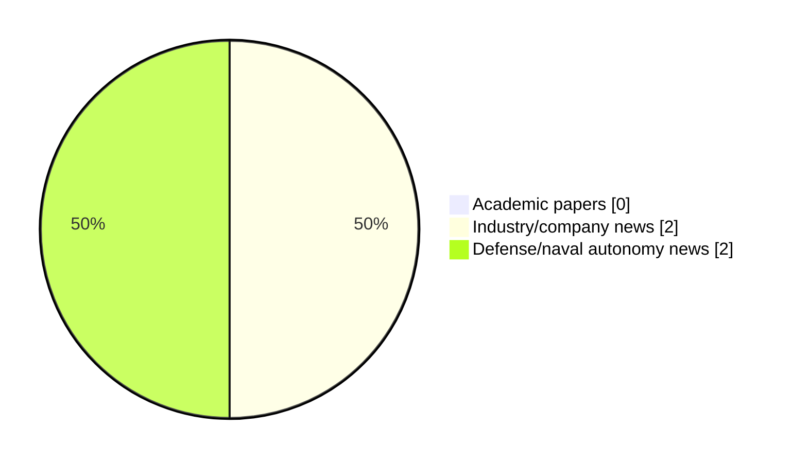

# Maritime Autonomy Watch — 2026-11-18

## Executive Summary

- Total selected items: 4
- Academic papers: 0
- Industry/company news: 2
- Defense/naval autonomy news: 2
- Failed/inaccessible sources: 1

## Contents

- [Analyst Brief](#analyst-brief)
- [Must Read](#must-read)
- [Top Signals Today](#top-signals-today)
- [Topic Signals](#topic-signals)
- [Freshness and Coverage](#freshness-and-coverage)
- [Quality Notes](#quality-notes)
- [Watchlist](#watchlist)
- [Academic Papers](#academic-papers)
- [Industry and Company News](#industry-and-company-news)
- [Defense and Naval Autonomy News](#defense-and-naval-autonomy-news)
- [Source Status Summary](#source-status-summary)

## Analyst Brief

Today's report selected 4 non-duplicate item(s), led by AUV navigation, USV operations, critical infrastructure. The strongest item is [Bedrock Ocean Exploration Deploys Onboard ATR Across Its AUV Fleet](https://oceannews.com/news/science-technology/bedrock-ocean-exploration-deploys-onboard-atr-across-its-auv-fleet/) from oceannews.com.
Coverage is weighted toward academic research (0), with 2 industry and 2 defense signal(s).
Quality caveat: low-score-unique=1.

## Must Read

- [Bedrock Ocean Exploration Deploys Onboard ATR Across Its AUV Fleet](https://oceannews.com/news/science-technology/bedrock-ocean-exploration-deploys-onboard-atr-across-its-auv-fleet/) — Defense signal: AUV navigation
- [Exail Secures Five DriX USV Orders from US Offshore & Institutional Customers](https://oceannews.com/news/science-technology/exail-secures-five-drix-usv-orders-from-us-offshore-institutional-customers/) — Industry signal: USV operations
- [Australia preps Bluebottle USV for submarine-hunting role](https://www.defensenews.com/global/asia-pacific/2026/11/03/australia-preps-bluebottle-usv-for-submarine-hunting-role/) — Defense signal: USV operations
- [AUV Integrates New Sensors for Floating Wind Research](https://www.oceansciencetechnology.com/news/auv-integrates-new-sensors-for-floating-wind-research/) — Industry signal: AUV navigation

## Top Signals Today

- AUV navigation: 2 selected item(s).
- USV operations: 2 selected item(s).
- critical infrastructure: 1 selected item(s).

## Topic Signals

- AUV navigation: 2
- USV operations: 2
- critical infrastructure: 1

## Freshness and Coverage

- Newest selected item date: 2026-11-18
- Oldest selected item date: 2026-11-03
- Active/enabled sources: 3
- Sources with access problems: 4
- Quality flags: 1

## Quality Notes

- low-score-unique: 1

## Watchlist

- [AUV Integrates New Sensors for Floating Wind Research](https://www.oceansciencetechnology.com/news/auv-integrates-new-sensors-for-floating-wind-research/) — low-score-unique

### Category Snapshot

| Category | Selected items |
|---|---:|
| Academic papers | 0 |
| Industry/company news | 2 |
| Defense/naval autonomy news | 2 |

## Academic Papers

_Selected items: 0_

No selected items.

## Industry and Company News

_Selected items: 2_

### [Exail Secures Five DriX USV Orders from US Offshore & Institutional Customers](https://oceannews.com/news/science-technology/exail-secures-five-drix-usv-orders-from-us-offshore-institutional-customers/)

- Source: oceannews.com
- Date: 2026-11-18
- Relevance score: 7
- Signal: Industry signal: USV operations
- Topic tags: USV operations

**Summary**

Exail announced five new orders for its DriX Uncrewed Surface Vehicles (USVs) from US customers across commercial offshore and institutional sectors.

**Why it matters**

Signals momentum in surface-vessel operations; useful for tracking product direction, partnerships, and deployment opportunities.

---

### [AUV Integrates New Sensors for Floating Wind Research](https://www.oceansciencetechnology.com/news/auv-integrates-new-sensors-for-floating-wind-research/)

- Source: oceansciencetechnology.com
- Date: 2026-11-18
- Relevance score: 3.5
- Signal: Industry signal: AUV navigation
- Topic tags: AUV navigation
- Quality flags: low-score-unique

**Summary**

The UK National Oceanography Centre (NOC) has completed sea trials off the coast of Plymouth using its Autosub Long Range.

**Why it matters**

Signals momentum in underwater autonomy; useful for tracking product direction, partnerships, and deployment opportunities.

---

## Defense and Naval Autonomy News

_Selected items: 2_

### [Bedrock Ocean Exploration Deploys Onboard ATR Across Its AUV Fleet](https://oceannews.com/news/science-technology/bedrock-ocean-exploration-deploys-onboard-atr-across-its-auv-fleet/)

- Source: oceannews.com
- Date: 2026-11-17
- Relevance score: 8.5
- Signal: Defense signal: AUV navigation
- Topic tags: AUV navigation, critical infrastructure

**Summary**

Bedrock Ocean Exploration (Bedrock), the autonomous intelligence infrastructure company powering the ocean economy, has announced that automated target recognition (ATR) is now running on board its fleet of autonomous underwater vehicles (AUVs). The proprietary model detects and classifies seafloor contacts, including objects of interest such as debris, infrastructure, and potential unexploded ordnance, as each survey line is completed.

**Why it matters**

Signals movement in underwater autonomy; useful for tracking operational concepts, procurement direction, and fleet integration.

---

### [Australia preps Bluebottle USV for submarine-hunting role](https://www.defensenews.com/global/asia-pacific/2026/11/03/australia-preps-bluebottle-usv-for-submarine-hunting-role/)

- Source: defensenews.com
- Date: 2026-11-03
- Relevance score: 6
- Signal: Defense signal: USV operations
- Topic tags: USV operations

**Summary**

"I want potential adversaries to understand that, when they see an Ocius Bluebottle USV, it’s a signal to get out of our ocean,” Minister for Defence Industry Pat Conroy said.

**Why it matters**

Signals movement in surface-vessel operations, naval adoption; useful for tracking operational concepts, procurement direction, and fleet integration.

---

## Inaccessible or Failed Sources

- OpenAlex: HTTP 503 for https://api.openalex.org/works?search=maritime+autonomy+marine+robotics+autonomous+vessel+autonomous+mission+autonomous+surface+vessel&per-page=15&sort=publication_date%3Adesc

## Source Status Summary

| Source | Status | Notes |
|---|---|---|
| arXiv | enabled | API source, 15 items fetched |
| OpenAlex | failed | HTTP 503 for https://api.openalex.org/works?search=maritime+autonomy+marine+robotics+autonomous+vessel+autonomous+mission+autonomous+surface+vessel&per-page=15&sort=publication_date%3Adesc |
| RSS feeds | partial | 82 RSS items fetched; failures: https://www.navalnews.com/feed/: HTTP 503 for https://www.navalnews.com/feed/ |
| SMI MASG News | enabled | HTML source, 10 items fetched |
| IEEE Xplore | disabled | Missing IEEE_XPLORE_API_KEY |
| Elsevier Scopus | enabled | API source, 15 items fetched |
| NewsAPI | disabled | Missing NEWS_API_KEY |

## Metadata

- Generated at: 2026-11-18T16:01:38.737607+01:00
- Date: 2026-11-18
- Repository: ferhannb/MarineRobotics
- Relevance threshold: 4.0
- Deduplication method: DOI, canonical URL, source ID, normalized title, similar recent titles, category caps, and novelty score
