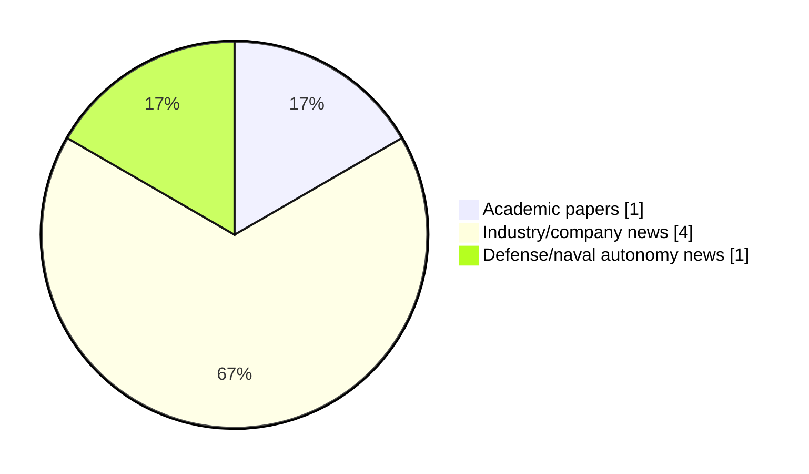

# Maritime Autonomy Watch — 2026-11-19

## Executive Summary

- Total selected items: 6
- Academic papers: 1
- Industry/company news: 4
- Defense/naval autonomy news: 1
- Failed/inaccessible sources: 1

## Contents

- [Analyst Brief](#analyst-brief)
- [Must Read](#must-read)
- [Top Signals Today](#top-signals-today)
- [Topic Signals](#topic-signals)
- [Freshness and Coverage](#freshness-and-coverage)
- [Quality Notes](#quality-notes)
- [Watchlist](#watchlist)
- [Academic Papers](#academic-papers)
- [Industry and Company News](#industry-and-company-news)
- [Defense and Naval Autonomy News](#defense-and-naval-autonomy-news)
- [Source Status Summary](#source-status-summary)

## Analyst Brief

Today's report selected 6 non-duplicate item(s), led by USV operations, AUV navigation, defense adoption. The strongest item is [Man-Portable AUV](https://www.oceansciencetechnology.com/suppliers/man-portable-auv/) from oceansciencetechnology.com.
Coverage is weighted toward academic research (1), with 4 industry and 1 defense signal(s).

## Must Read

- [Man-Portable AUV](https://www.oceansciencetechnology.com/suppliers/man-portable-auv/) — Industry signal: AUV navigation
- [Textron Systems Wins First Army Contract for TSUNAMI USV Platform](https://oceannews.com/news/defense/textron-systems-wins-first-army-contract-for-tsunami-usv-platform/) — Industry signal: USV operations
- [LLM-Assisted Planning with Distributed Onboard Behaviour Tree Execution for Multi-AUV Missions](http://arxiv.org/abs/2611.04518v1) — Research signal: AUV navigation
- [Everllence 175D Engine Cleared for 1,500 Hours of Unmanned Operation](https://oceannews.com/news/science-technology/everllence-175d-engine-cleared-for-1500-hours-of-unmanned-operation/) — Industry signal: USV operations
- [Seasats Integrates Anduril’s Altius-600M Loitering Munition into Quickfish USV](https://oceannews.com/news/defense/seasats-integrates-andurils-altius-600m-loitering-munition-into-quickfish-usv/) — Industry signal: USV operations

## Top Signals Today

- USV operations: 4 selected item(s).
- AUV navigation: 2 selected item(s).
- defense adoption: 1 selected item(s).

## Topic Signals

- USV operations: 4
- AUV navigation: 2
- defense adoption: 1

## Freshness and Coverage

- Newest selected item date: 2026-11-19
- Oldest selected item date: 2026-11-03
- Active/enabled sources: 4
- Sources with access problems: 3
- Quality flags: 0

## Quality Notes

- No quality flags on selected items.

## Watchlist

- No watchlist items today.

### Category Snapshot

| Category | Selected items |
|---|---:|
| Academic papers | 1 |
| Industry/company news | 4 |
| Defense/naval autonomy news | 1 |

## Academic Papers

_Selected items: 1_

### [LLM-Assisted Planning with Distributed Onboard Behaviour Tree Execution for Multi-AUV Missions](http://arxiv.org/abs/2611.04518v1)

- Source: arXiv
- Date: 2026-11-03
- Relevance score: 7.75
- Authors: Ehsan Khorrambakht, Cristiano Caissutti, Andrea Munafo, Andrea Caiti
- Signal: Research signal: AUV navigation
- Topic tags: AUV navigation

**Abstract**

Coordinating autonomous underwater vehicles requires translating operator intent into feasible assignments while preserving autonomous execution when communication is limited. We present a hierarchical framework that couples Large Language Model (LLM) interpretation of natural-language mission instructions with Mixed-Integer Linear Programming (MILP) and distributed Behaviour Tree (BT) execution. The LLM extracts assignment and ordering constraints, which the MILP optimizer combines with vehicle capabilities and temporal requirements. A BT-LLM Bridge distributes the resulting allocations to onboard BT Mission Managers. Per-vehicle Robotic Agents assess local faults and request selective replanning, allowing unaffected vehicles to continue their assigned tasks. Evaluation in a ROS-based AUV simulator compares Qwen-3-8B and Llama-3.1-8B on constraint extraction and tests recovery from sensor degradation and critical vehicle faults.

**Why it matters**

Relevant to underwater autonomy; the work may inform maritime autonomy research, testing priorities, or system design.

---

## Industry and Company News

_Selected items: 4_

### [Man-Portable AUV](https://www.oceansciencetechnology.com/suppliers/man-portable-auv/)

- Source: oceansciencetechnology.com
- Date: 2026-11-19
- Relevance score: 9.25
- Signal: Industry signal: AUV navigation
- Topic tags: AUV navigation

**Summary**

Introduction to Man-Portable Autonomous Underwater Vehicles Man-portable Autonomous Underwater Vehicles (AUVs) are compact, self-propelled underwater robots designed for deployment without.

**Why it matters**

Signals momentum in underwater autonomy; useful for tracking product direction, partnerships, and deployment opportunities.

---

### [Textron Systems Wins First Army Contract for TSUNAMI USV Platform](https://oceannews.com/news/defense/textron-systems-wins-first-army-contract-for-tsunami-usv-platform/)

- Source: oceannews.com
- Date: 2026-11-18
- Relevance score: 9.25
- Signal: Industry signal: USV operations
- Topic tags: USV operations

**Summary**

Textron Systems Corporation, a Textron Inc. company, has announced a contract award from Neya Systems, a wholly owned subsidiary of Applied Research Associates (ARA), to convert TSUNAMI® unmanned surface vessels (USVs) into an autonomous fuel distribution system aimed at transforming contested logistics for the future force. Issued by Army Contracting Command (ACC) to Neya Systems, this prototype program marks Textron Systems' first Army contract for the TSUNAMI platform.

**Why it matters**

Signals momentum in surface-vessel operations; useful for tracking product direction, partnerships, and deployment opportunities.

---

### [Everllence 175D Engine Cleared for 1,500 Hours of Unmanned Operation](https://oceannews.com/news/science-technology/everllence-175d-engine-cleared-for-1500-hours-of-unmanned-operation/)

- Source: oceannews.com
- Date: 2026-11-19
- Relevance score: 6.75
- Signal: Industry signal: USV operations
- Topic tags: USV operations

**Summary**

Everllence has reached an important milestone in the development of propulsion solutions for unmanned surface vessels (USVs) with the announcement that its 175D high-speed marine engine will now be used in a prototype project supporting up to 1,500 hours of unmanned vessel operation.

**Why it matters**

Signals momentum in surface-vessel operations; useful for tracking product direction, partnerships, and deployment opportunities.

---

### [Seasats Integrates Anduril’s Altius-600M Loitering Munition into Quickfish USV](https://oceannews.com/news/defense/seasats-integrates-andurils-altius-600m-loitering-munition-into-quickfish-usv/)

- Source: oceannews.com
- Date: 2026-11-19
- Relevance score: 6.75
- Signal: Industry signal: USV operations
- Topic tags: USV operations

**Summary**

Seasats has announced the successful integration and launch of Anduril Industries' Altius-600M loitering munition from Quickfish, the company's rapid-response unmanned surface vessel (USV). The integration equips Quickfish with long-range strike capability against higher-end maritime targets.

**Why it matters**

Signals momentum in surface-vessel operations; useful for tracking product direction, partnerships, and deployment opportunities.

---

## Defense and Naval Autonomy News

_Selected items: 1_

### [Mistral in a Box: MBDA Revives SPIMM Concept Against Drones](https://www.navalnews.com/naval-news/2026/11/mistral-in-a-box-mbda-revives-spimm-concept-against-drones/)

- Source: navalnews.com
- Date: 2026-11-18
- Relevance score: 4.5
- Signal: Defense signal: USV operations
- Topic tags: USV operations, defense adoption

**Summary**

MBDA and Terma partner at Euronaval 2026 to revive the SPIMM containerized Mistral 3 air defense system against drones, cruise missiles, and USVs.

**Why it matters**

Signals movement in surface-vessel operations, naval adoption; useful for tracking operational concepts, procurement direction, and fleet integration.

---

## Inaccessible or Failed Sources

- OpenAlex: HTTP 429 for https://api.openalex.org/works?search=maritime+autonomy+marine+robotics+autonomous+vessel+autonomous+mission+autonomous+surface+vessel&per-page=15&sort=publication_date%3Adesc

## Source Status Summary

| Source | Status | Notes |
|---|---|---|
| arXiv | enabled | API source, 15 items fetched |
| OpenAlex | failed | HTTP 429 for https://api.openalex.org/works?search=maritime+autonomy+marine+robotics+autonomous+vessel+autonomous+mission+autonomous+surface+vessel&per-page=15&sort=publication_date%3Adesc |
| RSS feeds | enabled | 92 RSS items fetched |
| SMI MASG News | enabled | HTML source, 10 items fetched |
| IEEE Xplore | disabled | Missing IEEE_XPLORE_API_KEY |
| Elsevier Scopus | enabled | API source, 15 items fetched |
| NewsAPI | disabled | Missing NEWS_API_KEY |

## Metadata

- Generated at: 2026-11-19T16:11:37.806934+01:00
- Date: 2026-11-19
- Repository: ferhannb/MarineRobotics
- Relevance threshold: 4.0
- Deduplication method: DOI, canonical URL, source ID, normalized title, similar recent titles, category caps, and novelty score
