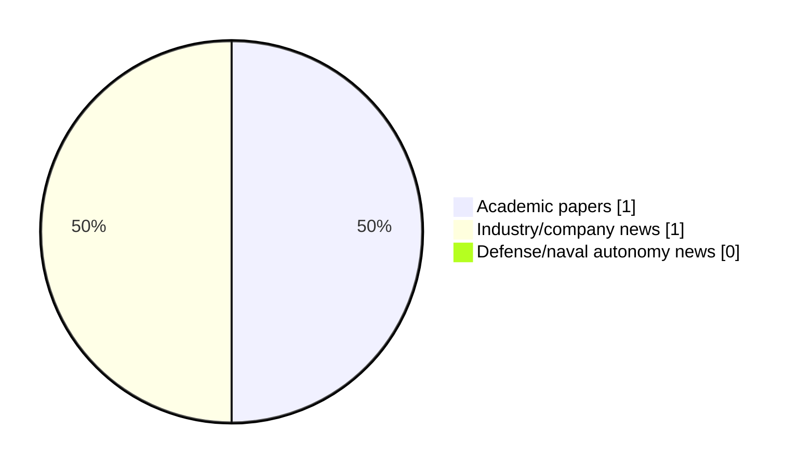

# Maritime Autonomy Watch — 2026-11-20

## Executive Summary

- Total selected items: 2
- Academic papers: 1
- Industry/company news: 1
- Defense/naval autonomy news: 0
- Failed/inaccessible sources: 0

## Contents

- [Analyst Brief](#analyst-brief)
- [Must Read](#must-read)
- [Top Signals Today](#top-signals-today)
- [Topic Signals](#topic-signals)
- [Freshness and Coverage](#freshness-and-coverage)
- [Quality Notes](#quality-notes)
- [Watchlist](#watchlist)
- [Academic Papers](#academic-papers)
- [Industry and Company News](#industry-and-company-news)
- [Defense and Naval Autonomy News](#defense-and-naval-autonomy-news)
- [Source Status Summary](#source-status-summary)

## Analyst Brief

Today's report selected 2 non-duplicate item(s), led by AUV navigation, general autonomy. The strongest item is [A Power-speed Performance Analysis Approach for the Optimization of Hull Geometry in Autonomous Underwater Vehicles](https://doi.org/10.3311/pptr.40991) from OpenAlex.
Coverage is weighted toward academic research (1), with 1 industry and 0 defense signal(s).
Quality caveat: low-score-unique=1.

## Must Read

- [A Power-speed Performance Analysis Approach for the Optimization of Hull Geometry in Autonomous Underwater Vehicles](https://doi.org/10.3311/pptr.40991) — Research signal: AUV navigation
- [MassRobotics Opens Marine Robotics Facility at Boston Fish Pier](https://oceannews.com/news/milestones/massrobotics-opens-marine-robotics-facility-at-boston-fish-pier/) — Industry signal: general autonomy

## Top Signals Today

- AUV navigation: 1 selected item(s).
- general autonomy: 1 selected item(s).

## Topic Signals

- AUV navigation: 1
- general autonomy: 1

## Freshness and Coverage

- Newest selected item date: 2026-11-19
- Oldest selected item date: 2026-11-10
- Active/enabled sources: 4
- Sources with access problems: 3
- Quality flags: 1

## Quality Notes

- low-score-unique: 1

## Watchlist

- [MassRobotics Opens Marine Robotics Facility at Boston Fish Pier](https://oceannews.com/news/milestones/massrobotics-opens-marine-robotics-facility-at-boston-fish-pier/) — low-score-unique

### Category Snapshot

| Category | Selected items |
|---|---:|
| Academic papers | 1 |
| Industry/company news | 1 |
| Defense/naval autonomy news | 0 |

## Academic Papers

_Selected items: 1_

### [A Power-speed Performance Analysis Approach for the Optimization of Hull Geometry in Autonomous Underwater Vehicles](https://doi.org/10.3311/pptr.40991)

- Source: OpenAlex
- Date: 2026-11-10
- Relevance score: 7
- Authors: Сергій Курдюк, Oleksiy Melnyk, Maxim Stetsenko, Олег Анатолійович Онищенко, Aditya Rio Prabowo, Martin Jurkovich, Dementiy Burlachenko
- DOI: 10.3311/pptr.40991
- Signal: Research signal: AUV navigation
- Topic tags: AUV navigation

**Abstract**

Optimization of the geometric parameters of the hull of autonomous underwater vehicles (AUVs) is a crucial factor affecting their hydrodynamic properties, energy efficiency, and functional suitability. This study analyzes the challenges associated with the miniaturization of structures, in particular, the limitations that arise when reducing the size of the vehicle. The main attention is paid to determining the dimensions of the hull that minimize losses in speed and propulsion performance. A comparative evaluation of configurations with different values of diameter and length was carried out, which made it possible to identify the advantages of options with an increased length-to-diameter ratio (L/D). The proposed approach takes into account power limitations and is focused on achieving the target performance characteristics.

**Why it matters**

Relevant to underwater autonomy; the work may inform maritime autonomy research, testing priorities, or system design.

---

## Industry and Company News

_Selected items: 1_

### [MassRobotics Opens Marine Robotics Facility at Boston Fish Pier](https://oceannews.com/news/milestones/massrobotics-opens-marine-robotics-facility-at-boston-fish-pier/)

- Source: oceannews.com
- Date: 2026-11-19
- Relevance score: 3.5
- Signal: Industry signal: general autonomy
- Topic tags: general autonomy
- Quality flags: low-score-unique

**Summary**

MassRobotics is developing a marine robotics facility at the historic Boston Fish Pier, giving startups in the marine technology space a place to build, launch, and test their robots right on Boston Harbor. Construction is underway through a partnership with Massport and the facility is planned to open in early 2028, with programming starting throughout 2027.

**Why it matters**

This item may signal product, market, or deployment momentum in maritime autonomy.

---

## Defense and Naval Autonomy News

_Selected items: 0_

No selected items.

## Inaccessible or Failed Sources

- None

## Source Status Summary

| Source | Status | Notes |
|---|---|---|
| arXiv | enabled | API source, 15 items fetched |
| OpenAlex | enabled | API source, 15 items fetched |
| RSS feeds | partial | 82 RSS items fetched; failures: https://www.navalnews.com/feed/: HTTP 503 for https://www.navalnews.com/feed/ |
| SMI MASG News | enabled | HTML source, 10 items fetched |
| IEEE Xplore | disabled | Missing IEEE_XPLORE_API_KEY |
| Elsevier Scopus | enabled | API source, 15 items fetched |
| NewsAPI | disabled | Missing NEWS_API_KEY |

## Metadata

- Generated at: 2026-11-20T15:50:51.516298+01:00
- Date: 2026-11-20
- Repository: ferhannb/MarineRobotics
- Relevance threshold: 4.0
- Deduplication method: DOI, canonical URL, source ID, normalized title, similar recent titles, category caps, and novelty score
