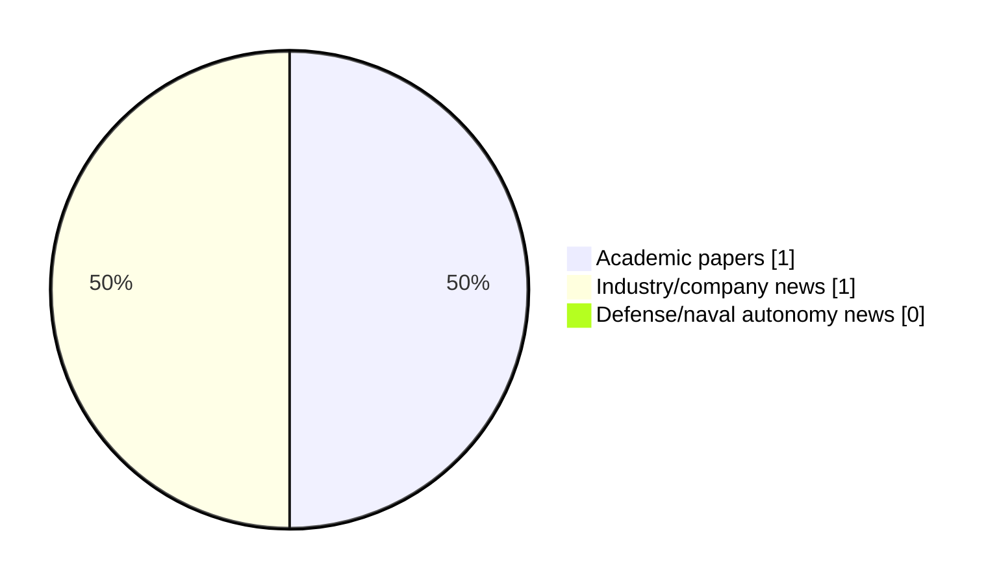

# Maritime Autonomy Watch — 2026-11-21

## Executive Summary

- Total selected items: 2
- Academic papers: 1
- Industry/company news: 1
- Defense/naval autonomy news: 0
- Failed/inaccessible sources: 2

## Contents

- [Analyst Brief](#analyst-brief)
- [Must Read](#must-read)
- [Top Signals Today](#top-signals-today)
- [Topic Signals](#topic-signals)
- [Freshness and Coverage](#freshness-and-coverage)
- [Quality Notes](#quality-notes)
- [Watchlist](#watchlist)
- [Academic Papers](#academic-papers)
- [Industry and Company News](#industry-and-company-news)
- [Defense and Naval Autonomy News](#defense-and-naval-autonomy-news)
- [Source Status Summary](#source-status-summary)

## Analyst Brief

Today's report selected 2 non-duplicate item(s), led by AUV navigation, USV operations, planning/control. The strongest item is [Hierarchical coverage path planning method for multi-USV with large-scale target search and detection constraints](https://api.elsevier.com/content/abstract/scopus_id/105056379536) from Elsevier Scopus.
Coverage is weighted toward academic research (1), with 1 industry and 0 defense signal(s).
Quality caveat: missing-summary=1, date-anomaly=1.

## Must Read

- [Deep Venture AUV Reaches Full Ocean Depth in WHOI-JPL Collaboration](https://oceannews.com/news/science-technology/deep-venture-auv-reaches-full-ocean-depth-in-whoi-jpl-collaboration/) — Industry signal: AUV navigation

## Top Signals Today

- AUV navigation: 1 selected item(s).
- USV operations: 1 selected item(s).
- planning/control: 1 selected item(s).

## Topic Signals

- AUV navigation: 1
- USV operations: 1
- planning/control: 1

## Freshness and Coverage

- Newest selected item date: 2027-03-25
- Oldest selected item date: 2026-11-20
- Active/enabled sources: 2
- Sources with access problems: 5
- Quality flags: 2

## Quality Notes

- missing-summary: 1
- date-anomaly: 1
- Date anomalies: [Hierarchical coverage path planning method for multi-USV with large-scale target search and detection constraints](https://api.elsevier.com/content/abstract/scopus_id/105056379536) reports 2027-03-25

## Watchlist

- [Hierarchical coverage path planning method for multi-USV with large-scale target search and detection constraints](https://api.elsevier.com/content/abstract/scopus_id/105056379536) — missing-summary, date-anomaly

### Category Snapshot

| Category | Selected items |
|---|---:|
| Academic papers | 1 |
| Industry/company news | 1 |
| Defense/naval autonomy news | 0 |

## Academic Papers

_Selected items: 1_

### [Hierarchical coverage path planning method for multi-USV with large-scale target search and detection constraints](https://api.elsevier.com/content/abstract/scopus_id/105056379536)

- Source: Elsevier Scopus
- Date: 2027-03-25
- Relevance score: 7.25
- DOI: 10.1016/j.ins.2026.124418
- Signal: Research signal: USV operations
- Topic tags: USV operations, planning/control
- Quality flags: missing-summary, date-anomaly

**Abstract**

No summary available.

**Why it matters**

Relevant to surface-vessel operations, planning and control; the work may inform maritime autonomy research, testing priorities, or system design.

---

## Industry and Company News

_Selected items: 1_

### [Deep Venture AUV Reaches Full Ocean Depth in WHOI-JPL Collaboration](https://oceannews.com/news/science-technology/deep-venture-auv-reaches-full-ocean-depth-in-whoi-jpl-collaboration/)

- Source: oceannews.com
- Date: 2026-11-20
- Relevance score: 7
- Signal: Industry signal: AUV navigation
- Topic tags: AUV navigation

**Summary**

Researchers have a new capability for exploring some of the least understood regions of the ocean. Developed by Woods Hole Oceanographic Institution (WHOI) in collaboration with NASA's Jet Propulsion Laboratory (JPL) in Southern California, Deep Venture is a next-generation autonomous underwater vehicle (AUV) for deep-ocean research, capable of supporting a wide range of scientific missions, from shallow coastal waters to the deepest places on Earth.

**Why it matters**

Signals momentum in underwater autonomy; useful for tracking product direction, partnerships, and deployment opportunities.

---

## Defense and Naval Autonomy News

_Selected items: 0_

No selected items.

## Inaccessible or Failed Sources

- arXiv: HTTP 429 for https://export.arxiv.org/api/query?search_query=all%3A%22maritime+autonomy%22+OR+all%3A%22marine+robotics%22+OR+all%3A%22autonomous+vessel%22+OR+all%3A%22autonomous+mission%22+OR+all%3A%22autonomous+surface+vessel%22+OR+all%3A%22autonomous+underwater+vehicle%22+OR+all%3A%22unmanned+surface+vehicle%22+OR+all%3A%22unmanned+underwater+vehicle%22&start=0&max_results=15&sortBy=submittedDate&sortOrder=descending
- OpenAlex: HTTP 503 for https://api.openalex.org/works?search=maritime+autonomy+marine+robotics+autonomous+vessel+autonomous+mission+autonomous+surface+vessel&per-page=15&sort=publication_date%3Adesc

## Source Status Summary

| Source | Status | Notes |
|---|---|---|
| arXiv | failed | HTTP 429 for https://export.arxiv.org/api/query?search_query=all%3A%22maritime+autonomy%22+OR+all%3A%22marine+robotics%22+OR+all%3A%22autonomous+vessel%22+OR+all%3A%22autonomous+mission%22+OR+all%3A%22autonomous+surface+vessel%22+OR+all%3A%22autonomous+underwater+vehicle%22+OR+all%3A%22unmanned+surface+vehicle%22+OR+all%3A%22unmanned+underwater+vehicle%22&start=0&max_results=15&sortBy=submittedDate&sortOrder=descending |
| OpenAlex | failed | HTTP 503 for https://api.openalex.org/works?search=maritime+autonomy+marine+robotics+autonomous+vessel+autonomous+mission+autonomous+surface+vessel&per-page=15&sort=publication_date%3Adesc |
| RSS feeds | partial | 82 RSS items fetched; failures: https://www.navalnews.com/feed/: HTTP 503 for https://www.navalnews.com/feed/ |
| SMI MASG News | enabled | HTML source, 10 items fetched |
| IEEE Xplore | disabled | Missing IEEE_XPLORE_API_KEY |
| Elsevier Scopus | enabled | API source, 15 items fetched |
| NewsAPI | disabled | Missing NEWS_API_KEY |

## Metadata

- Generated at: 2026-11-21T15:09:30.117630+01:00
- Date: 2026-11-21
- Repository: ferhannb/MarineRobotics
- Relevance threshold: 4.0
- Deduplication method: DOI, canonical URL, source ID, normalized title, similar recent titles, category caps, and novelty score
