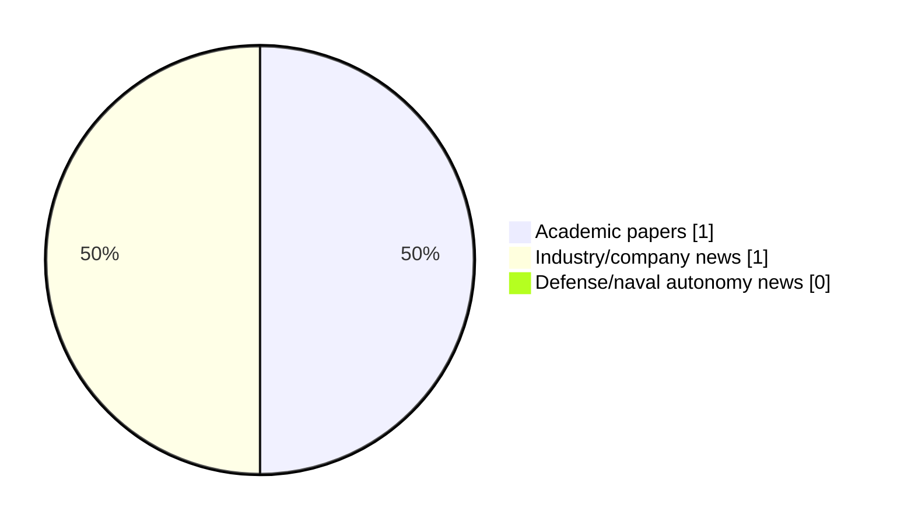

# Maritime Autonomy Watch — 2026-11-23

## Executive Summary

- Total selected items: 2
- Academic papers: 1
- Industry/company news: 1
- Defense/naval autonomy news: 0
- Failed/inaccessible sources: 0

## Contents

- [Analyst Brief](#analyst-brief)
- [Must Read](#must-read)
- [Top Signals Today](#top-signals-today)
- [Topic Signals](#topic-signals)
- [Freshness and Coverage](#freshness-and-coverage)
- [Quality Notes](#quality-notes)
- [Watchlist](#watchlist)
- [Academic Papers](#academic-papers)
- [Industry and Company News](#industry-and-company-news)
- [Defense and Naval Autonomy News](#defense-and-naval-autonomy-news)
- [Source Status Summary](#source-status-summary)

## Analyst Brief

Today's report selected 2 non-duplicate item(s), led by USV operations, critical infrastructure, AUV navigation. The strongest item is [Nauticus Robotics Confirms Intent to Acquire OPT WAM-V Business Assets](https://www.marinelink.com/news/nauticus-robotics-confirms-intent-acquire-544528) from marinelink.com.
Coverage is weighted toward academic research (1), with 1 industry and 0 defense signal(s).

## Must Read

- [Nauticus Robotics Confirms Intent to Acquire OPT WAM-V Business Assets](https://www.marinelink.com/news/nauticus-robotics-confirms-intent-acquire-544528) — Industry signal: USV operations
- [BRINA: Bottom-Referenced Inertial Navigation with AKAZE, a Sonar SLAM for Autonomous Marine Vehicles](http://arxiv.org/abs/2611.27817v1) — Research signal: AUV navigation

## Top Signals Today

- USV operations: 1 selected item(s).
- critical infrastructure: 1 selected item(s).
- AUV navigation: 1 selected item(s).
- perception: 1 selected item(s).

## Topic Signals

- USV operations: 1
- critical infrastructure: 1
- AUV navigation: 1
- perception: 1

## Freshness and Coverage

- Newest selected item date: 2026-11-23
- Oldest selected item date: 2026-11-20
- Active/enabled sources: 4
- Sources with access problems: 3
- Quality flags: 0

## Quality Notes

- No quality flags on selected items.

## Watchlist

- No watchlist items today.

### Category Snapshot

| Category | Selected items |
|---|---:|
| Academic papers | 1 |
| Industry/company news | 1 |
| Defense/naval autonomy news | 0 |

## Academic Papers

_Selected items: 1_

### [BRINA: Bottom-Referenced Inertial Navigation with AKAZE, a Sonar SLAM for Autonomous Marine Vehicles](http://arxiv.org/abs/2611.27817v1)

- Source: arXiv
- Date: 2026-11-20
- Relevance score: 4.25
- Authors: Adolfo Damiano Cafaro, Patrizio Mariani, Roberto Galeazzi
- Signal: Research signal: AUV navigation
- Topic tags: AUV navigation, perception

**Abstract**

Forward-looking sonar (FLS) provides reliable underwater perception where optical sensing is limited, but its use for navigation is hindered by the unobserved elevation of each return. As a result, motion estimated directly from sonar images suffers from an unknown metric scale that is commonly resolved using a Doppler velocity log (DVL). We present BRINA (Bottom-Referenced Inertial Navigation with AKAZE), a sonar-inertial SLAM system for marine vehicles that uses the FLS as its only exteroceptive sensor. BRINA estimates the sonar altitude from the first seabed return in each beam and uses it to project matched features onto the seabed, providing metric odometry without a DVL. We further derive a bound relating the remaining scale error to seabed tilt and slope variability.

**Why it matters**

Relevant to underwater autonomy; the work may inform maritime autonomy research, testing priorities, or system design.

---

## Industry and Company News

_Selected items: 1_

### [Nauticus Robotics Confirms Intent to Acquire OPT WAM-V Business Assets](https://www.marinelink.com/news/nauticus-robotics-confirms-intent-acquire-544528)

- Source: marinelink.com
- Date: 2026-11-23
- Relevance score: 8.25
- Signal: Industry signal: USV operations
- Topic tags: USV operations, critical infrastructure
- Also reported by: https://oceannews.com/feed/

**Summary**

Nauticus Robotics, Inc., a developer of autonomous subsea robotics and software solutions, announced that it has signed a non-binding Letter of Intent (LOI) with Ocean Power Technologies, Inc. (OPT) for the proposed acquisition of its WAM-V unmanned surface vessel (USV) business assets…

**Why it matters**

Signals momentum in surface-vessel operations; useful for tracking product direction, partnerships, and deployment opportunities.

---

## Defense and Naval Autonomy News

_Selected items: 0_

No selected items.

## Inaccessible or Failed Sources

- None

## Source Status Summary

| Source | Status | Notes |
|---|---|---|
| arXiv | enabled | API source, 15 items fetched |
| OpenAlex | enabled | API source, 15 items fetched |
| RSS feeds | partial | 82 RSS items fetched; failures: https://www.navalnews.com/feed/: Remote end closed connection without response |
| SMI MASG News | enabled | HTML source, 10 items fetched |
| IEEE Xplore | disabled | Missing IEEE_XPLORE_API_KEY |
| Elsevier Scopus | enabled | API source, 15 items fetched |
| NewsAPI | disabled | Missing NEWS_API_KEY |

## Metadata

- Generated at: 2026-11-23T18:17:46.900556+01:00
- Date: 2026-11-23
- Repository: ferhannb/MarineRobotics
- Relevance threshold: 4.0
- Deduplication method: DOI, canonical URL, source ID, normalized title, similar recent titles, category caps, and novelty score
