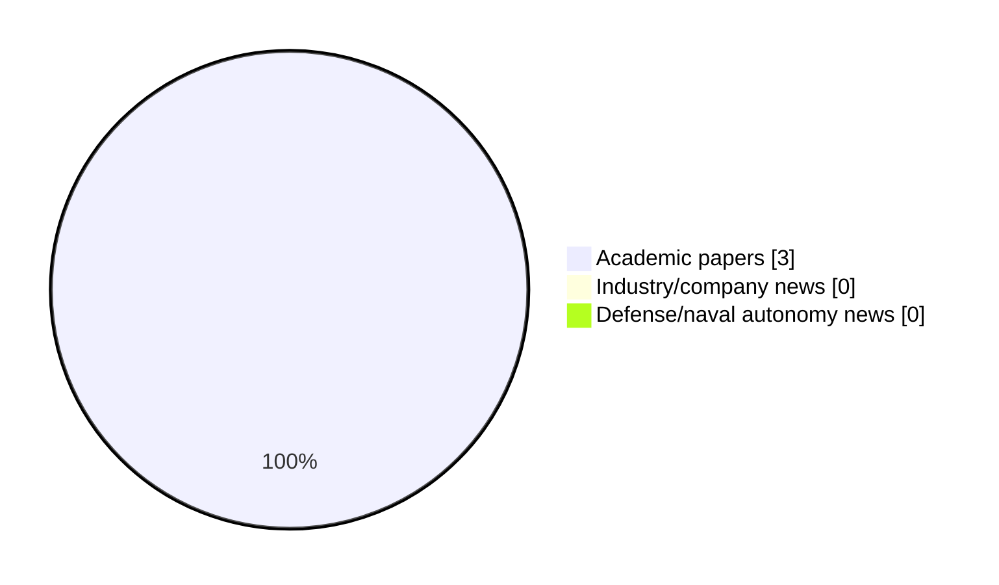

# Maritime Autonomy Watch — 2026-11-24

## Executive Summary

- Total selected items: 3
- Academic papers: 3
- Industry/company news: 0
- Defense/naval autonomy news: 0
- Failed/inaccessible sources: 0

## Contents

- [Analyst Brief](#analyst-brief)
- [Must Read](#must-read)
- [Top Signals Today](#top-signals-today)
- [Topic Signals](#topic-signals)
- [Freshness and Coverage](#freshness-and-coverage)
- [Quality Notes](#quality-notes)
- [Watchlist](#watchlist)
- [Academic Papers](#academic-papers)
- [Industry and Company News](#industry-and-company-news)
- [Defense and Naval Autonomy News](#defense-and-naval-autonomy-news)
- [Source Status Summary](#source-status-summary)

## Analyst Brief

Today's report selected 3 non-duplicate item(s), led by planning/control, AUV navigation, swarm autonomy. The strongest item is [FATHOM: World-Model-Guided Diffusion Action-Trajectory Selection for Sparse-Marker AUV Tracking](http://arxiv.org/abs/2611.08898v1) from arXiv.
Coverage is weighted toward academic research (3), with 0 industry and 0 defense signal(s).
Quality caveat: missing-summary=1, date-anomaly=1.

## Must Read

- [FATHOM: World-Model-Guided Diffusion Action-Trajectory Selection for Sparse-Marker AUV Tracking](http://arxiv.org/abs/2611.08898v1) — Research signal: AUV navigation
- [World Models for Ocean Engineering: A Critical Review of Maritime Autonomy, Adaptive Latent Prediction, Digital Twins, and Biodiversity Monitoring](http://arxiv.org/abs/2611.28978v1) — Research signal: planning/control

## Top Signals Today

- planning/control: 3 selected item(s).
- AUV navigation: 2 selected item(s).
- swarm autonomy: 2 selected item(s).
- perception: 1 selected item(s).

## Topic Signals

- planning/control: 3
- AUV navigation: 2
- swarm autonomy: 2
- perception: 1

## Freshness and Coverage

- Newest selected item date: 2027-03-01
- Oldest selected item date: 2026-11-06
- Active/enabled sources: 5
- Sources with access problems: 2
- Quality flags: 2

## Quality Notes

- missing-summary: 1
- date-anomaly: 1
- Date anomalies: [Formation control of AUVs for enabling safe and efficient marine operations](https://api.elsevier.com/content/abstract/scopus_id/105046585164) reports 2027-03-01

## Watchlist

- [Formation control of AUVs for enabling safe and efficient marine operations](https://api.elsevier.com/content/abstract/scopus_id/105046585164) — missing-summary, date-anomaly

### Category Snapshot

| Category | Selected items |
|---|---:|
| Academic papers | 3 |
| Industry/company news | 0 |
| Defense/naval autonomy news | 0 |

## Academic Papers

_Selected items: 3_

### [FATHOM: World-Model-Guided Diffusion Action-Trajectory Selection for Sparse-Marker AUV Tracking](http://arxiv.org/abs/2611.08898v1)

- Source: arXiv
- Date: 2026-11-06
- Relevance score: 8.5
- Authors: Xiaorui Wang, Zeyu Sha, Mingyang Yang, David Chen Wang, Feitian Zhang
- Signal: Research signal: AUV navigation
- Topic tags: AUV navigation, swarm autonomy, perception, planning/control

**Abstract**

Reliable relative tracking is fundamental to cooperative autonomous underwater vehicles (AUVs), yet remains challenging under nonlinear vehicle dynamics and degraded underwater visual conditions. Active light markers improve robustness to appearance variation, but provide deliberately sparse observations that can become incomplete or corrupted by occlusion, reflections, and detection noise during dynamic motion. To address the resulting partial-observation control problem, this paper proposes FATHOM, a world-model-guided diffusion action-trajectory selection framework for sparse-marker AUV tracking. FATHOM first integrates structured marker observations, inertial measurements, action history, and temporal dynamics into a predictive tracking belief using a multimodal task-supervised recurrent state-space model.

**Why it matters**

Relevant to underwater autonomy, planning and control; the work may inform maritime autonomy research, testing priorities, or system design.

---

### [World Models for Ocean Engineering: A Critical Review of Maritime Autonomy, Adaptive Latent Prediction, Digital Twins, and Biodiversity Monitoring](http://arxiv.org/abs/2611.28978v1)

- Source: arXiv
- Date: 2026-11-21
- Relevance score: 5
- Authors: Basma Dokkara, Esteban W. G. Cluab, Luiz M. G. Goncalves, Paolo Spagnolo, Cosimo Distante
- Signal: Research signal: planning/control
- Topic tags: planning/control

**Abstract**

Marine robots face partial observability, non-stationary dynamics, and sparse communication, motivating WMs that learn compact predictive states for planning. This review develops a functional taxonomy of WMs for ocean engineering, focusing on Joint-Embedding Predictive Architectures (JEPAs) and AdaJEPA's test-time adaptation within model predictive control, mapping them to navigation, adaptive sampling, digital twins, and biodiversity monitoring, and separating demonstrated evidence from prospective applications. The synthesis identifies key Gaps: benchmarks, uncertainty calibration, safe adaptation and proposes a research agenda for physics-informed, deployment-adaptive marine WMs validated through simulation and field missions.

**Why it matters**

Relevant to infrastructure monitoring; the work may inform maritime autonomy research, testing priorities, or system design.

---

### [Formation control of AUVs for enabling safe and efficient marine operations](https://api.elsevier.com/content/abstract/scopus_id/105046585164)

- Source: Elsevier Scopus
- Date: 2027-03-01
- Relevance score: 4.25
- DOI: 10.1016/j.apm.2026.117232
- Signal: Research signal: AUV navigation
- Topic tags: AUV navigation, swarm autonomy, planning/control
- Quality flags: missing-summary, date-anomaly

**Abstract**

No summary available.

**Why it matters**

Relevant to underwater autonomy, multi-vehicle coordination; the work may inform maritime autonomy research, testing priorities, or system design.

---

## Industry and Company News

_Selected items: 0_

No selected items.

## Defense and Naval Autonomy News

_Selected items: 0_

No selected items.

## Inaccessible or Failed Sources

- None

## Source Status Summary

| Source | Status | Notes |
|---|---|---|
| arXiv | enabled | API source, 15 items fetched |
| OpenAlex | enabled | API source, 15 items fetched |
| RSS feeds | enabled | 92 RSS items fetched |
| SMI MASG News | enabled | HTML source, 10 items fetched |
| IEEE Xplore | disabled | Missing IEEE_XPLORE_API_KEY |
| Elsevier Scopus | enabled | API source, 15 items fetched |
| NewsAPI | disabled | Missing NEWS_API_KEY |

## Metadata

- Generated at: 2026-11-24T17:55:30.949221+01:00
- Date: 2026-11-24
- Repository: ferhannb/MarineRobotics
- Relevance threshold: 4.0
- Deduplication method: DOI, canonical URL, source ID, normalized title, similar recent titles, category caps, and novelty score
