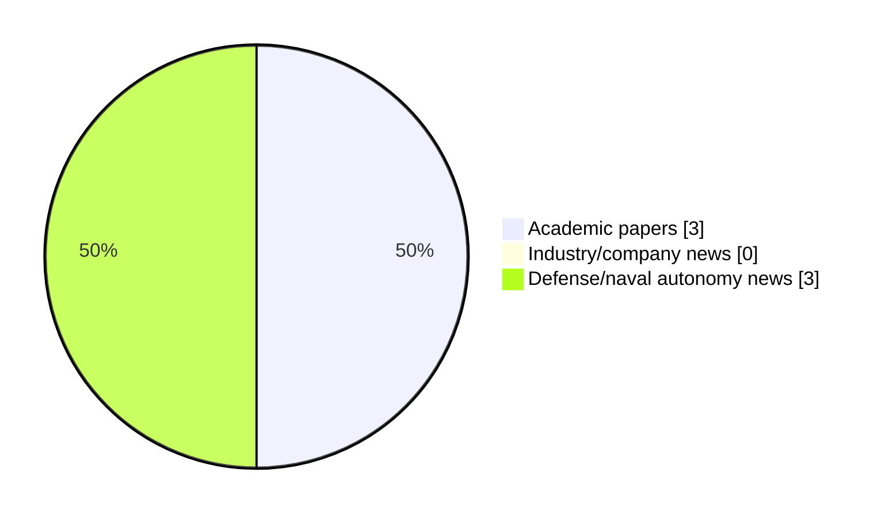

# Maritime Autonomy Watch — 2026-11-25

## Executive Summary

- Total selected items: 6
- Academic papers: 3
- Industry/company news: 0
- Defense/naval autonomy news: 3
- Failed/inaccessible sources: 0

## Contents

- [Analyst Brief](#analyst-brief)
- [Must Read](#must-read)
- [Top Signals Today](#top-signals-today)
- [Topic Signals](#topic-signals)
- [Freshness and Coverage](#freshness-and-coverage)
- [Quality Notes](#quality-notes)
- [Watchlist](#watchlist)
- [Academic Papers](#academic-papers)
- [Industry and Company News](#industry-and-company-news)
- [Defense and Naval Autonomy News](#defense-and-naval-autonomy-news)
- [Source Status Summary](#source-status-summary)

## Analyst Brief

Today's report selected 6 non-duplicate item(s), led by defense adoption, AUV navigation, USV operations. The strongest item is [HII Wins Record UK Ministry of Defence Contract for REMUS 620 UUVs](https://oceannews.com/news/defense/hii-wins-record-uk-ministry-of-defence-contract-for-remus-620-uuvs/) from oceannews.com.
Coverage is weighted toward academic research (3), with 0 industry and 3 defense signal(s).
Quality caveat: missing-summary=1, date-anomaly=1, low-score-unique=1.

## Must Read

- [HII Wins Record UK Ministry of Defence Contract for REMUS 620 UUVs](https://oceannews.com/news/defense/hii-wins-record-uk-ministry-of-defence-contract-for-remus-620-uuvs/) — Defense signal: defense adoption
- [Neural Implicit Representation for Bathymetry Estimation using Sidescan Sonar Imagery](http://arxiv.org/abs/2611.33118v1) — Research signal: AUV navigation
- [Metron’s Lancet Team Completes Payload Deployment Module FAT for CAMP Project](https://oceannews.com/news/milestones/metrons-lancet-team-completes-payload-deployment-module-fat-for-camp-project/) — Defense signal: defense adoption
- [Risk-Informed Path Planning: Collision and Grounding Avoidance Application for Autonomous Surface Vessels](http://arxiv.org/abs/2611.32760v1) — Research signal: USV operations
- [HMS Tyne Showcases Autonomous Systems and REMUS 620 UUVs in London](https://oceannews.com/news/defense/hms-tyne-showcases-autonomous-systems-and-remus-620-uuvs-in-london/) — Defense signal: swarm autonomy

## Top Signals Today

- defense adoption: 3 selected item(s).
- AUV navigation: 2 selected item(s).
- USV operations: 2 selected item(s).
- underwater communications: 1 selected item(s).
- perception: 1 selected item(s).

## Topic Signals

- defense adoption: 3
- AUV navigation: 2
- USV operations: 2
- underwater communications: 1
- perception: 1
- planning/control: 1
- swarm autonomy: 1

## Freshness and Coverage

- Newest selected item date: 2027-03-01
- Oldest selected item date: 2026-11-24
- Active/enabled sources: 5
- Sources with access problems: 2
- Quality flags: 3

## Quality Notes

- missing-summary: 1
- date-anomaly: 1
- low-score-unique: 1
- Date anomalies: [Fusion-driven geometry-constrained latent flow learning for robust AUV motion anticipation from heterogeneous 3D observations](https://api.elsevier.com/content/abstract/scopus_id/105051060825) reports 2027-03-01

## Watchlist

- [Fusion-driven geometry-constrained latent flow learning for robust AUV motion anticipation from heterogeneous 3D observations](https://api.elsevier.com/content/abstract/scopus_id/105051060825) — missing-summary, date-anomaly, low-score-unique

### Category Snapshot

| Category | Selected items |
|---|---:|
| Academic papers | 3 |
| Industry/company news | 0 |
| Defense/naval autonomy news | 3 |

## Academic Papers

_Selected items: 3_

### [Neural Implicit Representation for Bathymetry Estimation using Sidescan Sonar Imagery](http://arxiv.org/abs/2611.33118v1)

- Source: arXiv
- Date: 2026-11-24
- Relevance score: 7.75
- Authors: Tianxiang Lin, Sacchin Sundar, Fenghao Liu, Onur Bagoren, Katherine A. Skinner
- Signal: Research signal: AUV navigation
- Topic tags: AUV navigation, USV operations, underwater communications, perception

**Abstract**

Bathymetry measurement and estimation is critical for understanding the structure of underwater environments. While multibeam echosounders (MBES) provide accurate depth measurements, their deployment on surface vessels limits spatial resolution in deep water. Sidescan sonar (SSS), in contrast, can be deployed on autonomous underwater vehicles (AUVs) to operate closer to the seafloor, enabling high-resolution acoustic imaging. However, the inherent ambiguity in measurements and the limited observation coverage of sonar datasets degrade the performance of state-of-the-art methods for underwater bathymetry estimation from SSS. In this paper, we propose a differentiable neural rendering framework for SSS that enables effective estimation of bathymetry from SSS measurements. Our approach incorporates a measurement model based on SSS geometry, explicitly accounting for its wide elevation aperture and associated ambiguities.

**Why it matters**

Relevant to underwater autonomy, surface-vessel operations; the work may inform maritime autonomy research, testing priorities, or system design.

---

### [Risk-Informed Path Planning: Collision and Grounding Avoidance Application for Autonomous Surface Vessels](http://arxiv.org/abs/2611.32760v1)

- Source: arXiv
- Date: 2026-11-24
- Relevance score: 5
- Authors: Emir Cem Gezer, Ozan Kaya, Ingrid B. Utne, Roger Skjetne
- Signal: Research signal: USV operations
- Topic tags: USV operations, planning/control

**Abstract**

Maritime Autonomous Surface Ships (MASS) must demonstrate safety before and during operations, necessitating online risk assessment to guide decision-making at sea. This paper presents a risk-informed Rapidly Exploring Random Tree Star (RRT*) path planner that integrates a Bayesian Belief Network (BBN) as an online risk model. The BBN evaluates the probability and severity distribution of hazardous events, which are aggregated into a bounded scalar risk index. During the search, this risk index is evaluated at sample points along candidate edges. The planner optimizes a composite cost function comprising path distance, heading change penalties, and accumulated risk, subject to a hard constraint enforcing a risk acceptance limit. Each search tree vertex stores the BBN posterior at its state, enabling the tree to function as an explainable risk map for individual hazards.

**Why it matters**

Relevant to surface-vessel operations, navigation safety, planning and control; the work may inform maritime autonomy research, testing priorities, or system design.

---

### [Fusion-driven geometry-constrained latent flow learning for robust AUV motion anticipation from heterogeneous 3D observations](https://api.elsevier.com/content/abstract/scopus_id/105051060825)

- Source: Elsevier Scopus
- Date: 2027-03-01
- Relevance score: 3.5
- DOI: 10.1016/j.inffus.2026.104764
- Signal: Research signal: AUV navigation
- Topic tags: AUV navigation
- Quality flags: missing-summary, date-anomaly, low-score-unique

**Abstract**

No summary available.

**Why it matters**

Relevant to underwater autonomy; the work may inform maritime autonomy research, testing priorities, or system design.

---

## Industry and Company News

_Selected items: 0_

No selected items.

## Defense and Naval Autonomy News

_Selected items: 3_

### [HII Wins Record UK Ministry of Defence Contract for REMUS 620 UUVs](https://oceannews.com/news/defense/hii-wins-record-uk-ministry-of-defence-contract-for-remus-620-uuvs/)

- Source: oceannews.com
- Date: 2026-11-25
- Relevance score: 7.75
- Signal: Defense signal: defense adoption
- Topic tags: defense adoption
- Also reported by: https://www.navalnews.com/feed/, https://www.naval-technology.com/feed/

**Summary**

HII, America's largest military shipbuilder and global leader in autonomous seapower, has been awarded a £142 million (approximately $186 million) contract by the United Kingdom's National Armaments Director Group (NADG) to deliver REMUS 620 unmanned underwater vehicles (UUVs), ancillary equipment, and support services for the Royal Navy's Mine-Hunting Capability (MHC) program.

**Why it matters**

Signals movement in underwater autonomy, naval adoption; useful for tracking operational concepts, procurement direction, and fleet integration.

---

### [Metron’s Lancet Team Completes Payload Deployment Module FAT for CAMP Project](https://oceannews.com/news/milestones/metrons-lancet-team-completes-payload-deployment-module-fat-for-camp-project/)

- Source: oceannews.com
- Date: 2026-11-24
- Relevance score: 5
- Signal: Defense signal: defense adoption
- Topic tags: defense adoption

**Summary**

The Lancet Team, led by Metron, has completed fabrication and factory acceptance testing (FAT) of the Payload Deployment Module (PDM) for Lancet™, the integrated extra-large (XL) uncrewed undersea vehicle (UUV) being developed for the Defense Innovation Unit's (DIU) Combat Autonomous Maritime Platform (CAMP) project.

**Why it matters**

Signals movement in naval adoption; useful for tracking operational concepts, procurement direction, and fleet integration.

---

### [HMS Tyne Showcases Autonomous Systems and REMUS 620 UUVs in London](https://oceannews.com/news/defense/hms-tyne-showcases-autonomous-systems-and-remus-620-uuvs-in-london/)

- Source: oceannews.com
- Date: 2026-11-25
- Relevance score: 4.25
- Signal: Defense signal: swarm autonomy
- Topic tags: swarm autonomy, defense adoption

**Summary**

Royal Navy patrol ship HMS Tyne is visiting London to showcase the Royal Navy's transformation toward a Hybrid Navy, a force that combines the strength of sailors, warships, and autonomous systems to meet the challenges of modern warfare.

**Why it matters**

Signals movement in multi-vehicle coordination, naval adoption; useful for tracking operational concepts, procurement direction, and fleet integration.

---

## Inaccessible or Failed Sources

- None

## Source Status Summary

| Source | Status | Notes |
|---|---|---|
| arXiv | enabled | API source, 15 items fetched |
| OpenAlex | enabled | API source, 15 items fetched |
| RSS feeds | enabled | 92 RSS items fetched |
| SMI MASG News | enabled | HTML source, 10 items fetched |
| IEEE Xplore | disabled | Missing IEEE_XPLORE_API_KEY |
| Elsevier Scopus | enabled | API source, 15 items fetched |
| NewsAPI | disabled | Missing NEWS_API_KEY |

## Metadata

- Generated at: 2026-11-25T17:44:28.347453+01:00
- Date: 2026-11-25
- Repository: ferhannb/MarineRobotics
- Relevance threshold: 4.0
- Deduplication method: DOI, canonical URL, source ID, normalized title, similar recent titles, category caps, and novelty score
