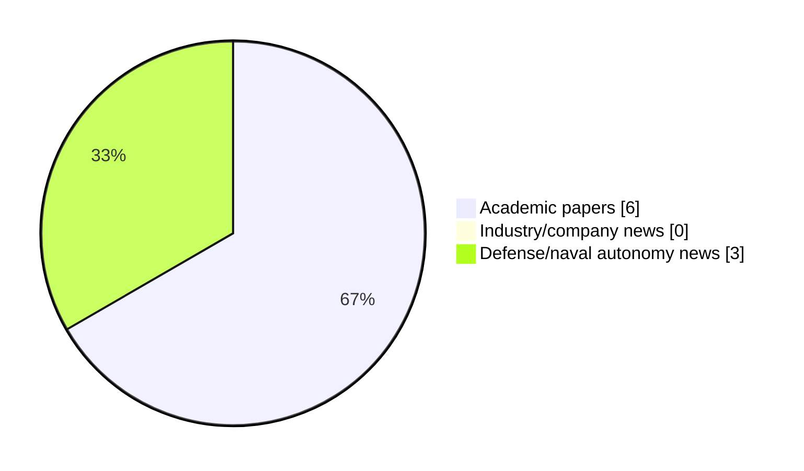

# Maritime Autonomy Watch — 2026-11-26

## Executive Summary

- Total selected items: 9
- Academic papers: 6
- Industry/company news: 0
- Defense/naval autonomy news: 3
- Failed/inaccessible sources: 0

## Contents

- [Analyst Brief](#analyst-brief)
- [Must Read](#must-read)
- [Top Signals Today](#top-signals-today)
- [Topic Signals](#topic-signals)
- [Freshness and Coverage](#freshness-and-coverage)
- [Quality Notes](#quality-notes)
- [Watchlist](#watchlist)
- [Academic Papers](#academic-papers)
- [Industry and Company News](#industry-and-company-news)
- [Defense and Naval Autonomy News](#defense-and-naval-autonomy-news)
- [Source Status Summary](#source-status-summary)

## Analyst Brief

Today's report selected 9 non-duplicate item(s), led by planning/control, AUV navigation, critical infrastructure. The strongest item is [Graph-Based RL for Sequential Rendezvous Planning with Multiple Patrolling USVs](http://arxiv.org/abs/2611.12205v1) from arXiv.
Coverage is weighted toward academic research (6), with 0 industry and 3 defense signal(s).
Quality caveat: low-score-unique=2.

## Must Read

- [Graph-Based RL for Sequential Rendezvous Planning with Multiple Patrolling USVs](http://arxiv.org/abs/2611.12205v1) — Research signal: USV operations
- [Two-Tier Task Offloading for Satellite-Assisted Marine Networks: A Hybrid Stackelberg-Bargaining Game Approach](http://arxiv.org/abs/2611.13019v1) — Research signal: AUV navigation
- [Gaussian Process-Augmented Model Predictive Contouring Control for 6-DoF Trajectory Tracking with a Holonomic AUV](http://arxiv.org/abs/2611.14373v1) — Research signal: AUV navigation
- [French Startup Arsenals Unveils Modular AUV Designed for Rapid Production](https://www.navalnews.com/naval-news/2026/11/euronaval-2026-french-startup-arsenals-unveils-modular-auv/) — Defense signal: AUV navigation
- [Euronaval 2026: Euroatlas and EvoLogics Move Greyshark AUV into Series Production](https://www.navalnews.com/event-news/euronaval-2026/2026/11/euronaval-2026-euroatlas-evologics-greyshark-uuv-series-production/) — Defense signal: AUV navigation

## Top Signals Today

- planning/control: 4 selected item(s).
- AUV navigation: 4 selected item(s).
- critical infrastructure: 4 selected item(s).
- defense adoption: 3 selected item(s).
- perception: 3 selected item(s).

## Topic Signals

- planning/control: 4
- AUV navigation: 4
- critical infrastructure: 4
- defense adoption: 3
- perception: 3
- USV operations: 2
- underwater communications: 1
- swarm autonomy: 1

## Freshness and Coverage

- Newest selected item date: 2026-11-26
- Oldest selected item date: 2026-11-09
- Active/enabled sources: 5
- Sources with access problems: 2
- Quality flags: 2

## Quality Notes

- low-score-unique: 2

## Watchlist

- [Digital-physical testbed for ship autonomy studies in the Marine Cybernetics Laboratory basin](https://doi.org/10.1080/17445302.2026.2765692) — low-score-unique
- [One Ocean, Many Tasks: A Data-Grounded Simulation Suite and Benchmark for Marine Robotics](http://arxiv.org/abs/2611.34925v1) — low-score-unique

### Category Snapshot

| Category | Selected items |
|---|---:|
| Academic papers | 6 |
| Industry/company news | 0 |
| Defense/naval autonomy news | 3 |

## Academic Papers

_Selected items: 6_

### [Graph-Based RL for Sequential Rendezvous Planning with Multiple Patrolling USVs](http://arxiv.org/abs/2611.12205v1)

- Source: arXiv
- Date: 2026-11-09
- Relevance score: 10
- Authors: Seung Woo Han, Hyeon Bin Yeo, Seung Heon Oh
- Signal: Research signal: USV operations
- Topic tags: USV operations, planning/control

**Abstract**

In patrol missions involving multiple unmanned surface vehicles (USVs), a designated command USV can support fleet management by sequentially rendezvousing with each patrolling USV. These operations require motion-feasible route planning and priority-aware rendezvous sequencing, with the objective of minimizing mission completion time and total tardiness relative to priority-dependent due dates. We propose a framework combining grid-based path planning, surrogate travel-time prediction, and graph-based reinforcement learning. The path planner accounts for ocean currents and approximates turn-rate constraints through multi-stage maneuvers, with path feasibility empirically validated through trajectory-tracking simulations.

**Why it matters**

Relevant to surface-vessel operations, planning and control; the work may inform maritime autonomy research, testing priorities, or system design.

---

### [Two-Tier Task Offloading for Satellite-Assisted Marine Networks: A Hybrid Stackelberg-Bargaining Game Approach](http://arxiv.org/abs/2611.13019v1)

- Source: arXiv
- Date: 2026-11-09
- Relevance score: 10
- Authors: Zhen Wang, Bin Lin, Qiang, Ye, Haixia Peng
- Signal: Research signal: AUV navigation
- Topic tags: AUV navigation, underwater communications

**Abstract**

The proliferation of maritime activities has spurred the emergence of numerous computation-intensive and delay-sensitive marine applications and services. Given the inherent rationality, selfish nature, and limited computational abilities of marine devices, devising effective strategies to incentivize their participation in task processing become a critical challenge. In this paper, we investigate the satellite-assisted marine multi-access edge computing (MEC) and propose a two-tier task offloading scheme through a hybrid Stackelberg-Bargaining game approach to enhance offloading efficiency and maximize the utility of marine devices. Specifically, for the underwater acoustic communication, we consider the scenario where multiple autonomous underwater vehicles (AUVs), managed by maritime autonomous surface ships (MASSs), upload their collected data using non-orthogonal multiple access(NOMA) to optimize channel utilization.

**Why it matters**

Relevant to underwater autonomy; the work may inform maritime autonomy research, testing priorities, or system design.

---

### [Gaussian Process-Augmented Model Predictive Contouring Control for 6-DoF Trajectory Tracking with a Holonomic AUV](http://arxiv.org/abs/2611.14373v1)

- Source: arXiv
- Date: 2026-11-10
- Relevance score: 9.25
- Authors: David Dörner, Giancarlo Troni, Ignacio Torroba, Ivan Stenius
- Signal: Research signal: AUV navigation
- Topic tags: AUV navigation, planning/control, critical infrastructure

**Abstract**

Small, holonomic Autonomous Underwater Vehicles (AUVs) enable close-range inspection of underwater structures from arbitrary viewpoints, requiring accurate position and attitude tracking under state and input constraints. Model Predictive Contouring Control (MPCC) naturally handles these requirements, but relies on an accurate dynamics model, which is difficult to obtain underwater. In this paper, we present a nonlinear MPCC in all six Degrees of Freedom (DoF) for a holonomic AUV and alleviate the inaccuracies in the dynamics by augmenting the nominal model employed with residual dynamics learned via Gaussian Process (GP) regression. The learned residual is embedded in the optimal control problem through a zero-order robust optimization scheme, which keeps the controller real-time capable at 25 Hz.

**Why it matters**

Relevant to underwater autonomy, planning and control, infrastructure monitoring; the work may inform maritime autonomy research, testing priorities, or system design.

---

### [Digital-physical testbed for ship autonomy studies in the Marine Cybernetics Laboratory basin](https://doi.org/10.1080/17445302.2026.2765692)

- Source: OpenAlex
- Date: 2026-11-24
- Relevance score: 3.75
- Authors: Emir Cem Gezer, Mael Korentin Ivan Moreau, Anders Sandneseng Høgden, Dong Trong Nguyen, Roger Skjetne, Asgeir Johan Sorensen
- DOI: 10.1080/17445302.2026.2765692
- Signal: Research signal: perception
- Topic tags: perception, planning/control, critical infrastructure
- Quality flags: low-score-unique

**Abstract**

The algorithms developed for Maritime Autonomous Surface Ships (MASS) are often challenging to test on actual vessels due to high operational costs and safety considerations. Simulations offer a cost-effective alternative and eliminate risks, but they may not accurately represent real-world dynamics for the given tasks. Utilizing small-scale model ships and robotic vessels in conjunction with a laboratory basin provides an accessible testing environment for the early stages of validation processes. However, designing and developing a model vessel for a single test can be costly and cumbersome, and researchers often lack access to such infrastructure. To address these challenges and enable streamlined testing, we have developed an in-house testbed that facilitates the development, testing, verification, and validation of MASS algorithms in a digital-physical laboratory.

**Why it matters**

This paper may influence autonomy, perception, planning, or control work for maritime robotic systems.

---

### [One Ocean, Many Tasks: A Data-Grounded Simulation Suite and Benchmark for Marine Robotics](http://arxiv.org/abs/2611.34925v1)

- Source: arXiv
- Date: 2026-11-25
- Relevance score: 3.5
- Authors: Shuaijun Liu, Qifu Wen, Xingwei Chen, Xinwen Hu, Feiyang You, Sijia Chen, Ningxin Su
- Signal: Research signal: swarm autonomy
- Topic tags: swarm autonomy, perception, planning/control, critical infrastructure
- Quality flags: low-score-unique

**Abstract**

Simulation is essential for marine robotics, yet existing platforms often trade off between visually realistic worlds, high-throughput experimentation, and ocean-condition realism grounded in real data. We present OneOcean, a data-grounded simulation suite and benchmark built around a unified spatiotemporal ocean-environment product that harmonizes bathymetry with data-driven currents and tides, with optional pollution fields for cleanup-related evaluation. On top of this environment representation, OneOcean defines a task ladder spanning navigation and station-keeping under currents, waypoint and route following, depth-profile tracking, area scanning, pipeline inspection, and multi-agent coordination, including formation transit, fish protection and patrol (herding), and surface pollution localization, containment, and cleanup. The suite supports multi-agent settings with 2-10 vehicles.

**Why it matters**

Relevant to multi-vehicle coordination, infrastructure monitoring; the work may inform maritime autonomy research, testing priorities, or system design.

---

### [Budget-aware Correspondence-driven View Selection for Real-time 3D Perception of Mobile Robots](http://arxiv.org/abs/2611.11809v1)

- Source: arXiv
- Date: 2026-11-09
- Relevance score: 4.25
- Authors: Vaishnav Ramesh, Jacob Carter, Shivali J. Patel, Sanjeev J. Koppal, Md Jahidul Islam
- Signal: Research signal: perception
- Topic tags: perception, critical infrastructure

**Abstract**

3D visual perception and scene reconstruction are critical for autonomous robots and intelligent transportation, yet real-world deployments often generate long, redundant image sequences that hinder downstream processing. This report investigates BCVS (budget-aware correspondence-driven view sampling), a pose-free view selection algorithm that offers 22+ FPS on a CPU, enabling online filtering for efficient 3D perception by mobile robots. Unlike existing approaches that rely on full structure-from-motion (SfM) pipelines or camera pose estimation, BCVS employs a purely correspondence-based scoring strategy that prioritizes view novelty while maintaining sufficient overlap for geometric stability. Given a user-specified budget, BCVS iteratively selects the most distinct frames and suppresses near-duplicates, producing compact subsets that preserve connectivity and minimize reconstruction loss.

**Why it matters**

This paper may influence autonomy, perception, planning, or control work for maritime robotic systems.

---

## Industry and Company News

_Selected items: 0_

No selected items.

## Defense and Naval Autonomy News

_Selected items: 3_

### [French Startup Arsenals Unveils Modular AUV Designed for Rapid Production](https://www.navalnews.com/naval-news/2026/11/euronaval-2026-french-startup-arsenals-unveils-modular-auv/)

- Source: navalnews.com
- Date: 2026-11-26
- Relevance score: 7
- Signal: Defense signal: AUV navigation
- Topic tags: AUV navigation, defense adoption

**Summary**

At Euronaval 2026 in Paris, Naval News spoke with Bastien Allanot, CEO and Co-Founder of French defense startup Arsenals, about its modular autonomous underwater vehicle.

**Why it matters**

Signals movement in underwater autonomy, naval adoption; useful for tracking operational concepts, procurement direction, and fleet integration.

---

### [Euronaval 2026: Euroatlas and EvoLogics Move Greyshark AUV into Series Production](https://www.navalnews.com/event-news/euronaval-2026/2026/11/euronaval-2026-euroatlas-evologics-greyshark-uuv-series-production/)

- Source: navalnews.com
- Date: 2026-11-26
- Relevance score: 7
- Signal: Defense signal: AUV navigation
- Topic tags: AUV navigation, defense adoption

**Summary**

Euroatlas and EvoLogics have moved the battery-powered Greyshark Bravo UUV into series production, with first deliveries scheduled before the end of 2026.

**Why it matters**

Signals movement in underwater autonomy, naval adoption; useful for tracking operational concepts, procurement direction, and fleet integration.

---

### [Indonesian Navy Takes Delivery of 58-Knot Missile-Capable USV](https://www.navalnews.com/naval-news/2026/11/indonesian-navy-ksr-x33-missile-usv/)

- Source: navalnews.com
- Date: 2026-11-26
- Relevance score: 4.5
- Signal: Defense signal: USV operations
- Topic tags: USV operations, defense adoption

**Summary**

North Sea Boats has delivered the first Indonesian Navy KSR X33, a 58-knot missile-capable USV commissioned as Patkamla Geledek, for coastal defence.

**Why it matters**

Signals movement in surface-vessel operations, naval adoption; useful for tracking operational concepts, procurement direction, and fleet integration.

---

## Inaccessible or Failed Sources

- None

## Source Status Summary

| Source | Status | Notes |
|---|---|---|
| arXiv | enabled | API source, 15 items fetched |
| OpenAlex | enabled | API source, 15 items fetched |
| RSS feeds | enabled | 92 RSS items fetched |
| SMI MASG News | enabled | HTML source, 10 items fetched |
| IEEE Xplore | disabled | Missing IEEE_XPLORE_API_KEY |
| Elsevier Scopus | enabled | API source, 15 items fetched |
| NewsAPI | disabled | Missing NEWS_API_KEY |

## Metadata

- Generated at: 2026-11-26T17:19:29.724484+01:00
- Date: 2026-11-26
- Repository: ferhannb/MarineRobotics
- Relevance threshold: 4.0
- Deduplication method: DOI, canonical URL, source ID, normalized title, similar recent titles, category caps, and novelty score
