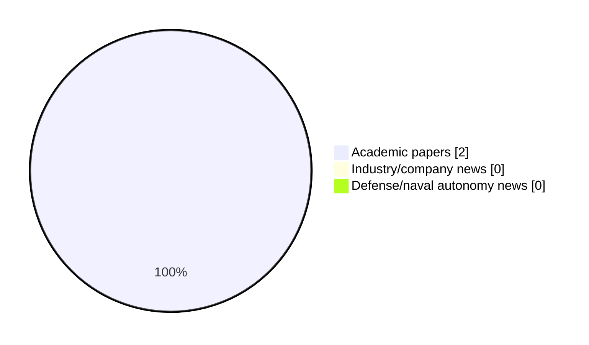

# Maritime Autonomy Watch — 2026-11-27

## Executive Summary

- Total selected items: 2
- Academic papers: 2
- Industry/company news: 0
- Defense/naval autonomy news: 0
- Failed/inaccessible sources: 0

## Contents

- [Analyst Brief](#analyst-brief)
- [Must Read](#must-read)
- [Top Signals Today](#top-signals-today)
- [Topic Signals](#topic-signals)
- [Freshness and Coverage](#freshness-and-coverage)
- [Quality Notes](#quality-notes)
- [Watchlist](#watchlist)
- [Academic Papers](#academic-papers)
- [Industry and Company News](#industry-and-company-news)
- [Defense and Naval Autonomy News](#defense-and-naval-autonomy-news)
- [Source Status Summary](#source-status-summary)

## Analyst Brief

Today's report selected 2 non-duplicate item(s), led by swarm autonomy, AUV navigation, underwater communications. The strongest item is [Search methods for underwater targets: a critical review of sensing, perception, and autonomous search](https://doi.org/10.3389/fmars.2026.2018441) from OpenAlex.
Coverage is weighted toward academic research (2), with 0 industry and 0 defense signal(s).
Quality caveat: missing-summary=1, date-anomaly=1.

## Must Read

- [Search methods for underwater targets: a critical review of sensing, perception, and autonomous search](https://doi.org/10.3389/fmars.2026.2018441) — Research signal: AUV navigation

## Top Signals Today

- swarm autonomy: 2 selected item(s).
- AUV navigation: 1 selected item(s).
- underwater communications: 1 selected item(s).
- perception: 1 selected item(s).
- planning/control: 1 selected item(s).

## Topic Signals

- swarm autonomy: 2
- AUV navigation: 1
- underwater communications: 1
- perception: 1
- planning/control: 1
- USV operations: 1

## Freshness and Coverage

- Newest selected item date: 2027-03-05
- Oldest selected item date: 2026-11-26
- Active/enabled sources: 4
- Sources with access problems: 3
- Quality flags: 2

## Quality Notes

- missing-summary: 1
- date-anomaly: 1
- Date anomalies: [Offline-to-online multi-agent constrained decision transformer for multi-USV cooperative pursuit-evasion games](https://api.elsevier.com/content/abstract/scopus_id/105054140077) reports 2027-03-05

## Watchlist

- [Offline-to-online multi-agent constrained decision transformer for multi-USV cooperative pursuit-evasion games](https://api.elsevier.com/content/abstract/scopus_id/105054140077) — missing-summary, date-anomaly

### Category Snapshot

| Category | Selected items |
|---|---:|
| Academic papers | 2 |
| Industry/company news | 0 |
| Defense/naval autonomy news | 0 |

## Academic Papers

_Selected items: 2_

### [Search methods for underwater targets: a critical review of sensing, perception, and autonomous search](https://doi.org/10.3389/fmars.2026.2018441)

- Source: OpenAlex
- Date: 2026-11-26
- Relevance score: 5.75
- Authors: Weicong Tan, Xiaobing Zhang, Lei Ni, Xipeng Zhou, Shihao Xin
- DOI: 10.3389/fmars.2026.2018441
- Signal: Research signal: AUV navigation
- Topic tags: AUV navigation, underwater communications, swarm autonomy, perception, planning/control

**Abstract**

Underwater target search is often assessed through separate studies of sensing, perception and path planning, although mission decisions depend on their interaction. This narrative review examines the search process as an observation–belief–planning loop. A four-dimensional framework compares sensing assumptions, target assumptions, decision stage and validation evidence across acoustic, optical, electric and magnetic sensing, learning-based perception, information-driven planning and multi-AUV coordination. Acoustic systems commonly support broad-area cueing, optical systems support close-range visual confirmation, and electromagnetic measurements can add material-sensitive evidence when their operating conditions are met. Local detection or recognition scores do not, by themselves, establish effective coverage or reliable area clearance.

**Why it matters**

Relevant to underwater autonomy, multi-vehicle coordination, planning and control; the work may inform maritime autonomy research, testing priorities, or system design.

---

### [Offline-to-online multi-agent constrained decision transformer for multi-USV cooperative pursuit-evasion games](https://api.elsevier.com/content/abstract/scopus_id/105054140077)

- Source: Elsevier Scopus
- Date: 2027-03-05
- Relevance score: 4.5
- DOI: 10.1016/j.ins.2026.124322
- Signal: Research signal: USV operations
- Topic tags: USV operations, swarm autonomy
- Quality flags: missing-summary, date-anomaly

**Abstract**

No summary available.

**Why it matters**

Relevant to surface-vessel operations; the work may inform maritime autonomy research, testing priorities, or system design.

---

## Industry and Company News

_Selected items: 0_

No selected items.

## Defense and Naval Autonomy News

_Selected items: 0_

No selected items.

## Inaccessible or Failed Sources

- None

## Source Status Summary

| Source | Status | Notes |
|---|---|---|
| arXiv | enabled | API source, 15 items fetched |
| OpenAlex | enabled | API source, 15 items fetched |
| RSS feeds | partial | 82 RSS items fetched; failures: https://massworld.news/feed/: Invalid XML from https://massworld.news/feed/: mismatched tag: line 93, column 2 |
| SMI MASG News | enabled | HTML source, 0 items fetched |
| IEEE Xplore | disabled | Missing IEEE_XPLORE_API_KEY |
| Elsevier Scopus | enabled | API source, 15 items fetched |
| NewsAPI | disabled | Missing NEWS_API_KEY |

## Metadata

- Generated at: 2026-11-27T17:04:24.895892+01:00
- Date: 2026-11-27
- Repository: ferhannb/MarineRobotics
- Relevance threshold: 4.0
- Deduplication method: DOI, canonical URL, source ID, normalized title, similar recent titles, category caps, and novelty score
